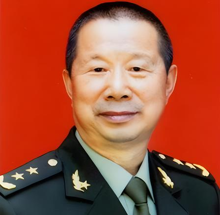

# 新对话新对话新对话

> 会话ID: 38438244587871746 | 抓取时间: 2026-08-25T09:18:54.496Z | 消息数: 2 | 图片数: 2
> 源URL: https://www.doubao.com/chat/38438244587871746

---

## **👤 用户**

栗戎生 搜索一下

---

## **🤖 助手**

搜索 1 个关键词，参考 6 篇资料 粟戎生（你写的 “栗戎生” 为错别字，应为 粟 sù） 粟戎生中将 粟戎生，1942 年生，是开国大将 粟裕 的长子，中将军衔。 主要履历 1961 年考入哈尔滨军事工程学院导弹专业，毕业后下到野战部队，从排长、连长做起，连长时期荣立三等功。 1985‑1986 参加 老山防御作战 ，任 67 集团军参谋长，深入前沿猫耳洞，还利用航模改装航拍侦察。 历任师长、24 集团军军长、总参军务部副部长， 北京军区副司令员 。 1990 年少将，1999 年晋升 中将 ，2006 年 1 月退休。 其他信息 军事技术方面，获国家科技进步二等奖、军队科技进步一等奖，拥有十余项国防专利。 妻子李曼俊，为开国少将李夫克之女，二人哈军工相识。 退休后，经常整理回忆父亲粟裕的史料，参与红色纪念活动。 需要我简单整理一份他的极简大事年表吗？ 相关视频 #军魂永不褪色 #致敬英雄

---
