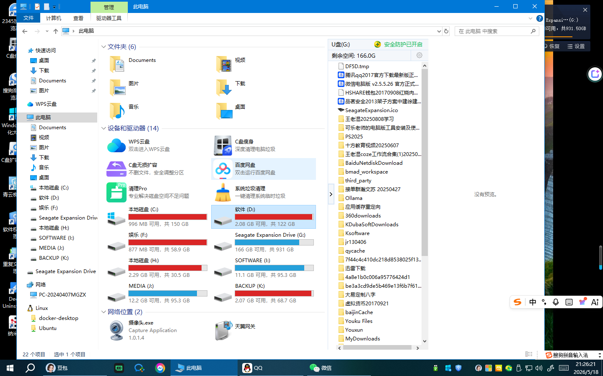

# 磁盘空间分析与优化建议磁盘空间分析与优化建议磁盘空间分析与优化建议

> 会话ID: 38426665922372866 | 抓取时间: 2026-08-25T09:19:03.276Z | 消息数: 10 | 图片数: 1
> 源URL: https://www.doubao.com/chat/38426665922372866

---

## **👤 用户**

---

## **🤖 助手**

我来帮你分析一下这张「此电脑」界面的情况，并给你针对性的优化建议。 📊 磁盘空间现状分析 表格 盘符 总容量 可用空间 状态 备注 C 盘 150 GB 996 MB ⚠️ 严重告急 系统盘空间不足，极易导致卡顿、更新失败 D 盘 122 GB 2.08 GB ⚠️ 严重告急 软件安装盘空间不足，会影响软件运行与更新 F 盘 58.9 GB 877 MB ⚠️ 严重告急 娱乐分区几乎占满 H 盘 30.5 GB 2.29 GB ⚠️ 严重告急 本地磁盘空间紧张 K 盘 68.7 GB 2.07 GB ⚠️ 严重告急 BACKUP 备份盘几乎占满 I 盘 95.3 GB 11.1 GB ✅ 有可用空间 SOFTWARE 分区剩余较多 J 盘 95.3 GB 12.2 GB ✅ 有可用空间 MEDIA 分区剩余较多 G 盘（希捷移动硬盘） 931 GB 166 GB ✅ 有大量空间 外接硬盘可作为数据迁移目的地 🚨 核心问题与优化建议 1. 系统与软件盘（C/D 盘）空间告急 紧急处理 ： 卸载不常用软件（可在「设置 - 应用 - 已安装的应用」里批量清理）。 清理浏览器缓存、下载文件夹，以及微信 / QQ 的聊天文件缓存。 使用系统自带的「磁盘清理」工具，清理临时文件、更新缓存。 长期方案 ： 将软件、游戏迁移至有空间的分区（如 I 盘、J 盘），或直接转移到 G 盘移动硬盘。 关闭休眠功能（管理员命令： powercfg -h off ），可释放数 GB 空间。 2. 数据分区（F/H/K 盘）几乎占满 数据迁移 ： 优先将备份文件、视频、安装包等大文件转移到 G 盘（希捷移动硬盘）。 定期清理重复文件、过期备份，释放空间。 注意 ：备份盘（K 盘）的文件建议先确认无保留价值再删除，避免数据丢失。 3. 外接硬盘（G 盘）的合理利用 你这块希捷移动硬盘还有 166GB 可用空间，是理想的临时数据中转站： 将 D 盘、F 盘里的大文件（如软件安装包、视频素材）剪切到 G 盘。 对重要文件做双备份，同时存放在 G 盘和其他安全位置，避免硬盘故障导致数据丢失。 💡 快速清理步骤（按优先级排序） 清理临时文件 ：右键 C 盘 → 属性 → 磁盘清理 → 勾选所有可清理项（包括临时文件、更新包）。 清理浏览器 / 聊天软件缓存 ： 浏览器：设置 → 隐私和安全 → 清除浏览数据（勾选缓存和下载记录）。 微信 / QQ：设置 → 文件管理 → 清理存储空间。 迁移大文件 ： 将 D 盘、F 盘里的大文件剪切到 G 盘移动硬盘，优先转移安装包、视频、备份文件。 卸载冗余软件 ：打开「控制面板 - 程序和功能」，卸载长期不用的软件，释放 D 盘空间。 如果你愿意，我可以帮你整理一份 详细的 C 盘瘦身 + 数据迁移分步清单 ，包含每一步的具体操作路径和注意事项，需要吗？

---

## **👤 用户**

---

## **🤖 助手**

我来帮你深度分析这张「磁盘管理」截图，并给出针对性的优化和扩容方案。 📊 磁盘结构与核心问题分析 1. 磁盘整体拓扑 表格 磁盘 容量 状态 分区情况 核心问题 磁盘 0 未知 未初始化 无 完全闲置，可作为新增存储 / 备份盘 磁盘 1 290.11GB 联机 H: 30.54GB NTFS I: 95.41GB FAT32 J: 95.41GB FAT32 K: 68.74GB FAT32 分区格式混杂（NTFS/FAT32），空间碎片化 磁盘 2 465.64GB 联机 300MB EFI C: 150GB NTFS D: 122GB NTFS 10.45GB 未分配 文档: 122GB NTFS 1.94GB 未分配 F: 58.95GB NTFS C 盘空间严重不足（仅 1.2GB 可用） ，存在多处未分配空间，浪费严重 磁盘 3 931.51GB 联机（希捷移动硬盘） G: 931.51GB NTFS 剩余空间充足（166GB 可用），是理想的数据迁移目的地 2. 关键问题拆解 🔴 系统盘（C 盘）危机 容量：150GB，仅 1.2GB 可用（占比 1%） 直接风险：系统卡顿、更新失败、软件无法运行、甚至无法正常开机 根源：系统盘划分过小，软件 / 数据过度安装在 C 盘，且存在大量缓存文件 🟡 磁盘 2 空间浪费 磁盘 2 上有 10.45GB + 1.94GB 共 12.39GB 未分配空间 ，可以直接合并到相邻分区（如 D 盘、文档盘），无需额外硬件。 🟢 分区格式隐患 磁盘 1 的 I/J/K 盘使用 FAT32 格式 ，存在单文件最大 4GB 限制，不适合存储大文件（如视频、镜像），且无文件权限、压缩等 NTFS 高级功能。 🛠️ 分步优化与扩容方案 方案一：紧急释放 C 盘空间（立即见效） 系统自带清理 右键 C 盘 → 属性 → 磁盘清理 → 勾选所有可清理项（临时文件、更新包、日志），完成后点击「清理系统文件」再扫一次。 开启「存储感知」：设置 → 系统 → 存储 → 开启存储感知，设置自动清理临时文件。 转移用户数据 桌面、下载、文档、图片、音乐文件夹右键 → 属性 → 位置 → 移动到 D 盘 / 文档盘（如 D:\Users\你的用户名\Desktop ）。 微信 / QQ 文件迁移：打开软件设置 → 文件管理 → 更改默认保存路径到 D 盘 / 移动硬盘。 卸载冗余软件 设置 → 应用 → 已安装的应用，卸载长期不用的软件、游戏、工具，优先卸载占用空间大的程序。 方案二：合并未分配空间，扩容 D 盘（安全无风险） 磁盘 2 上有 10.45GB 和 1.94GB 未分配空间，可以合并到相邻的 D 盘或文档盘： 备份 D 盘和文档盘的重要数据（避免操作失误丢失）。 右键「软件 (D:)」→ 扩展卷 → 按向导操作，将 10.45GB 未分配空间合并到 D 盘。 同理，右键「文档盘」→ 扩展卷，将 1.94GB 未分配空间合并进去。 完成后 D 盘可用空间会从 2.08GB 增加到约 12GB，缓解软件运行压力。 方案三：数据迁移 + 格式优化（解决长期隐患） 大文件迁移 ：将 D 盘、F 盘、C 盘里的视频、安装包、备份文件剪切到 G 盘（希捷移动硬盘），优先处理占用 GB 级的文件。 FAT32 转 NTFS ： 备份 I/J/K 盘的所有数据到 G 盘。 右键对应分区 → 格式化 → 文件系统选择「NTFS」，勾选快速格式化，完成后将数据迁回。 优势：突破 4GB 文件限制，支持文件压缩、权限管理，提升磁盘稳定性。 方案四：利用闲置磁盘 0（长期扩容） 磁盘 0 当前处于「未初始化」状态，完全可以作为新增存储盘： 右键「磁盘 0」→ 初始化磁盘 → 选择 GPT 分区形式。 初始化完成后，右键「未分配空间」→ 新建简单卷，格式化为 NTFS。 可以将新建分区作为备份盘，存储重要文件，或作为游戏 / 软件安装盘，缓解其他分区的压力。 ⚠️ 重要提醒 所有磁盘操作前，务必备份重要数据 ，避免操作失误导致数据丢失。 系统盘（C 盘）的扩容建议通过第三方工具（如 DiskGenius）进行，直接合并相邻分区存在一定风险，操作前需做好完整备份。 移动硬盘（G 盘）建议定期备份，避免硬盘故障导致数据丢失。 如果你需要，我可以帮你整理一份 详细的「C 盘瘦身 + 分区合并」分步操作清单 ，包含每一步的具体路径和注意事项，帮你安全地释放空间。需要吗？

---

## **👤 用户**

---

## **🤖 助手**

我来帮你结合这张磁盘管理截图，做一次 精准的磁盘空间诊断与可执行优化方案 ，解决你当前的存储危机。 🚨 核心问题一览 1. 各磁盘健康与空间状态 表格 磁盘 容量 关键问题 可用空间 风险等级 磁盘 0 未知 未初始化，完全闲置 100% ⭐（可直接利用） 磁盘 1（290GB） 290.11GB 分区格式混杂（FAT32/NTFS），存在 4GB 文件限制 平均 10% ⚠️ 磁盘 2（465GB） 465.64GB C 盘空间严重不足（仅 1.2GB/150GB） ，且有 12.39GB 未分配空间 C 盘 1%，D 盘 2%，F 盘 1% 🔴（系统级风险） 磁盘 3（希捷移动盘） 931.51GB 空间充足，可作为数据迁移目的地 166GB ✅ 2. 最紧急的隐患 C 盘（系统盘）仅剩 1.2GB 可用 ：会导致系统卡顿、更新失败、软件崩溃，甚至无法正常启动。 多分区 “红盘” ：D 盘（软件）、F 盘（娱乐）也处于几乎占满的状态，软件运行会受严重影响。 空间浪费 ：磁盘 2 上有 10.45GB + 1.94GB 共 12.39GB 未分配空间 ，完全可以合并到相邻分区，无需额外硬件。 格式隐患 ：磁盘 1 的 I/J/K 盘使用 FAT32 格式，不支持单文件超过 4GB，无法存储大型视频、镜像文件。 🛠️ 分阶段解决方案（按优先级排序） 阶段一：紧急释放 C 盘空间（立即见效） 系统自带清理 右键 C盘 → 属性 → 磁盘清理 → 勾选所有可清理项（临时文件、更新包、日志），再点击「清理系统文件」二次扫描。 开启「存储感知」： 设置 → 系统 → 存储 ，开启自动清理临时文件。 转移用户数据 将桌面、下载、文档、图片文件夹的路径，从 C 盘迁移到 D 盘 / 文档盘：右键文件夹 → 属性 → 位置 → 移动 。 微信 / QQ 文件迁移：在软件设置的「文件管理」中，更改默认保存路径到 D 盘或移动硬盘。 卸载冗余软件 设置 → 应用 → 已安装的应用 ，优先卸载占用空间大、长期不用的软件和游戏。 阶段二：合并未分配空间，扩容现有分区（安全无风险） 磁盘 2 上的 12.39GB 未分配空间，可以直接合并到相邻分区： 备份数据 ：先备份 D 盘和文档盘的重要文件，避免操作失误丢失。 扩展 D 盘 ：右键 软件(D:) → 扩展卷 → 按向导操作，将 10.45GB 未分配空间合并到 D 盘。 扩展文档盘 ：右键 文档盘 → 扩展卷 ，将 1.94GB 未分配空间合并进去。 完成后，D 盘可用空间会从 2.08GB 提升到约 12GB，缓解软件运行压力。 阶段三：数据迁移与格式优化（解决长期隐患） 大文件迁移 ：将 D 盘、F 盘、C 盘里的视频、安装包、备份文件剪切到希捷移动硬盘（G 盘），优先处理 GB 级大文件。 FAT32 转 NTFS ： 备份 I/J/K 盘的所有数据到 G 盘。 右键对应分区 → 格式化 → 文件系统选择 NTFS ，勾选快速格式化，完成后将数据迁回。 优势：突破 4GB 文件限制，支持文件压缩、权限管理，提升磁盘稳定性。 阶段四：利用闲置磁盘 0，新增存储盘 磁盘 0 当前处于「未初始化」状态，可直接作为新增存储 / 备份盘： 右键 磁盘0 → 初始化磁盘 → 选择 GPT 分区形式。 初始化完成后，右键未分配空间 → 新建简单卷 ，格式化为 NTFS。 可将其作为备份盘、游戏 / 软件安装盘，进一步缓解其他分区压力。 ⚠️ 重要操作提醒 所有磁盘操作前，务必备份重要数据 ，避免操作失误导致数据丢失。 C 盘扩容建议使用第三方工具（如 DiskGenius），直接合并相邻分区存在一定风险，操作前需做好完整备份。 移动硬盘（G 盘）建议定期备份，避免硬盘故障导致数据丢失。 如果你需要，我可以帮你整理一份 「C 盘瘦身 + 分区合并」的分步操作清单 ，包含每一步的具体路径和注意事项，帮你安全地释放空间。需要吗？

---

## **👤 用户**

---

## **🤖 助手**

我来结合这张「磁盘管理」截图，给你做一次 深度诊断 + 可执行的分区优化方案 ，彻底解决当前的存储危机。 🚨 磁盘现状与核心问题 1. 磁盘与分区概览 表格 磁盘 容量 关键分区 核心问题 磁盘 0 未知 未初始化 完全闲置，可直接利用 磁盘 1（290GB） 290.11GB H: 30.54GB NTFS I: 95.41GB FAT32 J: 95.41GB FAT32 K: 68.74GB FAT32 分区格式混杂（FAT32/NTFS），FAT32 不支持 4GB 以上文件 磁盘 2（465GB） 465.64GB E: 300MB EFI C: 150GB NTFS（系统盘） D: 122GB NTFS 文档: 122GB NTFS F: 58.95GB NTFS C 盘仅 1.2GB 可用（占比 1%） ，D 盘、F 盘也濒临占满，且存在 12.39GB 未分配空间 磁盘 3（希捷移动盘） 931.51GB G: 931.51GB NTFS 剩余 166GB 空间，是理想的数据迁移目的地 2. 最紧急的风险点 系统盘（C 盘）空间耗尽 ：150GB 容量仅余 1.2GB，会导致系统卡顿、更新失败、软件崩溃，甚至无法正常开机。 多分区 “红盘” ：D 盘（软件）、F 盘（娱乐）几乎占满，软件运行、文件读写会受到严重影响。 空间浪费 ：磁盘 2 上有 10.45GB + 1.94GB 共 12.39GB 未分配空间 ，可以直接合并到相邻分区，无需额外硬件。 格式隐患 ：磁盘 1 的 I/J/K 盘使用 FAT32 格式，存在单文件 4GB 限制，无法存储大型视频、镜像文件，且无 NTFS 的文件压缩、权限管理功能。 🛠️ 分阶段优化方案（按优先级执行） 阶段一：紧急释放 C 盘空间（立即见效） 系统自带清理 右键 C盘 → 属性 → 磁盘清理 → 勾选所有可清理项（临时文件、更新包、日志），再点击「清理系统文件」二次扫描，可释放数 GB 空间。 开启「存储感知」： 设置 → 系统 → 存储 ，开启自动清理临时文件，设置为 “每周清理”。 用户数据迁移 将桌面、下载、文档、图片文件夹的路径，从 C 盘迁移到 D 盘 / 文档盘：右键文件夹 → 属性 → 位置 → 移动 ，选择 D 盘的目标路径。 微信 / QQ 文件迁移：在软件设置的「文件管理」中，更改默认保存路径到 D 盘或移动硬盘（G 盘）。 卸载冗余软件 设置 → 应用 → 已安装的应用 ，优先卸载占用空间大、长期不用的软件和游戏，尤其是安装在 C 盘的程序。 阶段二：合并未分配空间，扩容现有分区（安全无风险） 磁盘 2 上的 12.39GB 未分配空间，可以直接合并到相邻分区，无需格式化或重装系统： 备份数据 ：先备份 D 盘和文档盘的重要文件，避免操作失误丢失。 扩展 D 盘（软件盘） ：右键 软件(D:) → 扩展卷 → 按向导操作，将 10.45GB 未分配空间合并到 D 盘，可用空间将从 2.08GB 提升到约 12GB。 扩展文档盘 ：右键 文档盘 → 扩展卷 ，将 1.94GB 未分配空间合并进去，进一步缓解空间压力。 阶段三：数据迁移与格式优化（解决长期隐患） 大文件迁移 ：将 D 盘、F 盘、C 盘里的视频、安装包、备份文件剪切到希捷移动硬盘（G 盘），优先处理 GB 级大文件，释放本地磁盘空间。 FAT32 转 NTFS ： 备份 I/J/K 盘的所有数据到 G 盘。 右键对应分区 → 格式化 → 文件系统选择 NTFS ，勾选快速格式化，完成后将数据迁回。 优势：突破 4GB 文件限制，支持文件压缩、权限管理，提升磁盘稳定性与读写性能。 阶段四：利用闲置磁盘 0，新增存储盘 磁盘 0 当前处于「未初始化」状态，可直接作为新增存储 / 备份盘： 右键 磁盘0 → 初始化磁盘 → 选择 GPT 分区形式（支持更大容量与更多分区）。 初始化完成后，右键未分配空间 → 新建简单卷 ，格式化为 NTFS，分配盘符（如 L 盘）。 可将其作为备份盘、游戏 / 软件安装盘，进一步缓解其他分区的存储压力。 ⚠️ 重要操作提醒 所有磁盘操作前，务必备份重要数据 ，避免操作失误导致数据丢失。 C 盘扩容建议使用第三方工具（如 DiskGenius），直接合并相邻分区存在一定风险，操作前需做好完整备份。 移动硬盘（G 盘）建议定期备份，避免硬盘故障导致数据丢失。 如果你需要，我可以帮你整理一份 「C 盘瘦身 + 分区合并」的分步操作清单 ，包含每一步的具体路径和注意事项，帮你安全地释放空间。需要吗？

---

## **👤 用户**

---

## **🤖 助手**

搜索 2 个关键词，参考 10 篇资料 重要版权风险提醒 你提供的全部网盘链接均为 未经版权方授权私自分发的付费盗版课程 ，该行为严重违反《中华人民共和国著作权法》，存在明确法律风险： 一、行为定性 网课、教辅、教程、教学视频属于视听 / 汇编作品，创作者、培训机构完整持有 信息网络传播权 ； 个人购买正版仅获得 仅限自身学习的使用权 ，不允许上传网盘、公开分享链接、转发给不特定人群； 无论免费分享还是有偿售卖网盘资源链接，都属于侵权，是否盈利不影响侵权认定。 二、对应的法律后果 1. 民事责任（最常见） 版权方取证后可起诉，法院会判决： 立即删除全部资源、停止分享传播； 赔偿经济损失 + 律师费、公证费等维权开支； 赔偿标准：单套课程几千至数万元，合集大规模传播可判数万至几十万，恶意侵权最高可按损失 5 倍惩罚性赔偿，法定赔偿区间 500 元 —500 万元。 参考判例：仅几十人拼课、获利几百元，仍被判赔偿 4 万元 四川法治报 。 2. 行政责任 平台、版权方投诉后： 网盘账号永久封禁，全部资源清空； 市场监管部门可责令停止侵权、没收存储设备、处以高额罚款。 3. 刑事责任（情节严重即触犯刑法） 以营利为目的，盗版课程违法所得 3 万元以上、非法经营额 5 万元以上，构成 侵犯著作权罪 ，可判处有期徒刑并处罚金。 你这份合集总量超 200G、数百套课程，传播规模极易达到刑事立案标准。 三、常见误区澄清 “只是转发链接，不是我上传”—— 转发、分发网盘分享链接属于协助共同侵权，同样追责； “免费分享没赚钱就没事”—— 著作权侵权不要求盈利，公开向他人提供作品即违规； “别人都在分享，不会查到我”：网盘、社交平台全链路可溯源，时间戳、聊天记录、下载记录均可作为完整法庭证据。 四、合规建议 立即停止传播、转发、引流上述所有网盘链接，删除本地及网盘内全部盗版课程； 学习相关内容请通过讲师、机构官方渠道购买正版课程； 不要参与倒卖、拼课、网盘分销课程资源，避免卷入知识产权诉讼。 我不能协助你转发、保存、提取上述盗版课程资源，还请遵守著作权相关法律法规，尊重创作者知识产权。

---
