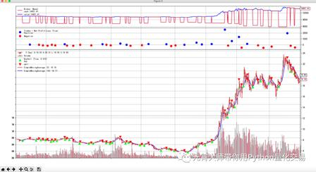

# 新对话新对话新对话

> 会话ID: 38433260701813250 | 抓取时间: 2026-08-25T09:19:29.491Z | 消息数: 2 | 图片数: 1
> 源URL: https://www.doubao.com/chat/38433260701813250

---

## **👤 用户**

Backtrader 搜索一下

---

## **🤖 助手**

搜索 3 个关键词，参考 16 篇资料 Backtrader 完整介绍 一、基础定义 Backtrader 是 纯 Python 开源量化回测 + 实盘交易框架 ，2015 年发布，作者 Daniel Rodriguez，协议 GPL-3.0（商用需单独授权），主打 事件驱动 回测，兼顾向量化加速，是个人量化、新手学习最主流轻量化框架之一。 核心定位：快速验证股票 / 期货 / 加密货币策略、参数寻优、绩效可视化、对接境外券商实盘。 Backtrader回测可视化图 二、核心优势 极简安装、零编译依赖 bash pip install backtrader # 带绘图功能 pip install backtrader [ plotting ] 纯 Python 编写，无 C 扩展，Windows/Mac/Linux/Jupyter 全兼容。 双运行模式兼顾效率与真实 next() ：事件驱动，逐根 K 线执行，1:1 模拟实盘下单逻辑，无未来函数； runonce() ：向量化批量计算，大数据回测提速。 内置极其丰富工具库 100 + 技术指标：SMA/EMA/MACD/RSI/BOLL/ATR 等，原生兼容 TA-Lib； 40 + 绩效分析器：夏普比率、最大回撤、卡尔玛比率、SQN 评分、盈亏统计； 完整模拟券商 Broker：支持市价 / 限价 / 止损 / 移动止损、滑点、分级佣金、部分成交模拟。 多周期、多品种原生支持 同一引擎同时加载多只标的、多时间周期（日线定方向 + 小时线入场），内置 K 线重采样工具 Backtrader 。 实盘对接生态完善 原生支持盈透 IB、OANDA；社区封装 CCXT 可对接币安 / 火币等加密交易所，少量美股外汇券商。 可视化开箱即用 一行 cerebro.plot() 输出 K 线、指标、买卖点、资金曲线、回撤曲线完整图表。 三、六大核心组件（架构） Cerebro（引擎大脑） 整个回测调度中心，统一装载数据、策略、分析器、资金、佣金，执行回测 / 参数优化 / 绘图。 python 运行 cerebro = bt . Cerebro ( ) DataFeed 数据源 标准化行情输入，支持：CSV、Pandas DataFrame、Yahoo 财经、Tushare、自定义分钟 / 日线数据。 Strategy 策略类（用户核心编写区） 继承 bt.Strategy ，两大关键函数： __init__ ：预计算指标、信号； next ：每根 K 线触发，写买入 / 卖出 / 风控逻辑。 Broker 模拟券商 管理账户资金、订单撮合、手续费、滑点，完全模拟真实交易规则。 Analyzer 绩效分析器 回测结束自动计算策略评价指标，输出收益、回撤、胜率、盈亏比等报表。 Indicator / Observer Indicator：技术指标；Observer：实时监控账户资金、持仓变化并绘图。 四、最简实战示例（双均线金叉策略） python 运行 import backtrader as bt from datetime import datetime # 自定义均线策略 class SmaCross ( bt . Strategy ) : # 可调参数 params = ( ( "fast_period" , 10 ) , ( "slow_period" , 30 ) ) def __init__ ( self ) : # 计算快慢均线 self . sma_fast = bt . ind . SMA ( period = self . p . fast_period ) self . sma_slow = bt . ind . SMA ( period = self . p . slow_period ) # 金叉死叉信号 self . cross = bt . ind . CrossOver ( self . sma_fast , self . sma_slow ) def next ( self ) : # 无持仓 + 金叉 → 买入 if not self . position and self . cross > 0 : self . buy ( ) # 持仓 + 死叉 → 卖出 elif self . position and self . cross < 0 : self . sell ( ) # 1. 创建引擎 cerebro = bt . Cerebro ( ) # 2. 添加策略 cerebro . addstrategy ( SmaCross ) # 3. 加载行情数据（示例：本地CSV） data = bt . feeds . YahooFinanceData ( dataname = "stock.csv" , fromdate = datetime ( 2020 , 1 , 1 ) , todate = datetime ( 2025 , 12 , 31 ) ) cerebro . adddata ( data ) # 4. 设置初始资金 cerebro . broker . setcash ( 100000 ) # 5. 运行回测 cerebro . run ( ) # 6. 绘图 cerebro . plot ( ) 五、缺点与局限（2026 现状） 官方停更，维护停滞 原作者 2022 年后不再更新，Python3.10 + 存在少量兼容性 bug；社区分支 backtrader2 仅修复 bug，无新功能开发。 单回测单线程，大数据慢 单次回测仅占用 1CPU 核心，多年分钟级海量数据回测速度远慢于 VectorBT、vnpy；仅参数优化支持多核并行。 GPL 开源协议限制商用 闭源私募 / 付费量化系统使用需购买商业授权，否则代码强制开源。 A 股原生支持弱 无内置 CTP 期货接口、无通达信 / 同花顺数据源适配，国内实盘需自行二次封装。 原生无机器学习集成 策略内调用 PyTorch/sklearn 需手动封装，不像 Qlib、VectorBT 原生支持因子建模。 长时实盘存在内存泄漏 连续多天实盘交易进程内存持续上涨，需定时重启程序。 六、同类框架对比（选型参考） 表格 框架 优势 劣势 适用人群 Backtrader 入门简单、文档全、指标丰富、轻量 停更、单线程、A 股适配差 新手学习、小样本策略验证、境外外汇 / 加密货币 vn.py 国内 A 股 / 期货完美适配、CTP 实盘、高性能 上手门槛高、组件重 国内实盘交易者、机构量化 VectorBT 向量化极速回测、ML 原生集成 事件驱动模拟弱，贴近实盘程度差 海量参数批量遍历、多因子研究 Zipline 曾机构级框架 彻底停更、数据源失效 不推荐新项目 七、适用场景 & 不推荐场景 适合使用 量化新手学习事件驱动回测逻辑； 短期日线 / 小时线策略快速验证； 外汇、美股、加密货币策略开发 + 境外券商实盘； 教学、个人业余研究、小资金自动化交易。 不推荐 国内 A 股 / 期货生产级实盘（优先 vn.py）； 十年以上分钟级海量数据批量回测； 闭源商用量化平台开发； 大规模机器学习多因子建模。 八、补充资源 官方文档： https://www.backtrader.com/docu/ 中文文档： https://backtrader-zh.readthedocs.io/zh-cn/latest/index_zh.html 社区维护分支：backtrader2（GitHub） 数据源扩展：Tushare 适配、CCXT 加密货币插件 需要我给你一份 A 股 Tushare 数据源接入 Backtrader 可直接运行的完整代码吗？ 本回答由AI生成，仅供参考，请仔细甄别，谨慎投资。

---
