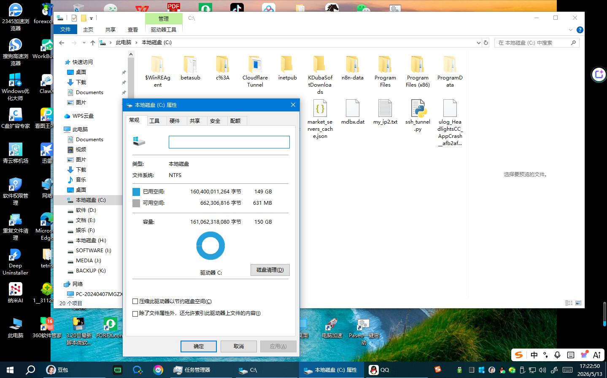

# C盘空间不足解决方案C盘空间不足解决方案C盘空间不足解决方案

> 会话ID: 38425859994036482 | 抓取时间: 2026-08-25T09:20:22.265Z | 消息数: 2 | 图片数: 1
> 源URL: https://www.doubao.com/chat/38425859994036482

---

## **👤 用户**

---

## **🤖 助手**

我看到你的 C 盘空间已经 严重不足 了，我们来分析一下情况并给你提供解决方案。 📊 当前状态分析 你的 C 盘总容量： 150 GB 已用空间： 149 GB 可用空间：仅剩 631 MB 这种情况会导致系统卡顿、更新失败、软件无法正常运行，甚至可能出现蓝屏。 🧹 紧急清理方案（按推荐顺序执行） 1. 立即运行「磁盘清理」 点击你截图里的 磁盘清理 (D) 按钮，按下面步骤操作： 等待扫描完成后，勾选以下选项： 临时文件 系统错误内存转储文件 设备驱动程序包 以前的 Windows 安装（如果有） 回收站 临时 Windows 安装文件 点击「确定」开始清理，这通常能释放数 GB 空间。 2. 卸载不必要的软件 打开「设置 → 应用 → 已安装的应用」 按「大小」排序，优先卸载： 不常用的大型软件（如游戏、视频剪辑工具） 重复安装的软件 占用空间超过 1GB 且不常用的程序 建议把非系统软件安装到 D 盘 / 其他盘，避免占用 C 盘空间。 3. 清理系统缓存与临时文件 按 Win+R 输入 %temp% ，回车后全选删除所有文件（部分文件被占用无法删除是正常的） 按 Win+R 输入 temp ，同样删除所有文件 按 Win+R 输入 prefetch ，删除所有文件 4. 转移个人文件 打开「此电脑 → C 盘 → 用户 → 你的用户名」 把「桌面、文档、下载、图片、视频」文件夹右键「属性 → 位置」，移动到 D 盘或其他非系统盘。 ⚠️ 长期优化建议 修改软件默认安装路径 ：在安装软件时，将路径从 C:\Program Files 改为 D:\Program Files 关闭自动更新临时文件 ：定期检查 Windows 更新留下的缓存文件 禁用休眠（可选） ：如果不使用休眠功能，以管理员身份打开命令提示符，输入 powercfg -h off ，可释放和内存大小相当的空间（你的 32G 内存可以释放约 32GB） 扩容 C 盘 ：如果清理后空间依然紧张，可以考虑从 D 盘 / 其他盘划分空间给 C 盘（需要用分区工具，注意备份数据） 💡 先从磁盘清理和卸载软件开始，这两步通常能快速释放出几 GB 到十几 GB 的空间，让系统恢复正常运行。 需要我帮你整理一份 分步操作清单 ，让你照着一步步做就能快速腾出空间吗？

---
