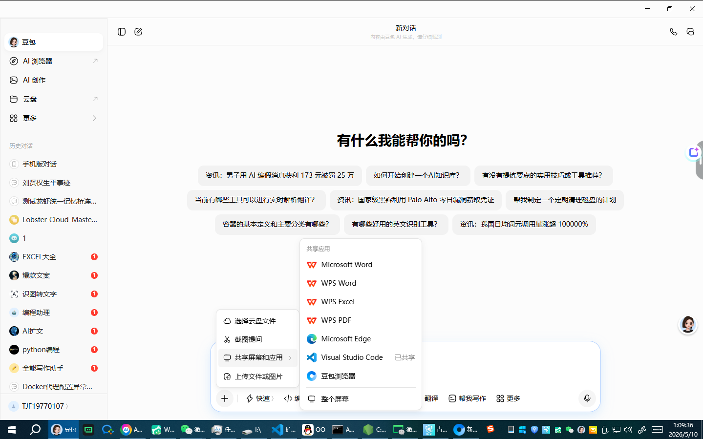

# 豆包PC客户端主界面解析vscod插件20260510豆包PC客户端主界面解析vscod插件20260510豆包PC客户端主界面解析vscod插件2026051

> 会话ID: 38425185971596802 | 抓取时间: 2026-08-25T09:20:39.895Z | 消息数: 4 | 图片数: 2
> 源URL: https://www.doubao.com/chat/38425185971596802

---

## **👤 用户**

---

## **🤖 助手**

这是 豆包 PC 客户端 的主界面截图，我帮你拆解一下关键信息和这个界面的亮点功能👇 🔍 界面核心解析 左侧边栏 包含「AI 浏览器」「AI 创作」「云盘」等功能入口，以及你的历史对话列表（能看到「测试龙虾统一记忆桥连...」「python 编程」等对话）。 历史对话带红色角标的是未读消息提醒。 主交互区 中间的 “有什么我能帮你的吗？” 是对话主界面，下方有话题快捷提问（比如 “如何开始创建一个 AI 知识库？”“容器的基本定义和主要分类有哪些？”）。 最关键的亮点：底部输入框的 「+」号菜单 ，展开后有「共享屏幕和应用」功能，这也是你截图里正在操作的部分。 「共享屏幕和应用」功能 这是豆包 PC 端近期更新的实用功能，支持： 共享单个应用窗口（比如你截图里的 Visual Studio Code、WPS、Edge 浏览器），豆包可以直接 “看到” 你的应用内容，帮你处理表格、写代码、读 PDF，不用手动截图 / 复制粘贴。 也支持共享整个屏幕，适合远程协作、操作指导类场景。 💡 这个功能的实用场景 Excel / 表格处理 ：共享 WPS Excel，直接用自然语言让它帮你算数据、写公式、做统计。 编程辅助 ：共享 VS Code，让它帮你看代码、找 bug、写注释，实时交互效率很高。 文档 / 阅读 ：共享 Word/PDF，让它帮你提炼要点、翻译、改文案。 如果你想知道这个功能的具体使用步骤，或者想了解更多豆包 PC 端的隐藏玩法，我可以给你整理一份超详细的操作指南。

---

## **👤 用户**

hermes_full_sync_repair.py 帮我输出这个文件的前 10 行代码，我要核对一下。

---

## **🤖 助手**

python 运行 from __future__ import annotations import json import os import sys from datetime import datetime from pathlib import Path from typing import Dict , List , Tuple import requests

---
