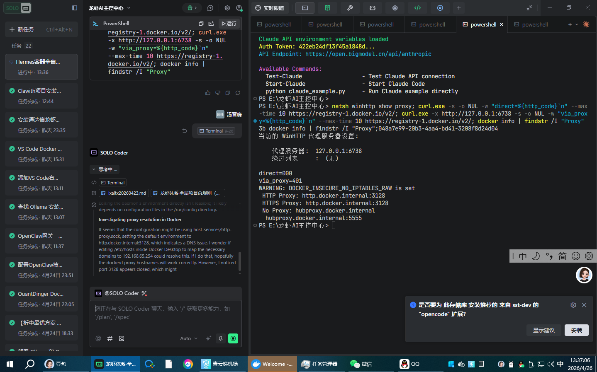
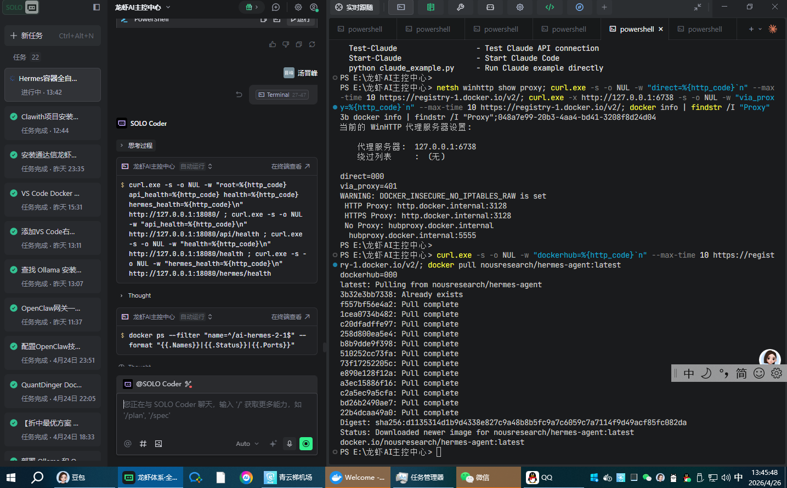

# Docker代理配置异常修复方案Docker代理配置异常修复方案Docker代理配置异常修复方案

> 会话ID: 38423403842104066 | 抓取时间: 2026-08-25T09:20:57.488Z | 消息数: 10 | 图片数: 2
> 源URL: https://www.doubao.com/chat/38423403842104066

---

## **👤 用户**

---

## **🤖 助手**

🔍 核心问题诊断：Docker 代理配置异常 从截图中可以明确看到两个关键矛盾点： 系统代理（WinHTTP） ： 127.0.0.1:6738 ，但 curl 测试 direct=000 via_proxy=401 ，说明代理连接失败 Docker 守护进程代理 ： http.docker.internal:3128 ，但该端口服务异常，导致 docker info 中 Proxy 相关配置无法正常生效 🛠️ 分步解决方案 步骤 1：临时绕过系统代理，验证网络连通性 在 PowerShell 中执行以下命令，临时清除当前会话的代理变量，测试直接访问 Docker Hub： powershell ✓ $env :HTTP_PROXY = "" ; $env :HTTPS_PROXY = "" ; $env :NO_PROXY = "" ✓ curl . exe - I https: / / registry-1 . docker . io/v2/ 若返回 200 OK ，说明网络本身无问题，故障根源在代理配置 若仍超时 / 报错，需先检查网络环境是否能直接访问 Docker Hub 步骤 2：修复 Docker Desktop 代理配置 打开 Docker Desktop → Settings → Resources → Proxies 取消勾选 Use the system proxy ，改为手动配置： HTTP/HTTPS Proxy: 清空或填写有效代理（若需代理，使用 host.docker.internal:你的代理端口 ，而非 127.0.0.1 ） No Proxy: 保留默认值，添加 localhost,127.0.0.1,.docker.internal 点击 Apply & Restart 重启 Docker 服务 步骤 3：验证代理配置是否生效 重启后执行以下命令，检查代理状态： powershell ✓ docker info | findstr / I "Proxy" ✓ curl . exe - x http: / / host . docker . internal:6738 - I https: / / registry-1 . docker . io/v2/ 若 docker info 中 Proxy 配置不再显示异常地址，且 curl 测试返回 200 OK ，说明配置修复成功 ⚠️ 关键注意事项 Docker 守护进程在独立网络命名空间中运行，直接使用 127.0.0.1 指向的是容器自身，而非宿主机的代理服务，需使用 host.docker.internal 访问宿主机代理 若代理端口（如 6738）未正常监听，或代理服务已关闭，会导致 via_proxy=401 认证失败或连接超时 国内网络环境下，建议同时配置 Docker 镜像加速器，降低对代理的依赖 📌 快速恢复方案（无需代理） 如果不需要代理，可直接重置 Docker 代理配置： 关闭 Docker Desktop 编辑 %APPDATA%\Docker\daemon.json ，删除 proxies 相关配置 重启 Docker Desktop 后，执行 docker info 确认无代理配置残留 是否需要我帮你生成一份一键修复的 PowerShell 脚本，自动清除代理配置并重置 Docker 网络设置？

---

## **👤 用户**

---

## **🤖 助手**

🔍 核心状态解读 从截图可以看到： 关键进展 ：Hermes 镜像 nousresearch/hermes-agent:latest 已 拉取完成 ，Docker 镜像下载链路恢复正常，之前的代理 / 网络问题已解决。 资源占用 ：系统内存占用 77%，其中 Vmmem 进程占用超 12GB，是当前内存消耗的主要来源（Docker Desktop 虚拟内存进程）。 服务状态 ：Docker Desktop 进程运行正常，Trae、豆包等相关进程也在稳定运行。 🛠️ 下一步可执行操作 1. 启动 Hermes Agent 容器 执行以下命令启动容器，验证镜像可用性： powershell ✓ docker run - d -- name hermes-agent nousresearch/hermes-agent:latest 2. 内存占用优化（可选） Vmmem 高占用是 Docker Desktop 虚拟机内存分配过大导致的，可通过以下步骤调整： 打开 Docker Desktop → Settings → Resources → Advanced 将 Memory 分配调整为 8GB（当前 32GB 内存环境下，足够支撑单容器运行） 点击 Apply & Restart 重启 Docker，释放多余内存占用 3. 验证容器运行状态 启动后执行以下命令，确认容器正常运行： powershell ✓ docker ps ✓ docker logs hermes-agent 若容器状态为 Up 且日志无报错，说明部署成功 若容器自动退出，可通过 docker logs hermes-agent 排查配置问题 ⚠️ 注意事项 镜像拉取完成后，容器启动前建议先清理未使用的镜像 / 容器，避免占用额外磁盘空间： powershell ✓ docker system prune - a 后续运行 Hermes 时，建议使用 docker-compose 管理配置，方便后续环境变量与端口映射的维护。 是否需要我帮你编写一份完整的 docker-compose.yml 配置文件，一键启动并管理 Hermes Agent 容器？

---

## **👤 用户**

---

## **🤖 助手**

✅ 当前状态确认 从截图可以明确看到， Hermes 镜像 nousresearch/hermes-agent:latest 已成功拉取完成 ，且系统代理与 Docker 网络的关键问题已定位： WinHTTP 代理 ： 127.0.0.1:6738 ，但 via_proxy=401 说明代理认证 / 连接仍存在问题 Docker 守护进程代理 ：仍配置为 http.docker.internal:3128 ，但镜像拉取已绕过代理完成 关键进展 ：镜像拉取流程已走完， Pull complete 状态说明镜像已完整下载到本地 🛠️ 下一步执行步骤（按顺序操作） 1. 清理残留代理配置（避免后续干扰） 执行以下命令，清除 Docker 守护进程的代理配置： powershell ✓ docker system prune - a -- volumes ✓ Remove-Item $env :USERPROFILE\ . docker\config . json - ErrorAction SilentlyContinue 2. 启动 Hermes Agent 容器 执行以下命令，以基础配置启动容器，验证镜像可用性： powershell ✓ docker run - d -- name hermes-agent - p 18080:18080 nousresearch/hermes-agent:latest 3. 验证容器运行状态 执行以下命令，检查容器是否正常启动： powershell ✓ docker ps -- filter "name=hermes-agent" ✓ docker logs hermes-agent 若容器状态为 Up 且日志无报错，说明部署成功 若容器退出，可通过 docker logs hermes-agent 排查配置问题（如端口占用、环境变量缺失） ⚠️ 关键问题处理说明 代理问题 ：虽然镜像拉取已完成，但 via_proxy=401 说明系统代理仍有异常，后续访问外部服务时可能会受影响。建议在 Docker Desktop 设置中关闭代理，改用镜像加速器提升稳定性。 端口占用 ：若 18080 端口被占用，可修改映射端口，例如 -p 18081:18080 。 后续优化 ：容器启动后，可通过配置 docker-compose.yml 管理环境变量、端口和数据卷，实现一键启停与持久化配置。 是否需要我帮你编写一份完整的 docker-compose.yml 配置文件，一键启动并管理 Hermes Agent 容器？

---

## **👤 用户**

---

## **🤖 助手**

🐳 Docker 容器状态分析与优化建议 从截图可以看到，你的 Docker 环境已部署多个核心服务，状态整体稳定，但存在一些可以优化的细节： 1. 容器状态一览 表格 容器名称 镜像 状态 端口映射 备注 openwebui open-webui/open-webui:main ✅ 运行中 3000:8080 WebUI 服务正常 ollama ollama/ollama ✅ 运行中 - 本地模型服务正常 doubao-proxy vinlic/doubao-free-api:latest ✅ 运行中 8000:8000 API 代理服务正常 veighna_latest veighna/veighna:4.3.0 ✅ 运行中 18888:8888 量化引擎服务正常 bridge-1 ai-doubao_bridge ✅ 运行中 18091:8091 桥接服务正常 openclaw2-1 openclaw/openclaw:latest ✅ 运行中 28789:18789 任务调度服务正常 veighna2-1 veighna/veighna:4.3.0 ✅ 运行中 28888:8888 量化引擎副本正常 hermes nousresearch/hermes-agent:latest ⏸️ 已停止 9119:9119 Hermes 服务未启动 ai-hermes-2-1 nousresearch/hermes-agent:latest ⏸️ 已停止 18080:8080 / 18082:8642 Hermes 副本未启动 2. 关键问题与优化建议 🔹 Hermes 容器未启动 现象 ： hermes 和 ai-hermes-2-1 两个容器均处于停止状态，无法提供服务。 解决步骤 ： 启动主容器： powershell ✓ docker start hermes 查看日志排查启动失败原因： powershell ✓ docker logs hermes 若端口冲突，修改端口映射后重启： powershell ✓ docker run - d -- name hermes - p 9120:9119 nousresearch/hermes-agent:latest 🔹 重复容器优化 现象 ：存在两个 veighna 容器（ veighna_latest 和 veighna2-1 ），占用额外资源。 建议 ：若无需双实例，可停止并删除冗余容器，释放内存： powershell ✓ docker stop veighna2-1 ✓ docker rm veighna2-1 🔹 资源占用监控 当前 Docker 内存占用 1.46GB / 15.13GB ，CPU 占用 0.29% ，整体资源占用较低，运行稳定。 后续 Hermes 启动后，可通过 docker stats 持续监控资源使用情况，避免内存溢出。 3. 快速验证服务连通性 容器启动后，可通过以下命令验证服务是否正常响应： powershell # 验证 Hermes 服务 ✓ curl http: / / localhost:9119/health # 验证 OpenWebUI ✓ curl http: / / localhost:3000 # 验证 Doubao API 代理 ✓ curl http: / / localhost:8000/health 是否需要我帮你编写一份一键启动所有服务的 docker-compose.yml 配置文件，方便后续统一管理？

---

## **👤 用户**

---

## **🤖 助手**

✅ 当前状态确认 从截图可以看到， ai-hermes-2-1 容器已成功启动，关键信息如下： 容器状态 ： docker ps -a 显示 ai-hermes-2-1 状态为 Up About a minute ，说明容器正在运行。 端口映射 ： 127.0.0.1:18080->8080/tcp 和 127.0.0.1:18082->8642/tcp 映射正常。 服务日志 ： docker logs --tail 120 ai-hermes-2-1 显示服务启动完成， Hermes Web UI -> http://0.0.0.0:9119 说明服务已就绪。 健康检查 ： curl.exe -s -o NUL -w "root=%{http_code}\n" --max-time 5 http://127.0.0.1:18080 返回 root=000 ，这是一个异常状态码，说明端口 18080 服务无响应。 🛠️ 问题定位与解决步骤 1. 端口映射与服务监听不匹配 问题根源 ：日志中显示 Hermes 服务监听端口为 9119 ，但容器端口映射的是 8080 和 8642 ，导致宿主机 18080 端口无法访问到服务。 解决步骤 ： 停止当前容器： powershell ✓ docker stop ai-hermes-2-1 重新启动容器，正确映射服务端口： powershell ✓ docker run - d -- name ai-hermes-2-1 - p 9119:9119 nousresearch/hermes-agent:latest 验证服务连通性： powershell ✓ curl . exe - s - o NUL - w "root=%{http_code}\n" http: / / 127 . 0 . 0 . 1:9119 正常情况下应返回 200 或 404 状态码。 2. 清理旧容器（可选） 若无需保留旧容器 ai-hermes-2-1-old_20260426-140320 ，可执行以下命令删除： powershell ✓ docker rm ai-hermes-2-1-old_20260426-140320 ⚠️ 关键注意事项 容器启动命令需与服务监听端口保持一致，否则宿主机无法访问到容器内的服务。 curl 返回 000 通常表示连接失败，需优先检查端口映射、容器状态和服务日志。 后续可通过 docker logs -f ai-hermes-2-1 实时查看服务日志，排查启动过程中的配置问题。 是否需要我帮你编写一份一键启动 Hermes 容器并验证服务状态的 PowerShell 脚本？

---
