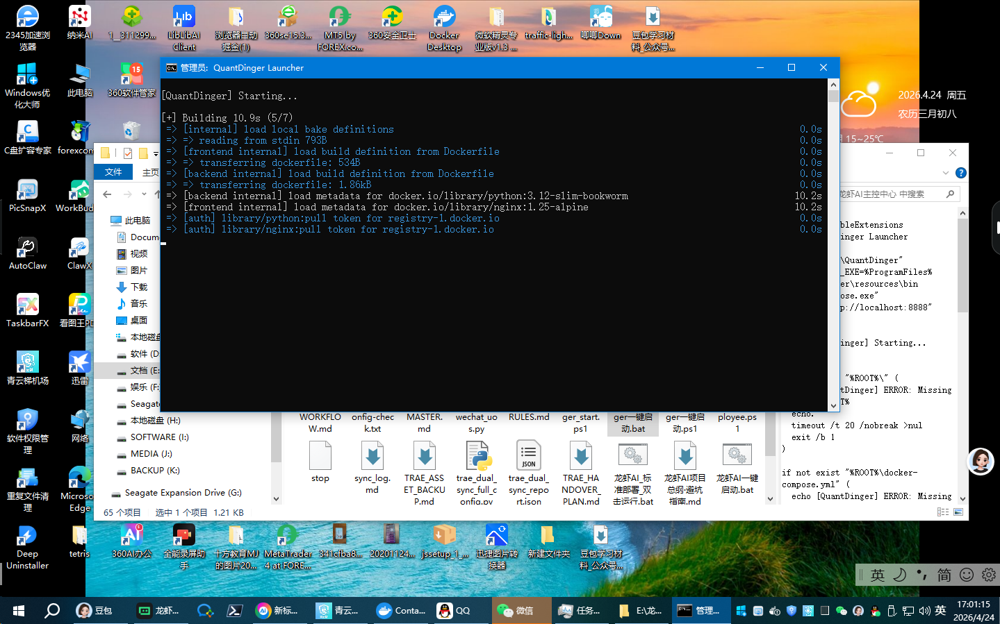
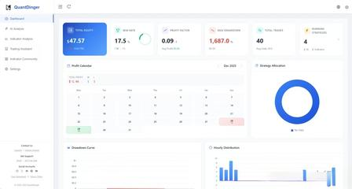

# QuantDinger启动Docker镜像构建过程解读QuantDinger启动Docker镜像构建过程解读QuantDinger启动Docker镜像构建过程解

> 会话ID: 38422668845939202 | 抓取时间: 2026-08-25T09:21:06.802Z | 消息数: 6 | 图片数: 2
> 源URL: https://www.doubao.com/chat/38422668845939202

---

## **👤 用户**

---

## **🤖 助手**

📊 画面内容解读 这张图显示的是你正在通过 QuantDinger Launcher 启动量化交易平台，它正处于 Docker 镜像构建过程中： 核心信息 终端标题： 管理员: QuantDinger Launcher 构建进度： Building 10.9s (5/7) ，表示总共 7 个步骤，当前正在执行第 5 步 关键日志： 正在拉取 python:3.12-slim-bookworm 和 nginx:1.25-alpine 两个基础镜像 正在获取 Docker Hub 的拉取授权令牌（ pull token for registry-1.docker.io ） 右侧窗口显示了启动脚本，提示 Missing compose.yml ，说明构建完成后会通过 Docker Compose 启动服务 当前状态分析 这是正常的 首次启动初始化流程 ： 你正在启动一个基于 Docker 的量化交易平台 QuantDinger ，它是一个开源的本地优先量化交易工作台 第 5/7 步是在拉取和准备运行所需的基础镜像，这一步需要从 Docker Hub 下载镜像，耗时约 10 秒 完成所有 7 步构建后，会自动启动平台服务，默认访问地址通常是 http://localhost:8888 ⚠️ 可能的问题与解决建议 1. 构建卡住或失败的排查 如果后续构建进度长时间停在第 5 步，或出现错误，可以按以下步骤排查： cmd ✓ 检查Docker Desktop是否正常运行 cmd ✓ 检查网络连接，确保能正常访问Docker Hub cmd ✓ 以管理员身份重新运行QuantDinger Launcher 2. 构建完成后无法访问服务 如果构建完成但无法打开 http://localhost:8888 ： cmd ✓ 检查Docker容器是否正常启动：docker ps cmd ✓ 查看容器日志：docker logs quantdinger-main cmd ✓ 确认8888端口未被其他程序占用 💡 补充说明 QuantDinger 是一个集数据获取、AI 投研、策略回测、实盘交易于一体的自托管量化平台，你当前的启动方式是通过其官方的 Launcher 脚本，一键完成 Docker 环境搭建和服务启动。 首次启动需要下载镜像，耗时会比后续启动长，属于正常现象。 需要我帮你整理一份 QuantDinger 启动后的常用命令清单，方便你后续排查和管理吗？

---

## **👤 用户**

---

## **🤖 助手**

🚨 问题诊断 从截图来看，你的 QuantDinger 启动失败，核心报错信息是： plaintext failed to fetch oauth token: Post "https://auth.docker.io/token": dial tcp ... connect: connection refused [QuantDinger] ERROR: Docker Compose failed. 这是一个典型的 Docker 网络连接问题 ，导致无法从 Docker Hub 拉取构建镜像所需的 python 和 nginx 基础镜像。 🔍 根本原因分析 Docker 客户端无法连接到 Docker Hub 的认证服务器 ，无法获取拉取镜像所需的 Token。 这通常是以下几种情况导致的： 网络防火墙 / 代理拦截了 Docker 的出站请求 Docker 未配置国内镜像加速器，直连国外服务器超时 系统网络或 DNS 配置异常 Docker Desktop 本身运行异常 ✅ 分步解决方案 方案 1：配置国内 Docker 镜像加速器（推荐） 这是解决国内访问 Docker Hub 慢 / 失败最有效的方法。 打开 Docker Desktop → 设置 → Docker Engine 在配置文件中添加国内镜像源（如阿里云、网易云），示例配置： json { "registry-mirrors" : [ "https://registry.docker-cn.com" , "https://docker.mirrors.ustc.edu.cn" , "https://hub-mirror.c.163.com" ] , "builder" : { "gc" : { "enabled" : true , "defaultKeepStorage" : "20GB" } } , "experimental" : false } 点击「Apply & Restart」重启 Docker，然后重新运行 QuantDinger Launcher 。 方案 2：检查并重置 Docker 网络 完全退出 Docker Desktop，等待 30 秒后重新启动。 执行以下命令，重置 Docker 的网络配置： cmd ✓ net stop com.docker.service cmd ✓ net start com.docker.service 或在 Docker Desktop 中，进入 Troubleshoot → Reset Kubernetes Cluster / Reset to factory defaults（重置会清除本地容器数据，注意备份）。 方案 3：手动拉取镜像，绕过构建失败 打开命令行，手动拉取构建所需的两个镜像： cmd ✓ docker pull python:3.12-slim-bookworm cmd ✓ docker pull nginx:1.25-alpine 如果手动拉取也失败，说明网络环境确实无法访问 Docker Hub，优先使用方案 1 配置加速器。 手动拉取成功后，再次运行 QuantDinger Launcher ，构建会直接使用本地已有的镜像。 方案 4：检查防火墙 / 代理设置 临时关闭系统防火墙和第三方安全软件（如 360 安全卫士），测试是否能正常拉取镜像。 如果你正在使用代理 / VPN，需要确保 Docker 也能正确走代理，或暂时关闭代理重试。 💡 后续建议 配置好镜像加速器后，你可以通过以下命令验证是否生效： cmd ✓ docker info 在输出中，你应该能看到 Registry Mirrors 列表中显示了你配置的国内镜像地址。 如果配置后仍然失败，我可以帮你提供一份完整的 docker-compose.yml 手动启动方案，绕过 Launcher 的构建流程，直接启动服务。需要吗？

---

## **👤 用户**

---

## **🤖 助手**

📊 画面内容解读 这张图展示了你当前的「龙虾 AI 主控中心」工作界面，核心是 Ollama 服务与 Docker 容器的状态，关键信息如下： 1. Ollama 服务状态 ✅ 容器状态 ： ollama 容器正在运行，端口映射为 127.0.0.1:11434->11434/tcp ，宿主机本地的 11434 端口已被 Ollama 服务监听（ TCP 127.0.0.1:11434 LISTENING ）。 本地访问验证命令 ： powershell ✓ $env :OLLAMA_HOST= "http://127.0.0.1:11434" ; ollama list 这个命令可以直接验证 Ollama 服务是否正常响应，并列出已下载的模型。 容器内访问命令 ： powershell ✓ docker exec - it ollama ollama list 这个命令可以进入 Ollama 容器内部，直接查看容器内的模型列表，用于排查宿主机与容器的通信问题。 2. Docker 容器全景状态 右侧窗口的 docker ps 输出显示了你所有正在运行的服务容器： 表格 容器名 状态 端口映射 openwebui Up 9 minutes (healthy) 0.0.0.0:3000->8080/tcp ai-hermes-2-1 Up 8 minutes 127.0.0.1:18080->8080/tcp hermes Up 8 minutes 0.0.0.0:9119->9119/tcp ai-bridge-1 Up 8 minutes 0.0.0.0:18091->8091/tcp ai-openclaw2-1 Up 8 minutes (healthy) 127.0.0.1:12879->12879/tcp ai-veighna2-1 Up 8 minutes 127.0.0.1:12888->8888/tcp ai-doubao2-1 Up 8 minutes 127.0.0.1:18000->8000/tcp doubao-proxy Up 8 minutes 0.0.0.0:8000->8000/tcp veighna_latest Up 8 minutes 0.0.0.0:18888->8888/tcp ollama Up 8 minutes 127.0.0.1:11434->11434/tcp 3. 关键问题与解决方案 你当前的核心需求是 打通本地 Ollama 与其他服务的连接 ，这里有两个关键注意事项： 端口访问限制 ： Ollama 容器只绑定了 127.0.0.1:11434 ，意味着 只有宿主机本地进程能直接访问 ，其他容器（如 openwebui 、 ai-hermes ）默认无法通过网络访问 Ollama 服务。 临时解决方法：修改 Ollama 容器配置，让它监听 0.0.0.0:11434 ，这样所有容器都能通过宿主机 IP 访问。 验证命令（宿主机本地）： powershell ✓ curl http: / / 127 . 0 . 0 . 1:11434/api/tags 这个命令可以直接测试 Ollama API 是否正常响应。 多服务端口规划 ： 你的端口使用已经比较密集（ 8000/8080/9119/11434/18000/18080/18091/12879/12888/18888 ），后续新增服务建议优先使用 19000+ 段端口，避免冲突。 💡 下一步建议 你可以先执行 docker exec -it ollama ollama list ，告诉我输出结果，我就能帮你判断模型是否在容器内正常加载，并给出对应的 OpenWebUI / Hermes 网关的连接配置方案。

---
