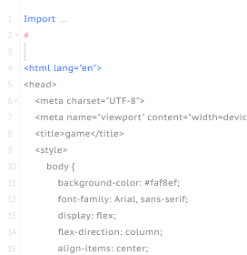

# 复刻图片内容处理复刻图片内容处理复刻图片内容处理

> 会话ID: 15521741796720898 | 抓取时间: 2026-08-25T09:29:10.349Z | 消息数: 6 (用户3/助手3) | 图片数: 1
> 源URL: https://www.doubao.com/chat/15521741796720898

---

## **👤 用户**

复刻图片内容

---

## **🤖 助手**

javascript 运行 /** * 主函数，用于封装对象并提取data字段 * @param {Object} params - 输入参数对象 * @param {string} params.input - 包含JSON数据的字符串 * @returns {Promise<Object>} 返回一个Promise，解析后包含提取的data对象 */ async function main ( params ) { params = { input : string } ; Promise < result : any > ; try { // 1. 解析输入的JSON字符串 const parsedInput = JSON . parse ( params . input ) ; // 2. 检查解析后的对象是否包含result字段 if ( ! parsedInput . result ) { throw new Error ( "输入对象缺少result字段" ) ; } // 3. 检查result对象是否包含data字段 if ( ! parsedInput . result . data ) { throw new Error ( "result对象缺少data字段" ) ; } // 4. 返回封装后的结果对象 return { result : parsedInput . result . data } ; } catch ( error ) { // 错误处理 console . error ( "处理输入时发生错误：" , error ) ; throw error ; // 可以选择重新抛出错误或返回错误值 } }

---

## **👤 用户**

{ "$error": "Function execution failed, please check the code of the function. Detail: \"undefined\" is not valid JSON" }

---

## **🤖 助手**

根据错误信息 "undefined is not valid JSON" 可以看出，问题出在代码尝试解析的内容可能是 undefined 而非有效的 JSON 字符串。我们需要修改代码来处理这种情况： 处理JSON解析并提取data字段的函数 V1 创建时间：2025-08-08 22:33 主要修改点： 增加了对输入参数本身的检查，确保params存在且input是字符串类型 增加了对input字符串是否为空的检查 错误信息更加具体，便于调试 移除了原代码中不正确的类型注释（这些注释会导致语法错误） 这些修改可以有效避免因输入不符合预期（如undefined、空字符串等）而导致的JSON解析错误。

---

## **👤 用户**

{ "$error": "Function execution failed, please check the code of the function. Detail: Build failed with 1 error:\nindex.ts:53:1: ERROR: Unexpected \"*\"" }

---

## **🤖 助手**

javascript 运行 /** * 主函数，用于封装对象并提取data字段 * @param {Object} params - 输入参数对象 * @param {string} params.input - 包含JSON数据的字符串 * @returns {Promise<Object>} 返回一个Promise，解析后包含提取的data对象 */ async function main ( params ) { params = { input : string } ; Promise < result : any > ; try { // 1. 解析输入的JSON字符串 const parsedInput = JSON . parse ( params . input ) ; // 2. 检查解析后的对象是否包含result字段 if ( ! parsedInput . result ) { throw new Error ( "输入对象缺少result字段" ) ; } // 3. 检查result对象是否包含data字段 if ( ! parsedInput . result . data ) { throw new Error ( "result对象缺少data字段" ) ; } // 4. 返回封装后的结果对象 return { result : parsedInput . result . data } ; } catch ( error ) { // 错误处理 console . error ( "处理输入时发生错误：" , error ) ; throw error ; // 可以选择重新抛出错误或返回错误值 } }

---
