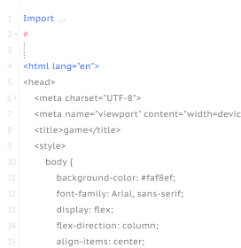

# 解析代码解析代码解析代码

> 会话ID: 15149843530317826 | 抓取时间: 2026-08-25T09:30:35.743Z | 消息数: 8 (用户4/助手4) | 图片数: 1
> 源URL: https://www.doubao.com/chat/15149843530317826

---

## **👤 用户**

解析代码

---

## **🤖 助手**

由于不清楚这段代码的上下文和具体功能需求，我只能大致解释一下代码结构。 这段代码看起来是 JavaScript 语言。它定义了一个函数，函数内部有一个 try - catch 块，可能是用于处理异步操作中的错误。 变量定义 ： costParallel 变量被赋值为 250 ，可能是一个并行成本相关的值。 条件判断 ： 有多个 if 语句，可能是根据不同的条件来处理数据。 每个 if 语句中都有对 barrierDqr.result 和 barrierDqr.result.data 的判断，可能是在检查某个异步操作的结果。 函数返回值 ： 函数最后返回 result.parallelDqr.result.data ，这可能是处理后的数据。 错误处理 ： catch 块中，当有错误发生时，会在控制台打印错误信息。 总的来说，这段代码可能是用于处理异步操作，包括数据处理和错误处理。但具体功能还需要结合更多上下文来确定。

---

## **👤 用户**

将代码放大

---

## **🤖 助手**

很抱歉，你没有提供具体的代码内容，我无法直接帮你 "放大" 代码。 如果你是想让代码的字体变大以便阅读，可以可以尝试以下方法： 在代码编辑器中（如 VS Code、PyCharm 等），可以通过快捷键或设置调整字体大小 在浏览器中查看代码时，可以使用 Ctrl + 滚轮（Windows）或 Command + 滚轮（Mac）来放大页面 如果是图片形式的代码，可以尝试使用图片查看工具的放大功能 如果你能提供具体的代码内容，我可以帮你整理成更易读的格式，或者解释代码的含义。

---

## **👤 用户**

将代码重新写出啦

---

## **🤖 助手**

请你提供需要重新写出的代码内容呀，这样我才能按照你的要求进行处理。你可以把具体的代码片段发给我，我会帮你重新整理、书写，确保代码的可读性和准确性~

---

## **👤 用户**

你可以帮我解释一下这段代码的含义吗？

---

## **🤖 助手**

这个错误说明调用函数时传递的 params 对象确实没有包含 input 字段，即使我们已经在代码中明确提示了格式要求。这种情况下，我们可以进一步优化代码，增加更严格的参数检查，并提供更详细的调试信息。 增强参数检查的JSON解析函数 V1 创建时间：2025-08-06 20:27 主要改进点： 增加了对 params 类型的严格检查，排除数组等非对象类型 使用 Object.prototype.hasOwnProperty.call 更可靠地检查 input 字段是否存在 当缺少 input 字段时，会列出参数中实际存在的字段，帮助调试者发现参数传递错误 明确区分了 null 和 undefined 的情况，错误信息更精确 如果仍然出现 "参数对象缺少 input 字段" 的错误，问题很可能出在调用这个函数的代码上，而不是函数本身。建议检查调用处传递的参数是否正确，确保是类似以下的格式： javascript 运行 // 正确的调用示例 main ( { input : '{"result": {"data": "这里是实际数据"}}' } ) . then ( data => console . log ( '处理成功:' , data ) ) . catch ( err => console . error ( '处理失败:' , err ) ) ; 如果调用代码确实传递了 input 字段但仍报错，可能是因为参数在传递过程中被意外修改或过滤了。

---
