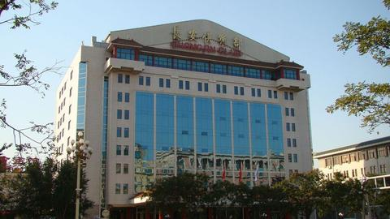
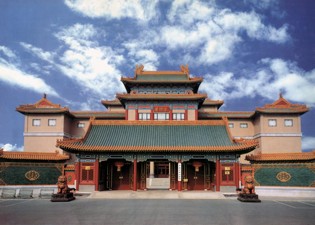

# 介绍陈丽华介绍陈丽华介绍陈丽华

> 会话ID: 14457001947437314 | 抓取时间: 2026-08-25T09:31:12.809Z | 消息数: 2 (用户1/助手1) | 图片数: 2
> 源URL: https://www.doubao.com/chat/14457001947437314

---

## **👤 用户**

陈丽华 搜索一下

---

## **🤖 助手**

陈丽华是中国内地著名女企业家，以下是关于她的详细介绍： 个人经历 2 早年经历 ：1941 年出生于北京，满族，因家境贫寒高中辍学后，做起家具维修生意，凭借出色的生意头脑和待人热诚，很快成立了自己的家具厂。 创业积累 ：20 世纪 80 年代初到香港，在比华利购得 12 套别墅并高价出售，完成原始资金积累。1988 年在香港成立富华国际集团，主要经营房地产开发业务，并在澳洲以及东南亚多国开设分公司。 内地发展 ：1989 年返回北京，开发的第一个地产项目是临近天安门广场的长安俱乐部，总投资 4.5 亿元，是北京首家五星级高档私人商业会所。之后还投资建设了丽苑公寓、金宝街等众多高端商业地产项目。 商业成就 房地产领域 长安俱乐部 ：作为北京首家五星级高档私人商业会所，长安俱乐部选址紧邻天安门广场，其建设过程历经波折，从审批到施工再到装修都面临诸多困难，但最终于 1996 年正式竣工开业，成为当时具有富人象征地位的商务综合企业 2 。 建筑 北京长安俱乐部 金宝街项目 ：2000 年，陈丽华以 40 亿元的投资额接手筹建东城区金宝街市政改造和危改工程，解决了拆迁、文物保护、改造方式等诸多难题，于 2005 年正式完成改建。如今金宝街汇聚了众多奢侈品品牌，成为北京的高端商业街区 2 。 其他项目 ：还投资建设了利山大厦、富华园小区、丽晶酒店、励骏酒店、金宝汇购物中心等，在北京及其他城市拥有大量优质房地产资产 2 。 紫檀事业 中国紫檀博物馆 ：1999 年国庆前夕，耗资 2 亿元建造的中国首家 “国” 字号开头的博物馆 —— 中国紫檀博物馆正式落成。馆内除了收藏的 300 余件明清家具外，其他 2000 余件都是 20 多年来在她的工厂生产出来的珍稀紫檀精品 2 。 建筑 中国紫檀博物馆 复制老北京城门 ：2008 年开启老北京城门的复制工作，组织专家学者和能工巧匠，用名贵木材按 1∶10 复制北京城门城墙，耗时十年完成 16 座 “城门” 和 10 座 “角楼”，具有较高艺术工艺价值、历史价值和文物价值 2 。 社会贡献 文化交流 ：2005 年 9 月 14 日，陈丽华馆长将馆内珍藏的 “紫檀制天坛”“紫檀制万春亭” 等分别赠送给故宫博物院、法国香波堡、美国史密森研究院等国内外博物馆作永久收藏，推动中国传统紫檀文化走向世界 2 。 慈善公益 ：多年来资助体育、教育、卫生、公安及赈灾的款项达数千万元人民币。为疫情捐款 100 万元和 203 万元食品 1 4 。 文化传承 ：2010 年，中国紫檀博物馆被国家文化部列为第三批国家级非物质文化遗产 “紫檀雕刻” 项目的传承单位，陈丽华致力于紫檀雕刻技艺的传承和发展 2 。 个人荣誉 1 2011 年和 2012 年连续两年入选《福布斯》“全球最具影响力百名女性”。 2012 年在《2012 胡润房地产富豪榜》中以财富 330 亿元排名第 3 名。 2014 年被评为全球白手起家女富豪榜第 1 名。 2025 年以 550 亿元人民币财富位列《2025 胡润全球富豪榜》第 414 位。 家庭生活 陈丽华的丈夫是电视剧《西游记》中唐僧角色的扮演者迟重瑞，两人于 1990 年结婚 3 。

---
