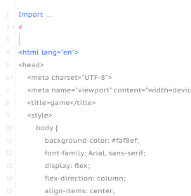

# 400 访问拒绝及解决400 访问拒绝及解决400 访问拒绝及解决

> 会话ID: 14051546195138562 | 抓取时间: 2026-08-25T09:31:25.502Z | 消息数: 8 (用户4/助手4) | 图片数: 1
> 源URL: https://www.doubao.com/chat/14051546195138562

---

## **👤 用户**

400 Access denied, please make sure your account is in good standing.

---

## **🤖 助手**

“400 Access denied, please make sure your account is in good standing” 是一条访问被拒绝的错误提示，核心意思是 “访问被拒绝，请确保你的账户状态正常”。下面从可能原因、解决思路和延伸建议三个方面详细说明： 一、可能的核心原因 这条提示的关键在于 “账户状态（account in good standing）”，常见导致该问题的原因包括： 账户存在异常或违规 可能违反了平台规则（如发布违规内容、恶意操作等），被临时限制权限。 账户被他人举报，处于审核或限制状态。 账户未完成必要验证 例如未绑定手机号、邮箱，或未完成实名认证（部分平台要求验证后才能访问特定功能）。 账户存在未处理的 “待办事项” 比如有未缴纳的费用（如会员欠费、服务账单）、未确认的协议更新等。 临时系统问题 平台服务器临时故障、账户数据同步延迟，也可能误判账户状态。 二、解决思路（按优先级排序） 检查账户基础状态 登录账户的 “个人中心” 或 “设置”，查看是否有 “账户提醒”“违规通知” 或 “待办事项”（如提示 “请完成实名认证”“存在未缴费用”）。 确认账户是否处于 “正常” 状态（部分平台会显示 “账户状态：正常 / 限制 / 冻结”）。 完成未验证或待办操作 若提示需验证，按指引绑定手机、邮箱或完成实名认证；若有欠费，及时补缴费用。 联系平台客服 若自查无异常，通过平台的 “帮助中心”“客服咨询” 入口，提供错误提示截图和账户信息，询问具体原因（客服能查询到账户限制的详细原因）。 排除临时问题 清除浏览器缓存或 APP 数据后重新登录，或等待 1-2 小时后再次尝试（可能是系统临时故障）。 三、延伸建议 不同平台的 “账户正常状态” 定义不同（例如电商平台可能关联交易合规，工具类平台可能关联使用规范），解决时需结合具体使用场景（如访问某网站、APP 功能、API 接口等）针对性排查。 若涉及付费服务，优先确认订阅是否有效（如会员到期、自动续费失败等）。 如果尝试上述步骤后仍未解决，建议重点联系平台客服 —— 他们能直接查询账户限制的底层原因，是最高效的解决方式。

---

## **👤 用户**

识别图片内容

---

## **🤖 助手**

这是一段 JavaScript 代码。代码定义了一个名为 main 的异步函数，函数内构建了一个名为 Output 的对象，对象包含了 key0 、 key1 和 key2 等属性。其中 key0 是对输入参数 input 的操作， key1 是一个数组， key2 是一个对象。 在代码的后半部分，定义了输入参数 num1 和 num2 以及输出参数 summary ，并且有一个需求是计算 num1 与 num2 相加的和，并将值赋给 summary 返回。 总的来说，这段代码展示了如何在 JavaScript 中定义函数、操作对象和数组，以及处理输入和输出参数。

---

## **👤 用户**

提取代码

---

## **🤖 助手**

JavaScript 代码片段 V1 创建时间：2025-07-29 06:33 以上代码是从对话中提取的完整 JavaScript 代码片段，包含了 main 函数的实现以及计算 num1 和 num2 之和的逻辑。

---

## **👤 用户**

提取图片代码和内容

---

## **🤖 助手**

这两张图片展示了一个表格，表格中包含了多条记录，每条记录包含以下信息： AE 图片列表 ：包含图片的链接，如 http://sns - webpic.qc.xh...。 收藏数量 ：记录了该条记录被收藏的次数，例如 251、461、736。 分享数量 ：记录了该条记录被分享的次数，例如 157、173、185。 AE 类型 ：有两种类型，分别是 “normal” 和 “video”。 AE 视频链接 ：仅在类型为 “video” 时出现，例如 http://sns - video - al.xhsc...。 视频展示 ：可能是一个表示是否展示视频的标记，表格中有一个图标。 这些数据可能来自一个社交媒体平台，用于统计和展示不同内容（图片或视频）的受欢迎程度（收藏和分享数量）。其中，“AE 类型” 列区分了内容是图片还是视频，“AE 视频链接” 列提供了视频的链接，“视频展示” 列可能用于标记视频是否正在展示。

---
