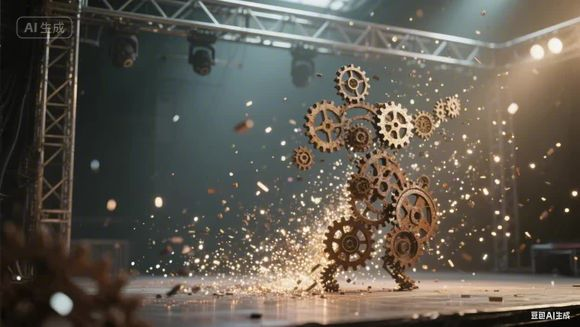
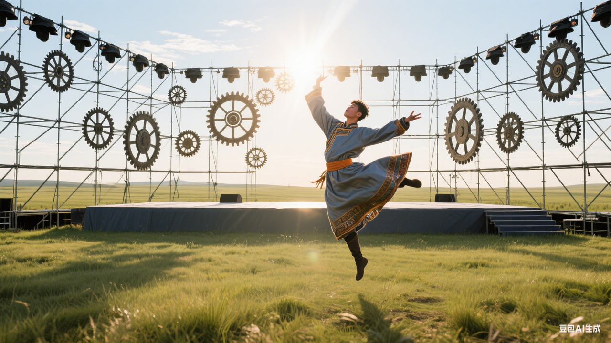
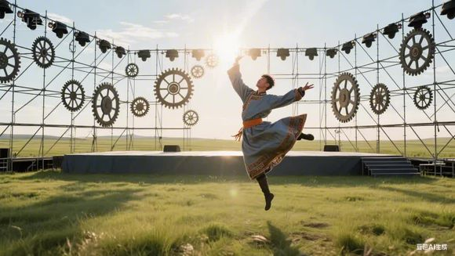
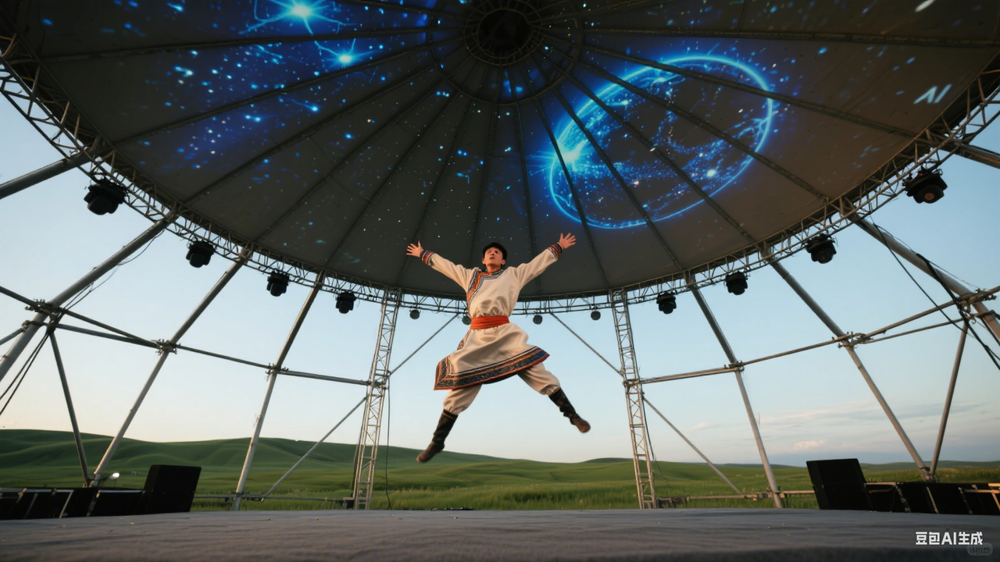
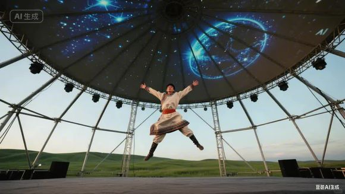
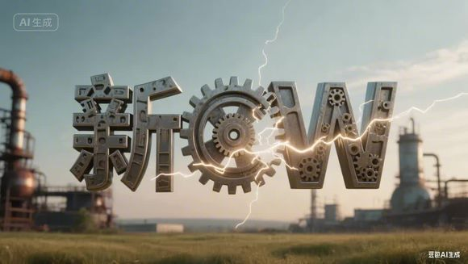

# 企业宣传片创意企业宣传片创意企业宣传片创意

> 会话ID: 10583444655170306 | 抓取时间: 2026-08-25T09:36:07.915Z | 消息数: 24 (用户12/助手12) | 图片数: 8
> 源URL: https://www.doubao.com/chat/10583444655170306

---

## **👤 用户**

视频名称：《钢铁穹庐的新生》 内容创意： 画面：钢铁厂生锈齿轮被AI“吹散”，重组为跳舞舞台钢架；蒙古族青年在齿轮舞台上跳蒙古舞，背景是草原。 齿轮组成字幕——“新”。生成AI绘画的提示词,分6个分镜头,要有创意,要高效运镜,做企业宣传片,用在即梦和可灵上,中文,不超过150

---

## **🤖 助手**

已完成思考 用户需要为视频《钢铁穹庐的新生》生成 AI 绘画的提示词，分 6 个分镜头，用于企业宣传片，还要适合在即梦和可灵上使用，中文，不超过 150 字。首先，我得理解用户的内容创意：钢铁厂生锈齿轮被 AI 吹散，重组为舞台，蒙古族青年跳舞，背景是草原，还有 “新” 字的字幕。 首先，分镜头需要覆盖整个故事线，从生锈齿轮到 AI 处理，再到重组舞台，青年跳舞，背景草原，最后字幕。每个镜头要突出创意和运镜，比如特写、全景、动态效果。还要考虑高效运镜，可能需要不同的视角和移动方式，比如推、拉、摇、移。 然后，提示词需要包含画面元素、材质、光影、风格，还要适合 AI 绘画工具。比如生锈齿轮的细节，AI 的粒子效果，舞台的钢架结构，蒙古舞的动态，草原的自然景色，字幕的设计。同时要注意字数限制，每个镜头不能太长，还要简洁有力。 可能需要先列出每个分镜头的主要元素，再组织语言，确保流畅和创意。比如第一个镜头是生锈齿轮的特写，第二个是 AI 吹散的粒子效果，第三个是舞台重组的过程，第四个是青年跳舞的全景，第五个是草原背景的结合，第六个是齿轮组成的 “新” 字。 还要注意运镜描述，比如 “特写生锈齿轮”、“AI 粒子流吹散”、“舞台钢架重组” 等，让画面动起来。同时，企业宣传片需要大气、现代，所以风格上可能需要结合工业和自然元素，突出科技与传统的融合。 最后，检查每个镜头是否符合要求，字数是否在限制内，中文表达是否准确，有没有创意，是否适合 AI 生成。可能需要调整用词，比如 “钢铁穹庐” 可以解释为钢铁结构的蒙古包，或者直接用 “钢铁结构”，确保 AI 能理解。还要注意光影效果，比如金属的反光，草原的自然光，让画面更生动。 特写生锈钢铁齿轮旋转，金属锈迹斑驳，镜头下拉展现钢铁厂废墟全景，AI 蓝色粒子流从齿轮缝隙涌入 中景：AI 粒子流吹散齿轮成金属微粒，粒子如星河流淌，镜头右摇展现微粒重组为舞台钢架轮廓 全景：齿轮钢架舞台在草原升起，阳光照射金属结构反光，蒙古族青年从舞台后方跃起，蒙古舞袍翻飞 跟拍青年旋转舞步，镜头环绕舞台，钢架齿轮随舞姿发光，背景草原绿意延伸至天际，羊群如白云点缀 仰拍青年跳跃至最高处，双手展开，舞台钢架展开为穹顶状，AI 粒子在穹顶绘出草原星空投影 特写齿轮组合成 "新" 字，金属光泽流转，字体重构时迸发电光，背景融合钢铁厂与草原渐变画面，镜头拉远

---

## **👤 用户**

每个镜头要有旁白,配音

---

## **🤖 助手**

我将围绕镜头展现的画面和主题，为每个镜头创作契合的旁白，以生动语言阐述钢铁与新生、传统与科技的碰撞。 《钢铁穹庐的新生》分镜头旁白文案 创建时间：2025-07-01 00:08 以上旁白从不同角度诠释了视频主题。你若觉得某段旁白风格、内容不合适，或有其他修改需求，随时和我说。

---

## **👤 用户**

要写实风格

---

## **🤖 助手**

接下来我将分六个分镜呈现《钢铁穹庐的新生》的故事，画面是写实风格。 第一个分镜，在荒废的钢铁厂中，一个巨大的生锈齿轮正在缓慢转动，锈迹布满了整个齿轮，显得破败不堪。突然，一道道蓝色的AI能量流从齿轮的缝隙中涌入，能量流带有强烈的科技感，与周围陈旧的环境形成鲜明对比。 第二个分镜，AI能量流不断增强，将齿轮吹散成无数细小的金属微粒，这些微粒在空气中闪烁着光芒，如同星河流淌。镜头右摇，展示这些金属微粒开始重新组合，逐渐形成跳舞舞台钢架的轮廓。 第三个分镜，在广阔的草原上，由齿轮重组而成的舞台钢架已经完全成型，阳光洒在金属结构上，反射出耀眼的光芒。一位身着蒙古族传统服饰的青年从舞台后方高高跃起，他的蒙古舞袍随风翻飞，充满了活力。 第四个分镜，镜头紧紧跟随着青年的旋转舞步，环绕着舞台移动。舞台上的钢架齿轮随着青年的舞姿闪烁着光芒，背景是一望无际的草原，绿意盎然，羊群像白色的云朵一样点缀在草原上。 第五个分镜，采用仰拍视角，青年跳跃到最高处，双手展开，仿佛要拥抱整个世界。此时，舞台的钢架逐渐展开，形成一个穹顶状，AI能量粒子在穹顶上绘制出草原星空的投影，美轮美奂。 第六个分镜，特写镜头聚焦在由齿轮组合成的“新”字上，金属光泽在字上流转，字体重构时迸发出一道道电光。背景是钢铁厂和草原的渐变画面，镜头逐渐拉远，展现出整个场景。

---

## **👤 用户**

画面：特写生锈钢铁齿轮旋转，金属锈迹斑驳，镜头下拉展现钢铁厂废墟全景，AI 蓝色粒子流从齿轮缝隙涌入。 旁白：岁月侵蚀的钢铁齿轮，承载着往昔的辉煌与沉寂。当 AI 的蓝色曙光刺破锈迹，变革的序章悄然开启。 画面：中景：AI 粒子流吹散齿轮成金属微粒，粒子如星河流淌，镜头右摇展现微粒重组为舞台钢架轮廓。 旁白：陈旧在此刻瓦解，科技的力量重塑未来。钢铁的灵魂挣脱束缚，在粒子的舞动中，勾勒出全新的模样。 画面：全景：齿轮钢架舞台在草原升起，阳光照射金属结构反光，蒙古族青年从舞台后方跃起，蒙古舞袍翻飞。 旁白：钢铁与草原在此相遇，工业文明与自然之美交融。青年的一跃，跃出传统与创新交织的蓬勃生机。 画面：跟拍青年旋转舞步，镜头环绕舞台，钢架齿轮随舞姿发光，背景草原绿意延伸至天际，羊群如白云点缀。 旁白：舞步与光影共舞，齿轮与自然共鸣。每一个旋转，都是对过去的致敬，对未来的憧憬。 画面：仰拍青年跳跃至最高处，双手展开，舞台钢架展开为穹顶状，AI 粒子在穹顶绘出草原星空投影。 旁白：当青年触及苍穹，钢铁穹庐绽放科技之光。草原的星空，在 AI 的魔法下，与钢铁穹顶完美融合。 画面：特写齿轮组合成 "新" 字，金属光泽流转，字体重构时迸发电光，背景融合钢铁厂与草原渐变画面，镜头拉远。 旁白：钢铁重生，焕新而来。在传统与科技的碰撞中，一个 "新" 字，书写无限可能，开启崭新篇章。

---

## **🤖 助手**

我将按照之前的写实风格，为这六个分镜重新生成图片。 第一个分镜，特写一个生锈且锈迹斑驳的钢铁齿轮在旋转，随后镜头下拉，展现出钢铁厂废墟全景，同时AI蓝色粒子流从齿轮缝隙涌入。 第二个分镜，中景展示AI粒子流不断增强，把齿轮吹散成闪烁光芒如星河流淌的金属微粒，镜头右摇，微粒开始重组为舞台钢架轮廓。 第三个分镜，全景呈现广阔草原上，由齿轮重组的舞台钢架已成型，阳光照在金属结构上反光，蒙古族青年从舞台后方跃起，舞袍翻飞。 第四个分镜，跟拍青年旋转舞步，镜头环绕舞台，舞台上的钢架齿轮随舞姿发光，背景是绿意延伸至天际且有羊群如白云点缀的草原。 第五个分镜，仰拍青年跳跃到最高处双手展开，舞台钢架展开成穹顶状，AI粒子在穹顶绘出草原星空投影。 第六个分镜，特写由齿轮组合成的“新”字，金属光泽流转，字体重构时迸发电光，背景是钢铁厂和草原的渐变画面，镜头逐渐拉远。

---

## **👤 用户**

将6个分镜生成一个20秒的视频

---

## **🤖 助手**

已完成思考 用户现在需要把之前的 6 个分镜生成一个 20 秒的视频。首先，我得回顾一下之前的分镜内容和旁白，确保每个镜头的时长分配合理。20 秒的话，每个镜头大概 3-4 秒，可能需要调整节奏，让视频流畅。 用户之前已经强调了写实风格，并且每个分镜都有对应的画面和旁白。现在需要考虑如何将这些分镜整合成视频，可能需要考虑转场效果，比如镜头之间的过渡，比如淡入淡出或者直接切换，以保持节奏紧凑。 另外，用户可能希望视频有企业宣传片的感觉，所以需要注意画面的冲击力和旁白的配合。每个镜头的时长需要根据内容的重要性来分配，比如开场的生锈齿轮可能需要稍长一点，而最后的 “新” 字特写也可以适当延长，以突出主题。 还要考虑音乐和音效的配合，但用户没有提到，可能暂时不需要，但如果有需要的话可以建议。不过当前主要任务是生成视频的分镜时间安排和转场方式。 另外，用户之前用的是 AI 绘画提示词，现在需要生成视频，可能需要考虑每个镜头的动画效果，比如齿轮的旋转、粒子流的运动、青年跳舞的动作流畅性，以及镜头的移动，比如下拉、右摇、跟拍等，这些在视频中需要通过动画来实现。 可能还需要注意画面的分辨率和比例，用户之前提到 16:9，所以视频尺寸要保持一致。另外，写实风格需要确保每个镜头的画质清晰，光影效果自然，比如阳光照射在金属上的反光，草原的绿意等。 最后，整合时要确保整个视频的叙事连贯，从钢铁厂的破败到 AI 粒子的重组，再到草原上的新生，突出 “新” 的主题。每个镜头的旁白需要和画面同步，语速适中，配合画面的节奏，让 20 秒的视频既有视觉冲击又有情感传达。 以下是6个分镜在20秒内的视频时间分配及制作建议，兼顾写实画面与叙事节奏，可直接用于视频剪辑： 《钢铁穹庐的新生》20秒视频分镜脚本 制作关键点 镜头衔接 ： 镜头1-2采用“粒子流消散”转场，齿轮瓦解的微粒自然过渡到重组画面； 镜头5-6用“穹顶光影渐变”转场，从星空投影淡入到“新”字特写。 写实质感强化 ： 齿轮锈迹、草原草叶、金属反光等细节需保留高分辨率素材； AI粒子流加入“电流滋滋声”音效，青年舞步搭配草原风声与蒙古长调背景音乐。 节奏控制 ： 动作镜头（如青年跳跃、齿轮旋转）采用120帧/秒慢动作，增强视觉冲击力； 旁白语速控制在每秒3字以内，配合镜头切换节点停顿（如“新”字出现时留白0.5秒）。 可使用Premiere Pro或DaVinci Resolve剪辑，将AI生成的分镜图片序列导入后，按上述时间轴排列并添加转场与音效即可。

---

## **👤 用户**

生成视频：中景展示 AI 粒子流不断增强，把齿轮吹散成闪烁光芒如星河流淌的金属微粒，镜头右摇，微粒开始重组为舞台钢架轮廓

---

## **🤖 助手**

---

## **👤 用户**

生成视频：全景呈现广阔草原上，由齿轮重组的舞台钢架已成型，阳光照在金属结构上反光，蒙古族青年从舞台后方跃起，舞袍翻飞

---

## **🤖 助手**

---

## **👤 用户**

生成视频：仰拍青年跳跃到最高处双手展开，舞台钢架展开成穹顶状，AI 粒子在穹顶绘出草原星空投影。

---

## **🤖 助手**

---

## **👤 用户**

生成视频：特写由齿轮组合成的 “新” 字，金属光泽流转，字体重构时迸发电光，背景是钢铁厂和草原的渐变画面，镜头逐渐拉远

---

## **🤖 助手**

---

## **👤 用户**

生成视频：为什么22秒的视频是2.5个g

---

## **🤖 助手**

---

## **👤 用户**

搜索一下：为什么22秒的视频是2.5个g

---

## **🤖 助手**

22 秒的视频文件大小达到 2.5GB，可能有以下几个原因： 一、分辨率和帧率 高分辨率 如果视频的分辨率非常高，例如 4K（3840×2160）甚至 8K（7680×4320），每一帧所包含的像素点就会非常多。视频文件大小的计算公式是： 文件大小 = 分辨率 × 帧率 × 色彩深度 × 时长 高分辨率意味着更多的像素点，会使文件大小迅速增加。 高帧率 常见的视频帧率有 24fps、30fps、60fps 等，一些专业视频可能会达到 120fps 甚至更高。更高的帧率意味着在相同的时间内有更多的帧，也会增加文件大小。 二、编码格式 未压缩或无损压缩格式 如果视频采用未压缩格式（如 RAW 视频）或无损压缩格式（如 Apple ProRes 4444），视频数据没有经过大量压缩处理，文件大小会非常大。 高比特率 视频的比特率（bitrate）决定了每秒传输的数据量。高比特率意味着视频质量更高，但文件大小也更大。例如，一些专业视频制作可能会使用高比特率来保证画质。 三、色彩深度 高色彩深度 如果视频采用高色彩深度（如 10 - bit 或 12 - bit），相比于常见的 8 - bit 色彩深度，能够显示更多的颜色层次，但也会增加文件大小。 四、音频质量 高音质音频 如果视频的音频采用高采样率和高比特率（如 24 - bit/96kHz），音频文件本身也会比较大，从而增加整个视频文件的大小。 五、特效和图层 复杂特效和多层视频 如果视频中包含大量复杂的特效、多层视频合成等，这些都会增加视频的数据量，导致文件变大。 综上所述，22 秒的视频达到 2.5GB 可能是因为它采用了高分辨率、高帧率、未压缩或高比特率的编码格式、高色彩深度、高音质音频以及包含复杂特效等原因。

---

## **👤 用户**

搜索一下：有视频教程吗

---

## **🤖 助手**

以下是一些可以找到视频教程的方法： 一、在线视频平台 哔哩哔哩（Bilibili） 这是一个内容丰富的视频网站，有大量关于视频制作、视频压缩、视频格式转换等相关的教程。你可以在搜索框中输入关键词 “视频大小优化”“视频压缩教程” 等进行搜索。 YouTube 全球最大的视频网站，有来自世界各地的创作者分享的视频教程。你可以搜索类似 “Reduce video file size” 等关键词来找到相关教程。 二、软件官方网站 视频编辑软件官网 如果你是用特定的视频编辑软件（如 Adobe Premiere Pro、Final Cut Pro 等）制作的视频，可以到这些软件的官方网站查看是否有相关的教程。这些软件的官网通常会有帮助中心或教程板块。 视频格式转换软件官网 例如 HandBrake（一款免费的视频格式转换软件）的官网有详细的使用教程，包括如何通过调整参数来控制视频文件大小。 三、在线课程平台 网易云课堂 有许多专业的视频制作和处理课程，你可以搜索相关课程来学习如何处理视频文件大小的问题。 腾讯课堂 提供丰富的在线学习资源，包括视频处理相关的课程，通过搜索关键词可以找到适合的教程。 四、搜索引擎 百度、谷歌 直接在搜索引擎中输入 “如何减小视频文件大小教程” 等关键词，搜索引擎会列出相关的网页、文章和视频教程供你参考。

---
