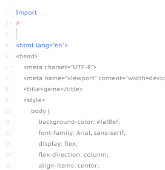

# COROSR 编程示例COROSR 编程示例COROSR 编程示例

> 会话ID: 10371419620731138 | 抓取时间: 2026-08-25T09:36:44.097Z | 消息数: 8 (用户4/助手4) | 图片数: 1
> 源URL: https://www.doubao.com/chat/10371419620731138

---

## **👤 用户**

COROSR

---

## **🤖 助手**

你想问的可能是 “COROS”，它是广东高驰运动科技股份有限公司旗下的户外运动手表品牌，以下是关于它的详细介绍： 品牌发展 8 2014 年，创始人牛浩田带领团队创立了智能手环品牌 WeLoop，后将重心转向专业户外运动手表领域，并正式创立了 COROS 品牌。 2021 年，COROS 的年营收就已经达到 2.6 亿，海外市场占比超过 60%。 2025 年 1 月，COROS 独立站的月访问量约达 115 万，其中直接流量 + 自然流量占比接近 90%。在亚马逊 “Running GPS Units” 类目排行榜 Top 10 中，COROS 占据了五个席位，与 Garmin 平分秋色。 产品特点 续航能力强 ：如 APEX 2 Pro 在 GPS 模式下续航最高达 66 小时，远超市场主流 20-30 小时水平；PACE 3 重量仅 30 克，标准模式下电池寿命长达 30 天，GPS 模式则长达 25 小时 7 。 适应极端环境 ：能在 - 20℃至 50℃的环境中稳定运行，满足高原、雪地、沙漠等各种极端场景的使用需求。 定位精准 ：GPS、GLONASS 和 BDS 卫星系统协同工作，即使在户外干扰较强的情况下也能精确定位用户位置，确保运动轨迹记录等数据的准确性 7 。 运动功能丰富 4 多种运动模式 ：涵盖跑步、游泳、骑自行车、登山、越野、攀岩、铁人三项等众多运动项目，每种运动模式都能精准记录相应的运动数据，如跑步的配速、距离、心率、步频、步幅等，游泳的划水次数、SWOLF 值等。 运动分析科学 ：基于 EvoLab 提供详尽的运动数据分析与体能信息，用户可以通过 COROS APP 查看运动轨迹、速度、配速等关键数据，还能获得科学的训练建议，帮助优化运动量、负荷目标等。 训练计划功能 ：支持训练计划的同步、制定、编辑与分享，用户可根据自己的运动目标和能力水平，量身定制相应的训练计划，也可以参考 APP 上提供的专业训练计划模板。 健康监测功能全面 ：具备睡眠监测、心率监测、血氧监测等功能，能够全面记录和分析用户的健康数据，帮助用户了解自己的身体状况，如睡眠质量、心率变化趋势、血氧饱和度等 3 4 。 产品系列 VERTIX 系列 ：属于专业越野户外款，续航能力强，适合长距离越野跑、登山、探险等户外运动，能够在复杂的户外环境中提供精准的导航和数据记录 6 。...

---

## **👤 用户**

编程

---

## **🤖 助手**

COROSR编程相关代码 V1 创建时间：2025-06-29 20:14 以上代码模拟了一个与 COROSR 设备通信的 Python 类。这个类提供了连接设备、断开连接、发送命令等功能。实际应用中，你需要根据 COROSR 的确切规范来实现具体的通信协议和命令处理逻辑。

---

## **👤 用户**

COMPOSERS

---

## **🤖 助手**

已完成思考 用户现在问的是 “COMPOSERS”，也就是作曲家。首先，我需要确定用户的具体需求是什么。可能他们想了解著名的作曲家，或者作曲家的分类，或者不同时期的作曲家代表。根据之前的对话历史，用户之前问过 COROSR，然后是编程相关的问题，现在转向作曲家，可能需要一个全面的介绍。 首先，按照知识类问题的要求，要全面深入，提供背景信息和细节解释。可能需要按音乐时期来划分作曲家，比如巴洛克、古典、浪漫、现代等时期，每个时期列举代表人物，并说明他们的风格和主要作品。这样结构清晰，用户容易理解。 还要考虑是否需要延伸内容，比如作曲家的影响，或者一些有趣的事实，帮助用户扩展知识。格式上需要用 markdown，加粗标题，使用列表，可能的话用表格对比不同时期。需要确保信息准确，比如作曲家的生卒年、代表作品，避免错误。 另外，用户可能对不同时期的作曲家有不同的兴趣，所以先提供一个概览，再分时期详细说明。每个时期的作曲家按重要性排序，列出他们的主要贡献和代表作。同时，可以提到一些现代作曲家，或者不同国家的作曲家，增加内容的丰富性。 还要注意用户可能的潜在需求，比如是否需要学习作曲的建议，或者推荐聆听的作品，但当前问题比较宽泛，所以先集中在介绍主要作曲家和他们的成就上。最后，检查格式是否符合要求，使用有序列表和无序列表，适当加粗标题，确保可读性。 作曲家（COMPOSERS）概述 作曲家是创作音乐作品的艺术家，其作品涵盖古典音乐、流行音乐、影视配乐等多种类型。以下从音乐历史时期切入，介绍不同流派的代表性作曲家及其成就： 一、巴洛克时期（1600-1750） 以复调音乐为主要特征，旋律华丽，节奏规整，代表作曲家： 约翰・塞巴斯蒂安・巴赫（Johann Sebastian Bach，1685-1750） 国籍 ：德国 风格 ：复调音乐大师，作品结构严谨，宗教音乐与世俗音乐融合。 代表作 ：《马太受难曲》《平均律钢琴曲集》《勃兰登堡协奏曲》。 安东尼奥・维瓦尔第（Antonio Vivaldi，1678-1741） 国籍 ：意大利 风格 ：协奏曲形式的奠基人，旋律充满活力，擅长描绘自然景象。 代表作 ：小提琴协奏曲《四季》《和谐的灵感》。 乔治・弗里德里希・亨德尔（George Frideric Handel，1685-1759） 国籍 ：德国（后入英国籍） 风格 ：擅长清唱剧，旋律宏大庄严，兼具戏剧性与宗教性。 代表作 ：清唱剧《弥赛亚》、管弦乐《水上音乐》。 二、古典主义时期（1750-1820） 注重旋律的简洁流畅，结构工整，代表作曲家： 沃尔夫冈・阿玛多伊斯・莫扎特（Wolfgang Amadeus Mozart，1756-1791） 国籍 ：奥地利 风格 ：音乐天才，作品涵盖交响曲、歌剧、室内乐，兼具优雅与戏剧性。 代表作 ：歌剧《费加罗的婚礼》《魔笛》，《第 40 号交响曲》。 路德维希・范・贝多芬（Ludwig van Beethoven，1770-1827） 国籍 ：德国 风格 ：古典主义向浪漫主义过渡的桥梁，作品充满英雄主义与抗争精神。 代表作 ：《第五交响曲（命运）》《第九交响曲（合唱）》《月光奏鸣曲》。 弗朗茨・约瑟夫・海顿（Franz Joseph Haydn，1732-1809） 国籍 ：奥地利 风格 ：“交响曲之父”，奠定古典交响曲四乐章结构，旋律幽默明快。 代表作 ：《创世纪》《四季》，《惊愕交响曲》。 三、浪漫主义时期（1820-1910） 强调个人情感表达，旋律富有诗意，配器丰富，代表作曲家： 弗里德里希・弗朗茨・肖邦（Frédéric François Chopin，1810-1849） 国籍 ：波兰 风格 ：“钢琴诗人”，专注于钢琴音乐，作品充满波兰民族风格与抒情性。 代表作 ：《夜曲》《革命练习曲》《波兰舞曲》。 路德维希・范・瓦格纳（Richard Wagner，1813-1883） 国籍 ：德国 风格 ：歌剧改革家，提出 “整体艺术作品” 概念，音乐与戏剧深度结合。 代表作 ：歌剧《尼伯龙根的指环》《特里斯坦与伊索尔德》。 彼得・伊里奇・柴可夫斯基（Pyotr Ilyich Tchaikovsky，1840-1893） 国籍 ：俄罗斯 风格 ：旋律优美感伤，融合俄罗斯民族音乐与西方古典传统。 代表作 ：芭蕾舞剧《天鹅湖》《胡桃夹子》，《悲怆交响曲》。 弗朗茨・李斯特（Franz Liszt，1811-1886） 国籍 ：匈牙利 风格 ：钢琴演奏大师，首创 “交响诗” 体裁，音乐充满炫技性与戏剧性。 代表作 ：《匈牙利狂想曲》《前奏曲》《但丁交响曲》。 四、民族主义时期（19 世纪中后期） 作曲家融入本民族音乐元素（民歌、传说等），代表人物： 安东宁・德沃夏克（Antonín Dvořák，1841-1904） 国籍 ：捷克 风格 ：吸收捷克民间音乐节奏与旋律，作品充满乡土气息。 代表作 ：《第九交响曲（自新大陆）》《斯拉夫舞曲》。 莫杰斯特・穆索尔斯基（Modest Mussorgsky，1839-1881） 国籍 ：俄罗斯 风格 ：“强力集团” 成员，音乐描绘俄罗斯历史与现实，风格粗犷独特。 代表作 ：钢琴套曲《图画展览会》，歌剧《鲍里斯・戈杜诺夫》。 五、20 世纪现代主义时期（1910 至今） 打破传统调性，探索新技法（无调性、十二音体系、电子音乐等），代表作曲家： 伊戈尔・斯特拉文斯基（Igor Stravinsky，1882-1971） 国籍 ：俄罗斯（后入法国、美国籍） 风格 ：节奏创新大师，作品风格从原始主义到新古典主义多变。 代表作 ：芭蕾舞剧《春之祭》《火鸟》，《士兵的故事》。 阿诺尔德・勋伯格（Arnold Schoenberg，1874-1951） 国籍 ：奥地利（后入美国籍） 风格 ：十二音体系创始人，开创无调性音乐，影响现代音乐发展。 代表作 ：《升华之夜》《一个华沙幸存者》。 约翰・凯奇（John Cage，1912-1992） 国籍 ：美国 风格 ：先锋派代表，倡导 “偶然音乐”，代表作《4 分 33 秒》以沉默挑战传统音乐定义。 六、其他领域代表性作曲家 影视配乐作曲家 ： 约翰・威廉姆斯（John Williams）：《星球大战》《哈利・波特》《侏罗纪公园》配乐。 坂本龙一（Ryuichi Sakamoto）：《末代皇帝》《荒野猎人》配乐，融合古典与电子元素。 流行音乐作曲家 ： 保罗・麦卡特尼（Paul McCartney）：披头士乐队核心成员，创作《Yesterday》等经典歌曲。 昆西・琼斯（Quincy Jones）：参与迈克尔・杰克逊《Thriller》等专辑制作。 作曲家的重要贡献 推动音乐体裁发展 ：如巴赫完善赋格，海顿奠定交响曲结构，斯特拉文斯基革新节奏。 反映时代精神 ：贝多芬的英雄主义、柴可夫斯基的浪漫悲情、现代作曲家的先锋实验，均为特定历史语境的艺术表达。 跨领域影响 ：影视、游戏、广告等领域的音乐创作，多以古典作曲技法为基础，如《权力的游戏》配乐即融合交响乐与民族乐器。 如需深入了解某一作曲家或流派，可进一步说明具体需求！

---

## **👤 用户**

怎么在CURSOR 里编程

---

## **🤖 助手**

Python 解释器是执行 Python 代码的程序，将人类可读的源代码转换为计算机可执行的指令。以下是关于 Python 解释器的详细介绍： 一、Python 解释器的工作原理 编译 vs 解释 编译型语言 （如 C、Java）：代码先被编译器翻译成机器码，再执行。 解释型语言 （如 Python）：代码逐行被解释器翻译成字节码（ .pyc 文件），再由虚拟机（VM）执行。 Python 解释流程 plaintext Python 代码 (.py) → 编译为字节码 (.pyc) → Python 虚拟机 (VM) 执行字节码 二、常见的 Python 解释器 1. CPython 特点 ：官方标准解释器，用 C 语言实现，最广泛使用。 功能 ：支持完整的 Python 标准库和第三方包。 执行方式 ：代码先编译为字节码，再由 C 实现的虚拟机执行。 下载 ： Python 官网 。 2. IPython 特点 ：交互式解释器，提供更友好的命令行界面和强大的自省功能。 扩展 ：Jupyter Notebook 基于 IPython 内核。 安装 ： pip install ipython 。 3. PyPy 特点 ：使用即时编译（JIT）技术，性能通常比 CPython 快（尤其循环密集型代码）。 适用场景 ：需要高性能的 Python 应用（如数据处理、科学计算）。 兼容性 ：大部分 Python 代码兼容，但部分 C 扩展模块可能不支持。 4. Jython 特点 ：运行在 Java 虚拟机（JVM）上的 Python 解释器，可无缝调用 Java 类库。 适用场景 ：Python 与 Java 混合开发的项目。 5. IronPython 特点 ：运行在 .NET 平台上的 Python 解释器，支持与 C# 等 .NET 语言交互。 三、如何选择解释器？ 日常开发 ：使用 CPython （兼容性最佳）。 交互式编程 ：结合 IPython 或 Jupyter Notebook 。 高性能需求 ：尝试 PyPy 。 跨语言集成 ：根据目标平台选择 Jython 或 IronPython 。 四、Python 解释器的使用 1. 命令行交互模式 打开终端，输入 python 或 python3 启动交互式解释器： bash $ python3 Python 3.9 .6 ( default, Jun 29 2021 , 05:25:02 ) [ Clang 12.0 .0 ( clang-1200.0.32.29 ) ] on darwin Type "help" , "copyright" , "credits" or "license" for more information. >> > print ( "Hello, World!" ) Hello, World ! 2. 执行 Python 文件 创建 hello.py 文件，内容： python 运行 print ( "Hello, Python!" ) 在终端执行： bash $ python3 hello.py Hello, Python ! 3. 指定解释器路径 若系统安装了多个 Python 版本，可通过路径指定解释器： bash $ /usr/local/bin/python3.9 hello.py # 使用特定版本 五、解释器相关工具 1. 虚拟环境（Virtual Environments） 隔离项目依赖，避免版本冲突： bash # 创建虚拟环境 $ python3 -m venv myenv # 激活环境（Windows） $ myenv \ Scripts \ activate # 激活环境（Linux/macOS） $ source myenv/bin/activate # 安装依赖 ( myenv ) $ pip install requests # 退出环境 ( myenv ) $ deactivate 2. 版本管理工具 pyenv ：管理多个 Python 版本（推荐）。 bash $ pyenv install 3.10 .4 # 安装指定版本 $ pyenv global 3.10 .4 # 设置全局版本 Anaconda ：集成环境，适合数据科学，自动管理包和环境。 六、常见问题与解决方案 版本冲突 ：使用虚拟环境或版本管理工具。 性能问题 ：尝试 PyPy 或优化代码（如使用 NumPy 替代纯 Python 循环）。 模块导入错误 ：检查解释器路径和包是否正确安装。 七、进一步学习资源 官方文档 ： Python 解释器官方文档 教程推荐 ： Real Python - Python 解释器详解 如果需要更具体的帮助（如调试解释器问题、配置虚拟环境），请告诉我！

---
