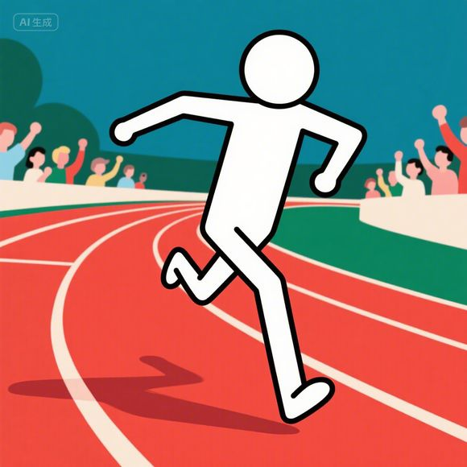
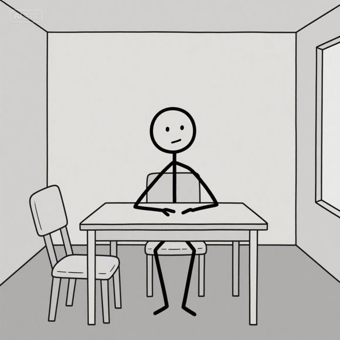

# 火柴人图片生成火柴人图片生成火柴人图片生成

> 会话ID: 10327887183762946 | 抓取时间: 2026-08-25T09:38:22.754Z | 消息数: 8 (用户4/助手4) | 图片数: 4
> 源URL: https://www.doubao.com/chat/10327887183762946

---

## **👤 用户**

火柴人

---

## **🤖 助手**

接下来我将生成四张火柴人形象的图片。画面风格是简洁抽象的火柴人风格。主体是火柴人，正面对视角，场景分别为站在草地上、奔跑在赛道上、跳跃在篮球场上、坐在椅子上。

---

## **👤 用户**

火柴人矢量心里提问

---

## **🤖 助手**

已完成思考 用户现在的问题是 “火柴人矢量心里提问”，看起来可能有些拼写错误，可能是 “火柴人矢量心理提问” 或者 “火柴人矢量心里问题”。首先需要明确用户的需求到底是什么。可能用户想了解火柴人矢量图在心理学中的应用，或者是用火柴人矢量图来进行心理提问的方式？ 首先，“火柴人矢量” 指的是用矢量图形绘制的火柴人，这种图形具有简洁、可缩放的特点，常用于插画、动画等。而 “心理提问” 可能涉及到心理学中的投射测试、视觉刺激问答等。需要考虑用户是否想将火柴人矢量图作为心理测试或咨询中的工具，或者是需要相关的设计素材用于心理领域。 接下来，用户之前的历史对话中，已经生成过四张火柴人图片，场景分别是草地、跑道、篮球场和房间。现在用户的新问题可能是在之前的基础上，想进一步结合心理学进行提问或应用。需要明确用户是需要理论解释，还是需要具体的提问设计，或者是更多的图片生成。 考虑到用户可能希望了解如何用火柴人矢量图进行心理分析或提问，需要先解释矢量图的特点，再联系心理学中的视觉刺激工具，比如主题统觉测验（TAT），通过图片让被试者讲述故事，从而分析心理状态。火柴人的简洁性可能让被试者更容易投射自己的情感，因为细节少，解释空间大。 另外，用户可能需要具体的提问范例，比如针对不同场景的火柴人图片，设计哪些心理问题。例如，看到奔跑的火柴人，问被试者感受到什么情绪，或者想象火柴人为什么奔跑，从而反映其内心动机。 还要考虑用户是否需要设计心理问卷或咨询中的工具，这时候需要提供结构化的提问方法，结合不同场景的火柴人，设计对应的问题类型，如情绪识别、情境投射、动机分析等。同时，可能需要提醒用户，心理提问需要专业背景，矢量图只是工具，具体分析需要心理学知识。 另外，用户可能误写了 “心里” 为 “心理”，所以需要确认，但按照常见情况处理为心理学相关。如果有必要，可以先澄清用户需求，但根据历史对话，用户可能希望直接得到相关的信息或应用方法。 总结下来，回答需要包括：火柴人矢量图的特点，在心理学中的应用场景，具体的提问设计范例，可能的心理分析角度，以及注意事项。需要结构清晰，分点说明，结合之前生成的场景举例，帮助用户理解如何将火柴人矢量图用于心理提问。 火柴人矢量图在心理提问中的应用与设计 一、火柴人矢量图的心理投射优势 火柴人以极简的线条（圆形头部、直线四肢）和抽象场景为特征，这种「低细节」设计在心理提问中具有独特价值： 减少视觉干扰 ：无具体面部表情、服饰细节，避免被试者受具象元素引导，更易投射真实心理状态。 场景开放性 ：如草地、跑道等场景可被赋予多重解读，类似心理学中的「投射测试」（如主题统觉测验 TAT），通过被试者对画面的解释挖掘潜意识动机。 二、基于火柴人矢量图的心理提问框架 结合不同场景的火柴人矢量图，可设计以下类型的心理提问： （一） 情绪与状态识别类提问 以「站在草地上的火柴人」为例： “你觉得图中的火柴人现在是什么心情？为什么？” “如果用一种颜色形容火柴人的感受，你会选什么？” 心理逻辑：通过对静态场景的情绪归因，反映被试者当前的情绪投射（如选择「蓝色」可能关联平静或忧郁）。 （二） 情境投射类提问 以「奔跑在赛道上的火柴人」为例： “火柴人为什么在奔跑？终点有什么在等他？” “如果这是你在奔跑，你会想象自己在逃避什么或追逐什么？” 心理逻辑：通过场景补全，揭示被试者的目标驱动力、压力源或潜意识冲突（如回答 “追逐时间” 可能反映焦虑感）。 （三） 行为动机类提问 以「跳跃在篮球场上的火柴人」为例： “火柴人投篮的动作是自信的还是紧张的？你从哪里看出来？” “如果火柴人没投中，你觉得他会怎么做？” 心理逻辑：通过对行为细节的解读，分析被试者对「成功与失败」的认知模式（如回答 “放弃” 可能反映低自我效能感）。 （四） 环境关系类提问 以「坐在椅子上的火柴人」为例： “房间里只有火柴人一个人，他是享受独处还是感到孤独？” “如果让你给房间添加一样东西，你会加什么？为什么？” 心理逻辑：通过对环境互动的想象，反映被试者的社交需求、安全感或内心缺失（如添加 “宠物” 可能暗示对陪伴的渴望）。 三、心理提问设计的进阶技巧 对比提问法 ： 展示两张不同场景的火柴人图（如 “奔跑” 与 “静坐”），询问：“哪张图更像你最近的状态？为什么？”—— 用于快速定位情绪波动或压力源。 动态补全法 ： 提供单一场景图，让被试者用语言或绘画补充 “下一个画面”，如 “火柴人跳起来之后发生了什么？”—— 挖掘对未来的预期或恐惧。 角色替换法 ： 询问：“如果你是图中的火柴人，你会做出什么不同的动作？”—— 通过行为替代，暴露被试者对当前自我的满意度或改变意愿。 四、注意事项 非专业限制 ：火柴人提问仅为辅助工具，正式心理评估需结合专业量表（如 SCL-90、MMPI）。 文化差异 ：场景设计需避免文化敏感元素（如篮球场在部分地区可能缺乏共鸣），优先选择普适性场景（如自然、家庭）。 解读弹性 ：同一回答可能有多重含义，需结合被试者的语言风格、肢体语言综合分析（如紧张时的语速变化）。 如需针对特定心理主题（如焦虑、社交关系）设计火柴人提问场景，可进一步说明需求，我可提供定制化的提问范例与分析逻辑。

---

## **👤 用户**

给我一些用火柴人进行心理提问的具体例子

---

## **🤖 助手**

以下是一些用火柴人进行心理提问的具体例子： 情绪感知类 ： 画面中是一个站在森林里的火柴人，周围树木茂密，阳光透过树叶缝隙洒下。提问：“你觉得这个火柴人现在心情如何？是平静、好奇还是有些害怕呢？为什么你会有这样的感觉？” 展示一个在雨中行走的火柴人，雨滴较大，火柴人没有打伞。询问：“看到这个火柴人，你认为它此刻的情绪是悲伤、洒脱还是其他的呢？是什么让你有这样的判断？” 压力与应对类 ： 呈现一个火柴人被许多大大小小的石头包围，石头堆得很高，几乎要把火柴人淹没。提问：“这些石头就像生活中的压力，你觉得火柴人会如何应对这些压力呢？是努力搬走石头，还是会被压垮？如果是你，你会怎么做？” 画出一个火柴人站在悬崖边，前方是深不见底的悬崖，背后有一群凶猛的动物逼近。询问：“火柴人面临着两难的处境，你认为它会选择跳下悬崖，还是转身与动物搏斗，或者有其他办法？这反映出你在面对绝境时的什么心态呢？” 人际关系类 ： 展示两个火柴人，一个站在房子里，一个站在房子外，房子的门是关着的。提问：“你觉得房子里和房子外的火柴人是什么关系呢？为什么房子里的火柴人没有让外面的火柴人进去？如果是你，你会选择进去还是留在外面？” 画出三个火柴人，其中两个靠得很近，有说有笑，另一个火柴人站在不远处，看着他们。询问：“你认为这三个火柴人之间发生了什么？站在远处的火柴人心里在想什么呢？如果你是那个火柴人，你会怎么做？” 自我认知类 ： 呈现一个火柴人对着镜子，镜子里却有两个不同形象的自己，一个笑容满面，一个愁眉苦脸。提问：“你觉得镜子里的两个形象代表了火柴人的什么呢？为什么会有这样的差异？这让你想到自己身上的哪些方面呢？” 画出一个火柴人站在一片空白的土地上，手中拿着一支画笔。询问：“火柴人可以用画笔在这片土地上创造任何东西，你觉得它会画什么呢？这反映出你内心渴望拥有或创造的什么东西呢？” 目标与动力类 ： 展示一个火柴人在攀登一座高耸的山峰，山峰上有一面旗帜。提问：“火柴人努力攀登山峰，你觉得它是为了那面旗帜，还是有其他原因呢？如果是你，你会为了什么而努力攀登这座山峰？” 画出一个火柴人站在一个十字路口，前方有三条不同的道路，分别通向光芒四射的地方、黑暗神秘的森林和宁静祥和的村庄。询问：“火柴人要选择一条道路前行，你认为它会选择哪条路呢？为什么？这反映出你在面对选择时，更看重什么呢？”

---

## **👤 用户**

再增加一些用火柴人进行心理提问的例子

---

## **🤖 助手**

为你提供更多借助火柴人进行心理提问的示例： 社交模式与人际边界类 ： 画面呈现多个火柴人在一个派对场景中，有一个火柴人站在角落，其他火柴人在中间嬉笑玩耍、互相交流。提问：“角落里的火柴人为什么站在那里？你觉得它是不想参与，还是在等待合适时机加入？如果你是它，你会怎么选择，这反映了你在社交场合中的什么习惯呢？” 画出两个火柴人面对面，中间有一条若隐若现的线隔开。询问：“这条线代表什么？你认为这两个火柴人是因为这条线而保持距离，还是这条线是他们之间自然形成的界限？这让你联想到自己在人际关系中的边界感是怎样的？” 挫折应对与复原力类 ： 展示一个火柴人被一块大石头绊倒，摔倒在地，旁边有一些小物件散落。提问：“火柴人被绊倒了，你觉得它接下来会马上站起来，还是会先看看散落的东西，或者有其他反应？这体现了你面对挫折时的第一反应是什么，以及你会如何重新整理自己？” 呈现一个火柴人处在一个迷宫里，四周都是高高的围墙，它站在一个岔路口前。询问：“火柴人在迷宫中迷路了，面对岔路口，它可能会随意选择一条路，也可能会仔细思考后再做决定，或者尝试其他办法。你觉得它会怎么做，这反映出你在面对困境时的决策方式和克服困难的能力如何？” 梦想与未来规划类 ： 画面中一个火柴人站在一片空地上，面前有一个巨大的、未完成的建筑蓝图。提问：“火柴人看着这个蓝图，你觉得它脑海里在想象完成后的样子吗？它会如何着手去实现这个蓝图？这和你对自己未来梦想的规划有哪些相似之处，你打算怎样迈出第一步？” 画出一个火柴人背着行囊，走在一条通往远方高山的小路上，山顶有光芒闪耀。询问：“火柴人朝着山顶前行，你认为山顶的光芒代表着什么？它在旅途中可能会遇到各种困难，它为什么还是坚持要去那里？这对你追寻自己的目标有什么启示，你愿意为实现目标付出怎样的努力？” 情绪管理与压力释放类 ： 展示一个火柴人周围有许多黑色的小圆圈围绕，它的线条有些颤抖。提问：“这些黑色小圆圈好像给火柴人带来了压力，你觉得它会如何应对这些压力，是努力驱散它们，还是会被它们影响情绪？这反映出你在面对压力时，是倾向于主动解决还是容易被压力左右情绪？” 呈现一个火柴人站在一个类似发泄室的房间里，房间里有一些可以被破坏的物品。询问：“火柴人来到这个发泄室，你觉得它会通过破坏物品来释放情绪，还是会选择其他方式？如果是你，你会怎么做，这体现了你平时是如何管理和释放自己负面情绪的？” 自我探索与身份认同类 ： 画面中有一个火柴人对着一面破碎的镜子，每一块镜子碎片里都映出不同姿态的它。提问：“看着破碎镜子里不同的自己，火柴人会有怎样的感受？这些不同的形象代表了它的多面性，你从这个画面中能联想到自己身上存在的不同角色和特质吗，你是如何看待自己的复杂性的？” 画出一个火柴人穿着一件写有 “？” 的衣服，站在人群中，其他人的衣服上都有明确的标识（如职业、爱好等）。询问：“这个火柴人衣服上的问号代表什么？它在人群中，你觉得它是在寻找自己的标识，还是不在意这些？这反映了你对自己身份认同的探索程度，你是否清楚自己在社会和生活中的独特定位？”

---
