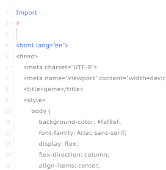

# 创建五子棋游戏创建五子棋游戏创建五子棋游戏

> 会话ID: 9925549886251778 | 抓取时间: 2026-08-25T09:39:38.051Z | 消息数: 2 (用户1/助手1) | 图片数: 1
> 源URL: https://www.doubao.com/chat/9925549886251778

---

## **👤 用户**

生成一个五子棋的小游戏

---

## **🤖 助手**

五子棋游戏 V1 创建时间：2025-06-25 02:06 这个五子棋游戏具有以下特点： 现代美观的 UI 设计 ：采用木纹棋盘风格，棋子有阴影和渐变效果，界面层次分明。 完整的游戏功能 ： 黑白双方轮流落子 自动判断胜负和平局 实时显示游戏状态和时间 支持悔棋功能 流畅的动画效果 ： 落子时有平滑过渡 胜利模态框有淡入效果 鼠标悬停时有棋子预览 响应式设计 ：适配不同屏幕尺寸，在手机和桌面设备上都能良好显示。 游戏规则说明 ：包含简单的规则介绍，方便新手理解。 你可以点击棋盘落子开始游戏，黑棋先行。当一方在横、竖或斜方向形成五子连线时，游戏结束并显示胜利者。

---
