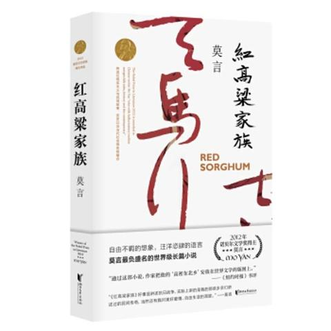
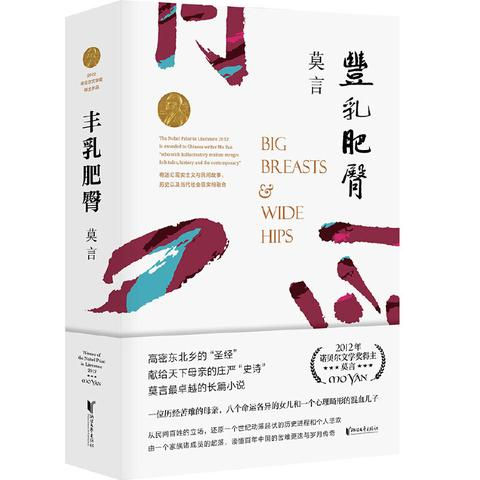
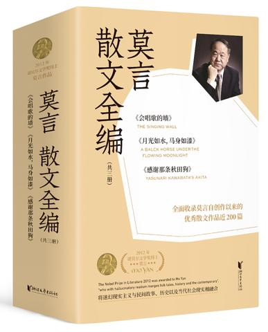

# 莫言作品介绍莫言作品介绍莫言作品介绍

> 会话ID: 9917754584588802 | 抓取时间: 2026-08-25T09:39:50.073Z | 消息数: 2 (用户1/助手1) | 图片数: 4
> 源URL: https://www.doubao.com/chat/9917754584588802

---

## **👤 用户**

莫言写的书

---

## **🤖 助手**

莫言著作颇丰，涵盖了长篇小说、中篇小说、短篇小说集以及散文集等多种体裁，以下是一些代表作品： 长篇小说 《红高粱家族》 ：由《红高粱》《高粱酒》《高粱殡》《狗道》《奇死》五部组成。小说以抗日战争时期的高密为背景，通过 “我” 的奶奶戴凤莲和爷爷余占鳌的故事，展现了高密人民在战争中的顽强生命力和不屈精神，同时也描绘了人性的复杂与多面，以及战争对人性的扭曲和摧残。 书籍 莫言《红高粱家族》 《丰乳肥臀》 ：讲述了上官鲁氏曲折的一生，她经历了多个历史时期，在战乱、贫困和苦难中挣扎求生，同时展现了女性在男权社会中的无奈与坚韧，以及母性的伟大与无私。该小说通过一个家族的兴衰，反映了中国近现代历史的沧桑巨变，对历史、文化、人性等问题进行了深刻的反思。 书籍 莫言《丰乳肥臀》 《生死疲劳》 ：以土地改革时期为背景，讲述了地主西门闹在死后经历了六道轮回，依次转生为驴、牛、猪、狗、猴和人的故事。小说通过西门闹的轮回经历，展现了中国农村 50 多年的历史变迁，反映了农民与土地之间的深厚情感以及土地改革对农民生活的巨大影响，同时也探讨了生死、轮回、因果等哲学问题。 《蛙》 ：以新中国计划生育政策为背景，讲述了乡村女医生万心的一生。万心在执行计划生育政策的过程中，经历了种种矛盾和冲突，她的命运与时代的变迁紧密相连。小说通过万心的故事，反映了计划生育政策给中国农村带来的巨大变化，以及在这个过程中所引发的人性、伦理、道德等问题，对生命、生育、人性等主题进行了深入的思考。 中篇小说 《透明的红萝卜》 ：故事发生在 20 世纪 60 年代的农村，讲述了一个沉默寡言、孤独无助的小男孩黑孩的故事。黑孩在艰苦的生活环境中，依然保持着对世界的好奇和对美的追求，他能看到别人看不到的透明红萝卜，展现了他内心深处的纯真与美好。小说通过黑孩的视角，描绘了农村生活的艰辛与无奈，同时也表达了对人性、自然和美好生活的向往。 《师傅越来越幽默》 ：主人公丁师傅是一名即将退休的工人，面临着工厂倒闭、生活困境等问题。他在一系列的遭遇中，逐渐从一个老实本分的工人变成了一个善于利用幽默和狡黠来应对生活的人。小说通过丁师傅的故事，反映了社会变革时期工人阶级的困境和无奈，以及人性在困境中的转变和挣扎。 短篇小说集 《白狗秋千架》 ：收录了《白狗秋千架》《秋水》《球状闪电》等多篇短篇小说。这些小说以不同的视角和题材，展现了莫言丰富的想象力和独特的叙事风格，涉及到爱情、友情、亲情、历史、文化等多个方面，反映了农村社会的变迁和人性的复杂。 《晚熟的人》 ：收录了莫言近十年创作的 12 篇短篇小说，如《天下太平》《等待摩西》等。小说以莫言的故乡高密为背景，讲述了在时代变革中，故乡的人和事的变化，展现了人性的善良与丑恶、命运的无常与无奈，同时也表达了作者对故乡的深深眷恋和对人生的深刻思考。 书籍 莫言《晚熟的人》 散文集 《莫言散文》 ：收录了莫言的多篇散文作品，如《我的老师》《我的中学时代》《过去的年》等 4 。这些散文以平实的语言、真挚的情感，讲述了莫言的成长经历、故乡往事、读书感悟等，展现了他丰富多彩的人生阅历和独特的内心世界，让读者更加深入地了解莫言的文学创作之路和他对生活、对文学的热爱。 书籍 莫言《莫言散文》

---
