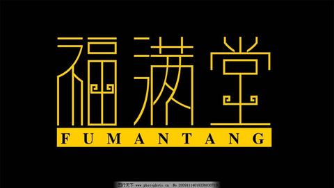
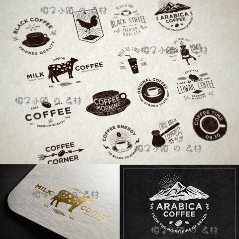
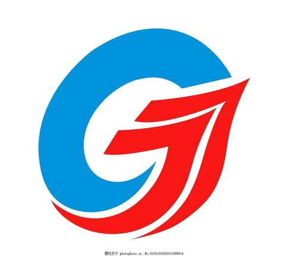
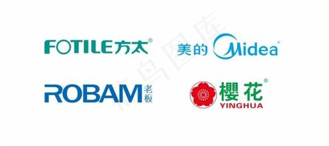

# LOGO 复刻与 CDRLOGO 复刻与 CDRLOGO 复刻与 CDR

> 会话ID: 9504348926248962 | 抓取时间: 2026-08-25T09:42:19.251Z | 消息数: 7 (用户2/助手5) | 图片数: 8
> 源URL: https://www.doubao.com/chat/9504348926248962

---

## **👤 用户**

LOGO复刻 CDR

---

## **🤖 助手**

这些是我帮你搜索到的图片。

---

## **🤖 助手**

+39

---

## **👤 用户**

复刻 CDR

---

## **🤖 助手**

这些是我帮你搜索到的图片。

---

## **🤖 助手**

+12

---

## **🤖 助手**

以下是一些关于 CDR 的教程和学习资源推荐： 视频教程 CorelDRAW 中文网站教程 1 ：有针对零基础用户的简易速成视频教程，专家全程语音详细讲解，包括图文排版、绘图工具、填充与轮廓、位图处理等基础内容，还有针对有一定基础用户的实例篇教程，结合 20 个实例传授 CDR 绘图技巧。 我要自学网 CorelDRAW2024 视频教程 5 ：全面讲解 CorelDRAW 2024 的工具和命令，课程涵盖文档编辑、文字工具、图形绘制、颜色填充等内容，教学案例多达两百多个，如名片、LOGO、字体等设计，适合零基础学员，强调实用性和操作性，帮助学员快速掌握平面设计技能。 B 站 CorelDRAW 教程视频 ：这是一个播放量较高的教程视频，内容系统全面，从软件界面介绍、基本工具使用到复杂的图形设计、特效制作等都有讲解，且讲解细致，适合初学者入门和进阶学习。 图文教程 CorelDRAW 新手入门教程 3 ：在 CorelDRAW 中文网站上，有一系列新手入门教程，详细介绍了 CorelDRAW 软件中各个工具的使用方法，如虚拟段删除工具、橡皮擦工具、裁剪工具等，以及如何进行图形绘制、文字排版、颜色填充等基础操作。 CDR 自学网 6 ：提供 CDR 图文教程，有 cdr100 例系列教程，包括制作立体渐隐轮廓字、设计海报主题文字立体字效果、绘制躺平立体文字效果、中国风祥云图案等各种案例，从基础到进阶，帮助学习者逐步掌握 CDR 的操作技巧。 官方资源 2 Corel 知识库 ：由 Corel 技术支持服务小组撰写的文章，回答了用户提出的问题，可帮助解决使用 CorelDRAW 过程中遇到的各种技术难题。 Community.CorelDRAW.com ：在线环境，可共享产品体验、提出问题、提供反馈并分享想法，还能接受其他用户的帮助和建议，与其他 CorelDRAW 爱好者交流学习心得和经验。 Corel 网站上的教程 ：有深入介绍的教程，CorelDRAW Graphics Suite 专家在这些教程中分享知识和技术，可从官方角度学习到软件的高级功能和应用技巧。

---
