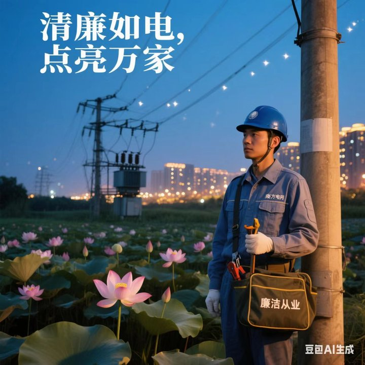
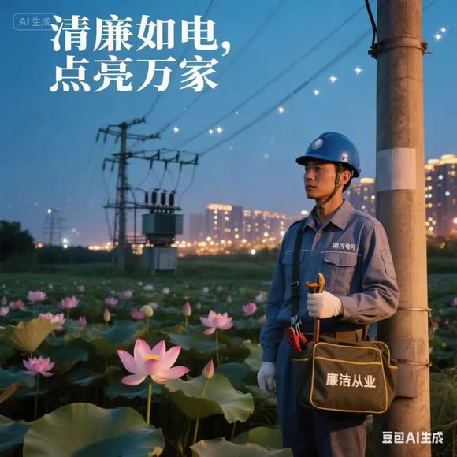

# 检查链接有效性检查链接有效性检查链接有效性

> 会话ID: 9495242230690050 | 抓取时间: 2026-08-25T09:42:31.987Z | 消息数: 9 (用户4/助手5) | 图片数: 2
> 源URL: https://www.doubao.com/chat/9495242230690050

---

## **👤 用户**

httpsplayground.bfl.aiimage

---

## **🤖 助手**

你提供的链接 “httpsplayground.bfl.aiimage” 格式不完整，缺少协议头 “http://” 或 “https://”，正确的链接应该类似 “ https://playground.bfl.ai/image File ” 这样的形式。由于链接格式有误，无法直接访问该页面并获取内容。 如果你想了解与 “playground.bfl.ai” 相关的图像内容或功能，建议你先检查链接的正确性，确保其格式完整（例如以 “http://” 或 “https://” 开头，且链接中的字符没有拼写错误），然后重新提供给我。这样我才能尝试访问该链接并为你介绍相关内容，比如这个平台可能具备的图像生成、编辑、处理等功能，或者它的使用场景、特点等信息。如果你有其他具体需求，也可以直接描述，我会尽力为你解答。

---

## **👤 用户**

电力工人 安全帽logo微光闪烁要0.5秒间隔， 要突出人物专注神情 工具包模拟点击反馈：鼠标悬停时弹出"廉洁标语"弹窗，循环播放时自动触发 荷花池 AE粒子效果模拟花瓣飘落要慢速慢速 文字加特效： "清廉如电"电流脉冲光效；"点亮万家"逐字发光字体用锐字洪荒体增强力度 背景城市灯光渐亮0→100%亮度1.5秒左右

---

## **🤖 助手**

以下是按照你的要求对图片各元素进行特效处理的步骤： 一、安全帽 logo 微光闪烁 选择电力工人安全帽上的 logo。 设置关键帧动画，每隔 0.5 秒让 logo 的亮度从 0 变到 100 再回到 0，形成闪烁效果。 二、突出人物专注神情 使用调色工具稍微提高人物面部的对比度和锐度。 可以对人物的眼睛部分进行轻微的提亮处理，以突出专注神情。 三、工具包模拟点击反馈 使用软件中的交互功能（如 Adobe Animate 等），为工具包添加鼠标悬停事件。 当鼠标悬停在工具包上时，弹出包含 “廉洁标语” 的弹窗。 如果是循环播放，可以在播放到特定帧时自动触发该弹窗。 四、荷花池 AE 粒子效果模拟花瓣飘落 在 Adobe After Effects 中，使用粒子系统（如 CC Particle World 等）。 设置粒子的形状为花瓣形状，并调整其大小、颜色和透明度与荷花池中的花瓣相匹配。 设置粒子的运动轨迹为从荷花上缓缓飘落，速度要慢。 五、文字特效 “清廉如电” 电流脉冲光效 为 “清廉如电” 四个字添加发光效果。 使用表达式或关键帧动画来模拟电流脉冲的效果，让光芒有节奏地闪烁和流动。 “点亮万家” 逐字发光字体 使用锐字洪荒体替换原字体。 为每个字添加发光效果，设置关键帧让每个字依次发光，形成逐字发光的效果。 六、背景城市灯光渐亮 选择背景中的城市灯光部分。 设置关键帧动画，在 1.5 秒内让灯光的亮度从 0% 线性增加到 100%。

---

## **👤 用户**

生成视频：一、安全帽 logo 微光闪烁 选择电力工人安全帽上的 logo。 设置关键帧动画，每隔 0.5 秒让 logo 的亮度从 0 变到 100 再回到 0，形成闪烁效果。 二、突出人物专注神情 使用调色工具稍微提高人物面部的对比度和锐度。 可以对人物的眼睛部分进行轻微的提亮处理，以突出专注神情。 三、工具包模拟点击反馈 使用软件中的交互功能（如 Adobe Animate 等），为工具包添加鼠标悬停事件。 当鼠标悬停在工具包上时，弹出包含 “廉洁标语” 的弹窗。 如果是循环播放，可以在播放到特定帧时自动触发该弹窗。 四、荷花池 AE 粒子效果模拟花瓣飘落 在 Adobe After Effects 中，使用粒子系统（如 CC Particle World 等）。 设置粒子的形状为花瓣形状，并调整其大小、颜色和透明度与荷花池中的花瓣相匹配。 设置粒子的运动轨迹为从荷花上缓缓飘落，速度要慢。 五、文字特效 “清廉如电” 电流脉冲光效 为 “清廉如电” 四个字添加发光效果。 使用表达式或关键帧动画来模拟电流脉冲的效果，让光芒有节奏地闪烁和流动。 “点亮万家” 逐字发光字体 使用锐字洪荒体替换原字体。 为每个字添加发光效果，设置关键帧让每个字依次发光，形成逐字发光的效果。 六、背景城市灯光渐亮 选择背景中的城市灯光部分。 设置关键帧动画，在 1.5 秒内让灯光的亮度从 0% 线性增加到 100%。

---

## **🤖 助手**

---

## **👤 用户**

搜索一下：要视频教程

---

## **🤖 助手**

以下是一些获取上述特效视频教程的方法： 一、在线视频平台 B 站（bilibili） 在 B 站搜索框中输入关键词，如 “视频特效教程”“Adobe After Effects 粒子特效教程”“视频关键帧动画教程” 等，能找到大量相关的免费教程。 例如，搜索 “Adobe Animate 交互功能教程”，可以找到教你如何设置鼠标悬停事件等交互效果的视频。 YouTube 这是全球最大的视频分享平台之一。搜索类似 “video special effects tutorial”“Adobe After Effects particle tutorial” 等关键词，会有很多专业的视频教程。 比如，你可以找到很多关于如何制作光效、文字特效的详细教程。 二、软件官方网站 Adobe 官方教程 如果你使用的是 Adobe 软件（如 Adobe After Effects、Adobe Animate 等），可以访问 Adobe 官方网站。 Adobe 官网有丰富的教程资源，针对每个软件的不同功能都有详细的步骤讲解。你可以找到关于关键帧动画、特效制作等相关教程。 三、专业教程网站 Lynda（现属于 LinkedIn Learning） 这是一个付费的在线学习平台，提供大量专业的软件教程。它涵盖了从基础操作到高级特效制作的各种课程。 你可以在该平台上搜索你需要的特效制作课程，如视频特效、动画特效等相关课程。 Coursera Coursera 与很多高校和机构合作，提供在线课程。虽然它主要以学术课程为主，但也有一些关于视频制作和特效制作的课程。 你可以搜索相关课程来学习视频特效的制作方法。 通过这些渠道，你可以找到满足你需求的视频特效制作教程，帮助你完成图片中所描述的各种特效操作。

---

## **🤖 助手**

以下是一些在 CorelDRAW 中复刻 LOGO 的方法及相关要点： 基本形状绘制与组合 分析 LOGO 的形状构成，利用 CorelDRAW 中的基本形状工具，如矩形工具、椭圆工具、多边形工具等，绘制出组成 LOGO 的各个基本形状。例如，制作百度云 LOGO 时，就需用椭圆工具绘制正圆，再通过复制、缩放、修剪等操作来构建其图形轮廓 6 。 通过对基本形状进行复制、粘贴、移动、旋转、缩放等操作，将它们组合成与目标 LOGO 相似的形状。可以使用快捷键 Ctrl+C（复制）、Ctrl+V（粘贴）、Ctrl+D（按预设位置复制）等提高操作效率 2 。 路径编辑与调整 对于一些不规则的形状，可使用形状工具对路径进行编辑。选择形状工具后，点击图形的节点，通过拖动节点、调整控制手柄等方式来改变图形的形状，使其更贴合 LOGO 的细节。 若 LOGO 中有曲线或弧线部分，可利用贝塞尔工具等精确绘制和调整曲线的形状，以达到复刻的准确性。 颜色填充与调整 选中绘制好的图形，在 CorelDRAW 的颜色面板中选择与 LOGO 对应的颜色进行填充。可以使用纯色填充、渐变填充、图案填充等方式，根据 LOGO 的实际效果进行选择。 如果需要调整颜色的明度、纯度或色相，可通过颜色调整工具进行微调，使复刻的 LOGO 颜色与原 LOGO 尽可能一致。 文字处理 若 LOGO 中包含文字，使用文本工具输入相应的文字内容。选择与 LOGO 原字体相似的字体，并根据需要调整文字的大小、间距、对齐方式等。 可对文字进行变形、添加特效等处理，使其与 LOGO 的整体风格相融合。例如，对文字进行弯曲、倾斜等变形操作，或者添加阴影、发光等特效。 细节处理与优化 检查复刻的 LOGO 是否存在细节上的差异，如线条的粗细、拐角的弧度等，对这些细节进行微调，使复刻效果更加完美。 利用 CorelDRAW 的对齐与分布功能，确保各个元素之间的位置关系准确无误，使 LOGO 看起来更加整齐、规范。 如果要复刻的 LOGO 是位图图像，可先将其导入 CorelDRAW 中，然后使用描摹功能将位图转换为矢量图形，再在此基础上进行编辑和调整。此外，网上也有一些 CDR 格式的 LOGO 制作教程，如 CDR 标志绘制教程，百度云 logo 制作方法全过程详解 ，通过具体案例详细讲解了在 CDR 中制作 LOGO 的步骤和方法，可参考学习 6 。

---
