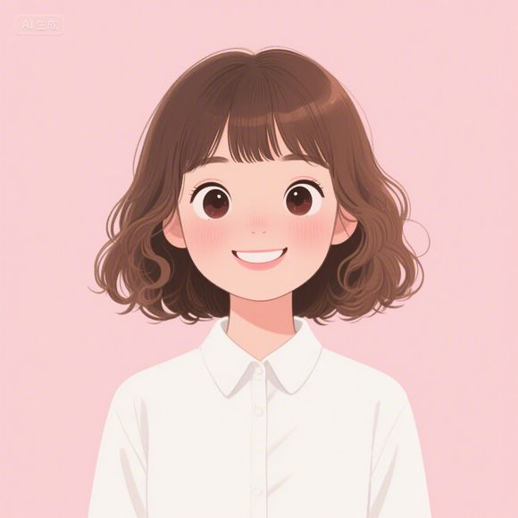
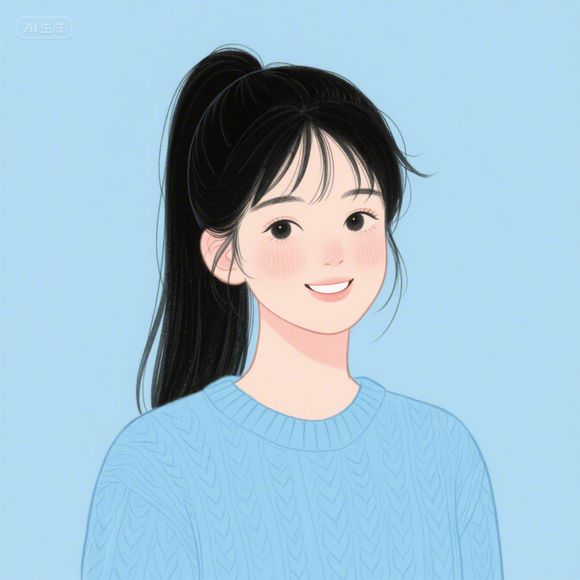
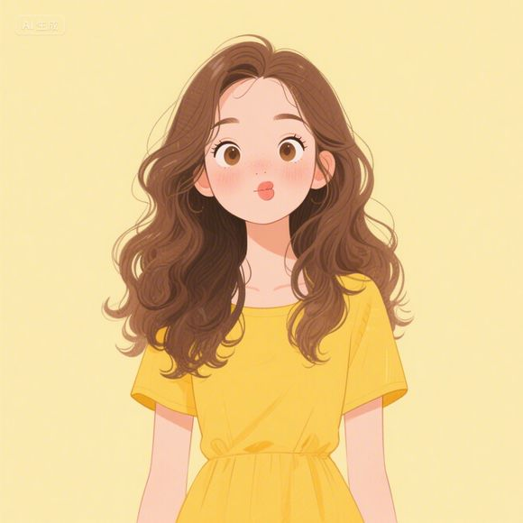
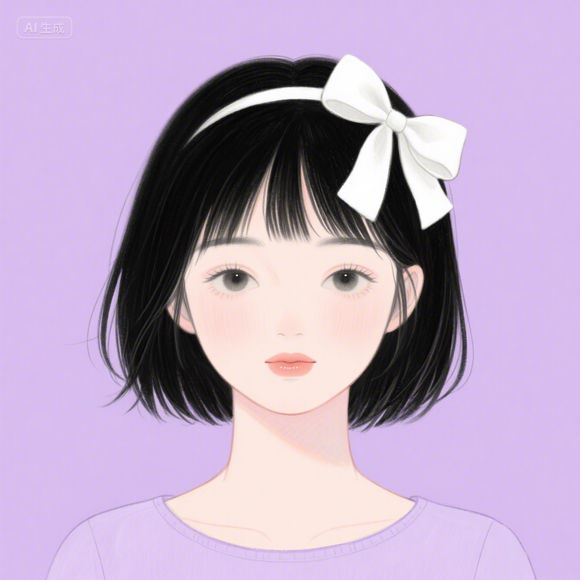
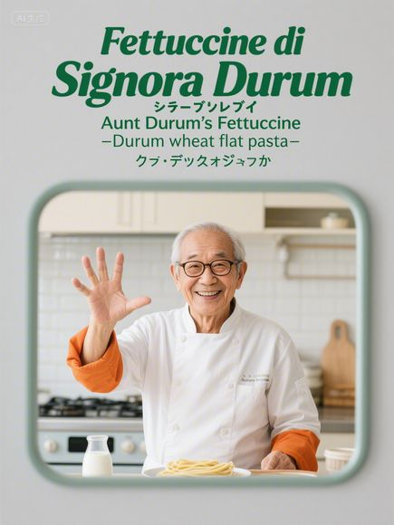
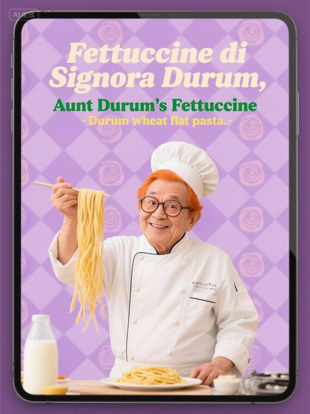
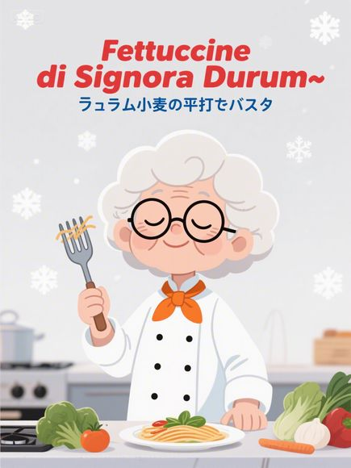
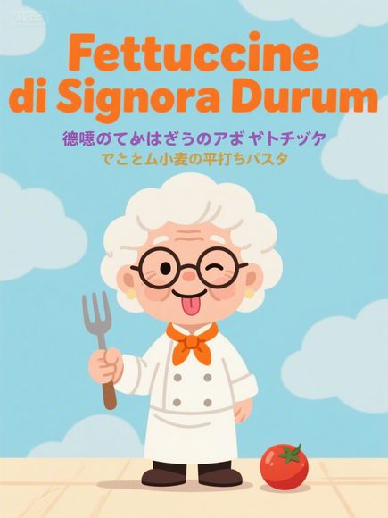

# 原创手绘头像设计原创手绘头像设计原创手绘头像设计

> 会话ID: 9330497352491778 | 抓取时间: 2026-08-25T09:44:35.117Z | 消息数: 7 (用户3/助手4) | 图片数: 8
> 源URL: https://www.doubao.com/chat/9330497352491778

---

## **👤 用户**

类似原创手绘头像设计

---

## **🤖 助手**

接下来我将为你生成四张原创手绘风格的头像。头像主体为年轻女性，有不同的发型和表情，画面风格清新自然。

---

## **👤 用户**

类似原创手绘头像设计

---

## **🤖 助手**

接下来我将生成四张类似简洁明快卡通风格的原创手绘头像，主体为不同姿态的老奶奶，色彩柔和温馨。

---

## **👤 用户**

拆解这张图片生成AI绘画的提示词 用与即梦和MJ 中文 要有创意上爆款

---

## **🤖 助手**

以下是拆解这张图片生成AI绘画提示词： 主体人物 形象 ：一位有着白色卷发、戴着圆眼镜的和蔼老奶奶。 服饰 ：穿着白色的厨师服，系着橙色的领结。 姿态 ：右手拿着一个多齿的叉子。 风格 画风 ：简洁明快的卡通风格。 色彩 ：柔和且温馨的色彩搭配，例如背景使用浅色。 背景 文字 ：上方有“Fettuccine di Signora Durum”的文字，下方有日文“エビオリのフェトッチャーム エビオリ小麦の平打ちパスタ”。 整体氛围 营造出一种亲切、温馨，仿佛在厨房制作美食的氛围。 以下是按照即梦和MJ的提示词格式： 即梦 主体 ：和蔼老奶奶，白色卷发，圆眼镜，白色厨师服，橙色领结，右手持多齿叉。 风格 ：简洁卡通，柔和温馨色彩。 背景 ：上方“Fettuccine di Signora Durum”，下方日文。 氛围 ：厨房美食制作的温馨感。 MJ Subject ：A kind - looking old woman with white curly hair, round glasses, wearing a white chef's outfit with an orange bow tie, holding a multi - pronged fork in her right hand. Style ：Simple and bright cartoon style with soft and warm color scheme. Background ："Fettuccine di Signora Durum" at the top and Japanese text at the bottom. Atmosphere ：A warm feeling of cooking in the kitchen.

---

## **🤖 助手**

我将再次生成四张满足要求的图片，主体还是那位白色卷发、戴圆眼镜、穿白色厨师服系橙色领结且右手持多齿叉的和蔼老奶奶，背景保持上方 “Fettuccine di Signora Durum” 、下方日文的样式，依旧是简洁明快卡通风格和厨房美食制作的温馨感，会进一步变换姿态、表情和场景细节。

---
