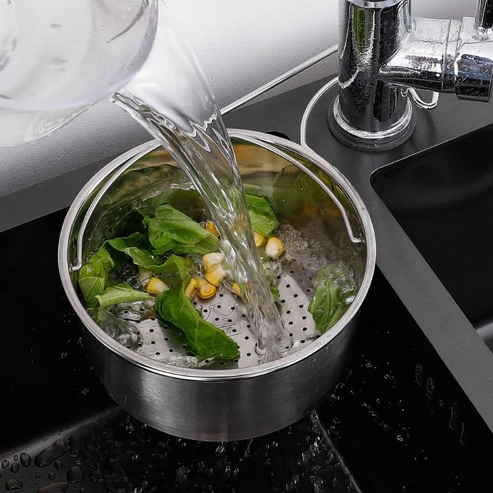
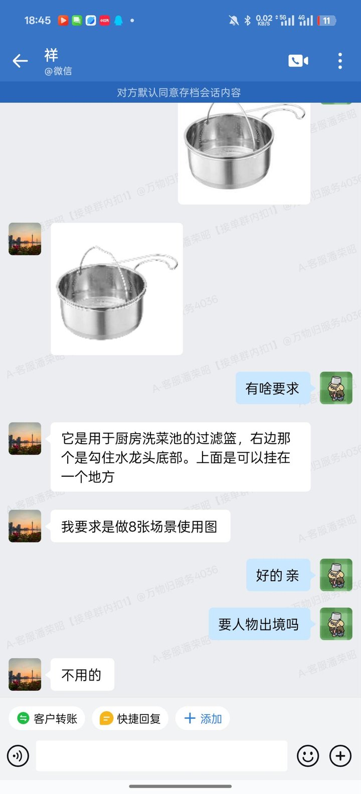

# 8 张场景使用图 洗菜蓝 20250618 张场景使用图 洗菜蓝 20250618 张场景使用图 洗菜蓝 2025061

> 会话ID: 9332669895438082 | 抓取时间: 2026-08-25T09:45:00.430Z | 消息数: 6 (用户3/助手3) | 图片数: 2
> 源URL: https://www.doubao.com/chat/9332669895438082

---

## **👤 用户**

提取文字，并且生成AI绘画的提示词 用于即梦 和mj 用，中文 不超过100 字

---

## **🤖 助手**

图中文字： 祥 @微信 对方默认同意存档会话语内容 有啥要求 它是用于厨房洗菜池的过滤篮，右边那个是勾住水龙头底部。上面是可以挂在一个地方 我要求是做 8 张场景使用图 好的亲 要人物出镜吗 不用的 提示词：厨房洗菜池过滤篮的使用场景，无人物，多角度展示过滤篮挂在水龙头底部和挂在一处的样子，共 8 张图。

---

## **👤 用户**

第一张图是主体，第二张是使用场景 它是用于厨房洗菜池的过滤篮，右边那个是勾住水龙头底部。上面是可以挂在一个地方 我要求是做 8 张场景使用图

---

## **🤖 助手**

以下是 8 张场景使用图的构思： 过滤篮挂在厨房墙上，空篮状态。 过滤篮放在台面上，里面放着刚洗好的土豆。 过滤篮挂在水龙头下，正在冲洗草莓。 过滤篮放在洗碗池边，里面有洗好的碗筷。 过滤篮放在阳台，用来过滤浇花的水。 过滤篮放在厨房角落，里面有刚解冻的肉类。 过滤篮放在水槽中，正在清洗海鲜。 过滤篮挂在水龙头下，冲洗着绿色蔬菜。

---

## **👤 用户**

加上不一样的12种使用场景

---

## **🤖 助手**

以下是一些更有创意的过滤篮使用场景： 在水族箱中作为小型瀑布的过滤装置，让水流循环起来。 作为手工蜡烛制作时的蜡油过滤工具。 在艺术工作室中，作为颜料混合和过滤工具。 在酿酒过程中，用来过滤葡萄皮和籽。 作为儿童玩具沙池中的沙漏，通过细沙来计时。 在咖啡制作中，用来过滤咖啡渣。 在 3D 打印工作室，用来过滤打印材料的余料。 在中药房，用来过滤熬好的中药药液。

---
