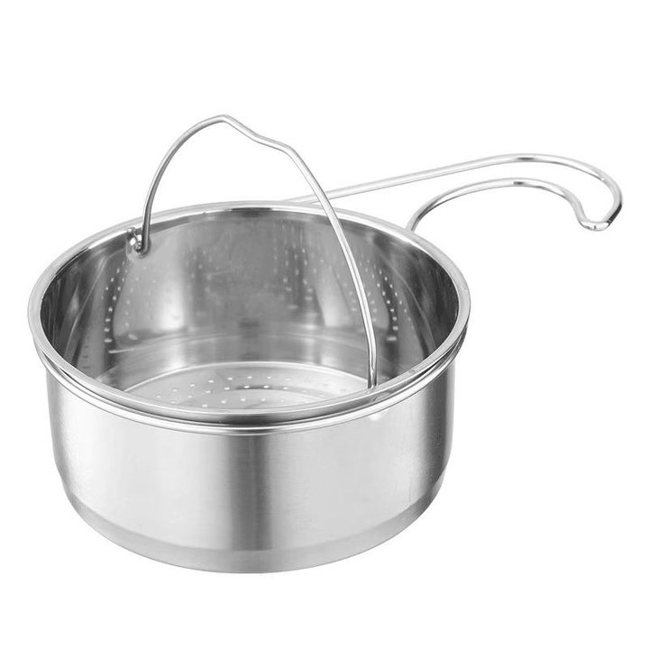
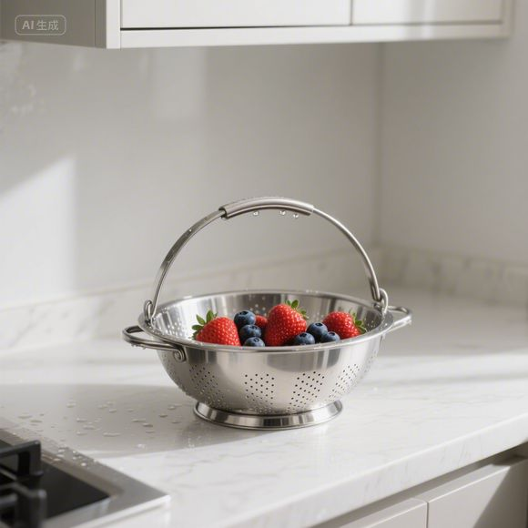
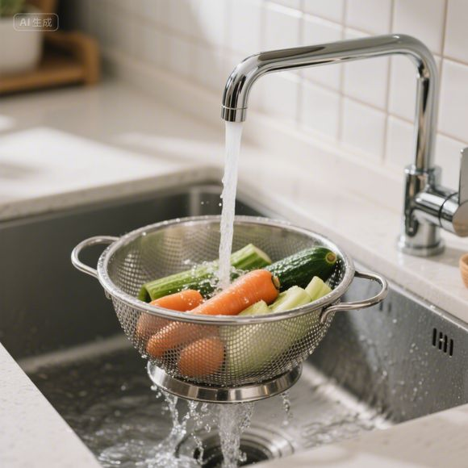
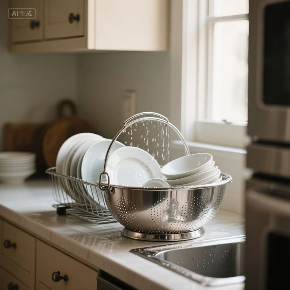
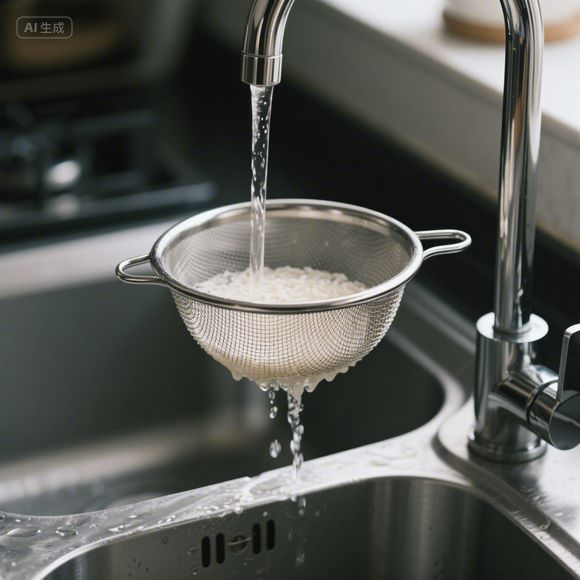
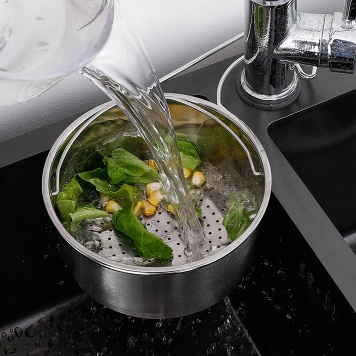
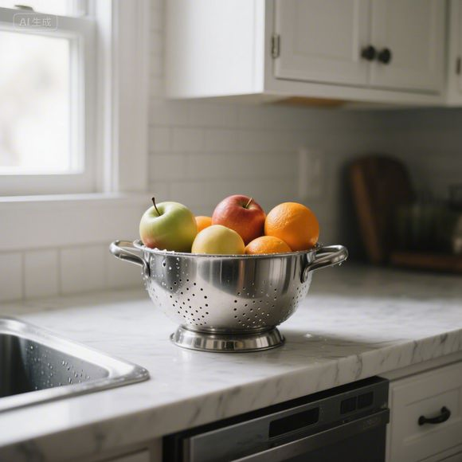
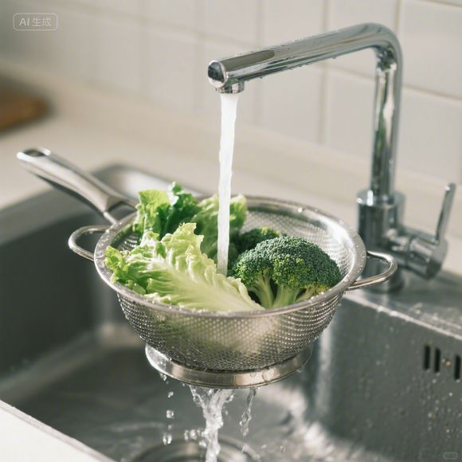

# 过滤篮的多种用途过滤篮的多种用途过滤篮的多种用途

> 会话ID: 9329736179014658 | 抓取时间: 2026-08-25T09:45:15.560Z | 消息数: 4 (用户2/助手2) | 图片数: 8
> 源URL: https://www.doubao.com/chat/9329736179014658

---

## **👤 用户**

过滤篮放在台面上，里面放着刚洗好的水果。 过滤篮在水龙头下冲洗蔬菜。 过滤篮中放着洗好的餐具在沥水。 过滤篮挂在水龙头底部，正在过滤淘米水。 过滤篮放在水槽边，里面是准备清洗的海鲜。 过滤篮挂在阳台，里面晾晒着小物件。 过滤篮在户外露营时用来清洗食材。

---

## **🤖 助手**

接下来我将按照你描述的场景，以参考图片中的过滤篮为主体，生成七张写实风格的图片。

---

## **👤 用户**

过滤篮放在台面上，里面放着刚洗好的水果。 过滤篮在水龙头下冲洗蔬菜。 过滤篮中放着洗好的餐具在沥水。 过滤篮挂在水龙头底部，正在过滤淘米水。 过滤篮放在水槽边，里面是准备清洗的海鲜。 过滤篮挂在阳台，里面晾晒着小物件。 过滤篮在户外露营时用来清洗食材。

---

## **🤖 助手**

接下来，我会以你上传图片中的不锈钢滤锅为主体，按照你描述的七个场景生成七张写实摄影风格的图片。

---
