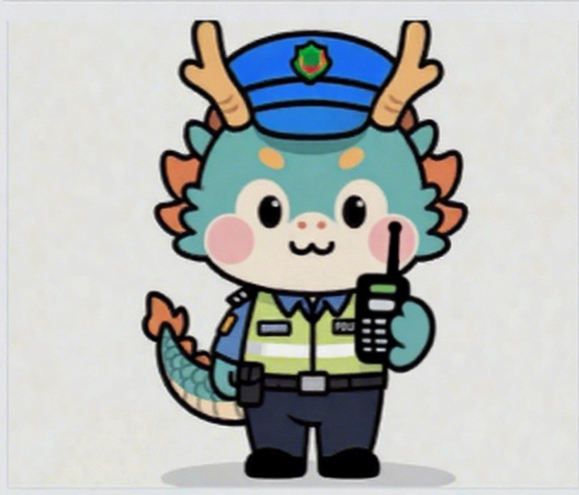
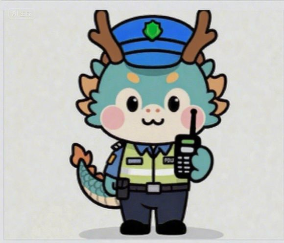
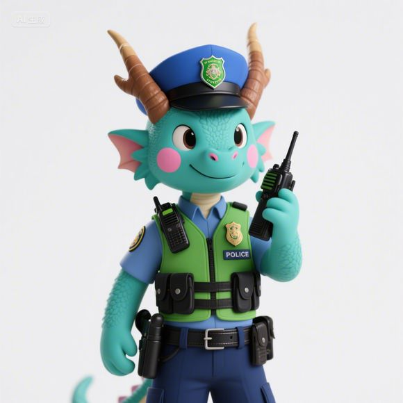
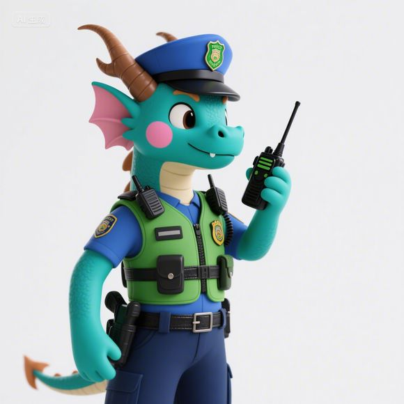
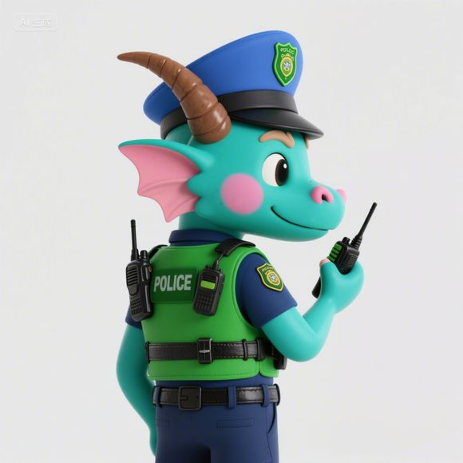
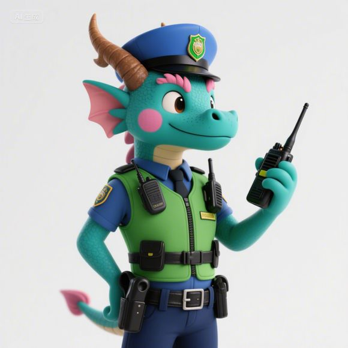
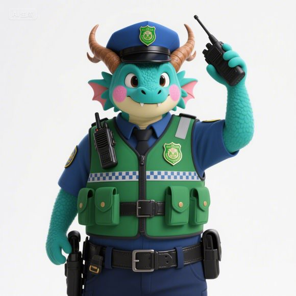
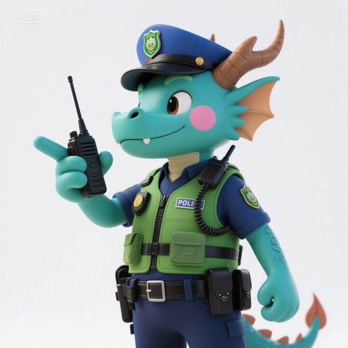

# 角色形象设计角色形象设计角色形象设计

> 会话ID: 8934974241641730 | 抓取时间: 2026-08-25T09:48:13.501Z | 消息数: 8 (用户4/助手4) | 图片数: 8
> 源URL: https://www.doubao.com/chat/8934974241641730

---

## **👤 用户**

角色特征： 角色是一个拟人化的动物，具有龙的特征。 头部有龙角，颜色为棕色。 脸部圆润，肤色为蓝绿色。 脸颊有粉红色的腮红。 耳朵为龙耳，形状小巧。 服饰： 戴着蓝色的警察帽，帽子上有一个绿色的徽章。 穿着绿色的警察背心，背心上有对讲机等装备。 腰间有黑色的皮带。 下半身穿着深蓝色的裤子。 动作： 右手拿着一个黑色的对讲机。 背景： 背景为简单的白色，无其他元素。

---

## **🤖 助手**

接下来我将把上传图片里的主体替换为一个头部有棕色龙角、蓝绿色肤色且脸颊带粉红色腮红的拟人化龙，它戴着有绿色徽章的蓝色警察帽，身着配备对讲机等装备的绿色警察背心和深蓝色裤子，右手拿着黑色对讲机，背景换成简单白色。 AI 生成并非真实，请谨慎使用

---

## **👤 用户**

生成4张

---

## **🤖 助手**

接下来将生成 4 张图片，主体都是这个头部有棕色龙角、蓝绿色肤色且脸颊带粉红色腮红的拟人化龙警察，它戴着有绿色徽章的蓝色警察帽，身着配备对讲机等装备的绿色警察背心和黑色皮带、深蓝色裤子，右手拿着黑色对讲机，背景是简单白色。

---

## **👤 用户**

重新生成

---

## **🤖 助手**

接下来将再次生成4张图片，主体依然是那个头部有棕色龙角、蓝绿色肤色且脸颊带粉红色腮红的拟人化龙警察，它戴着有绿色徽章的蓝色警察帽，身着配备对讲机等装备的绿色警察背心和黑色皮带、深蓝色裤子，右手拿着黑色对讲机，背景为简单白色。

---

## **👤 用户**

主体要一致性

---

## **🤖 助手**

接下来会再次生成 4 张图片，主体依旧是那个头部有棕色龙角、蓝绿色肤色且脸颊带粉红色腮红的拟人化龙警察，它戴着有绿色徽章的蓝色警察帽，身着配备对讲机等装备的绿色警察背心和黑色皮带、深蓝色裤子，右手拿着黑色对讲机，在动作姿态上会有新的变化。

---
