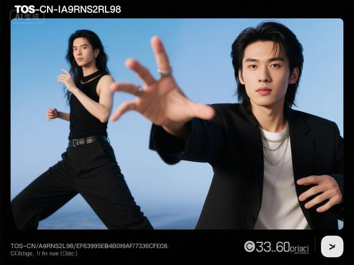
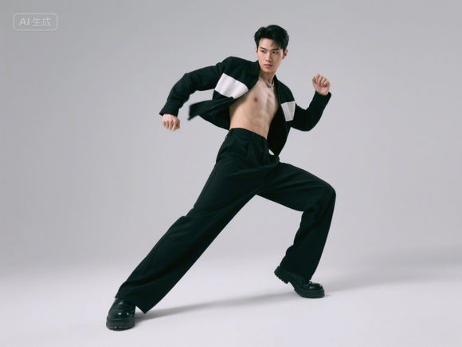
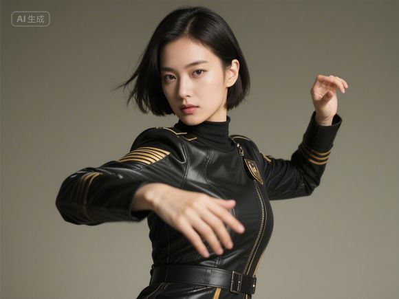
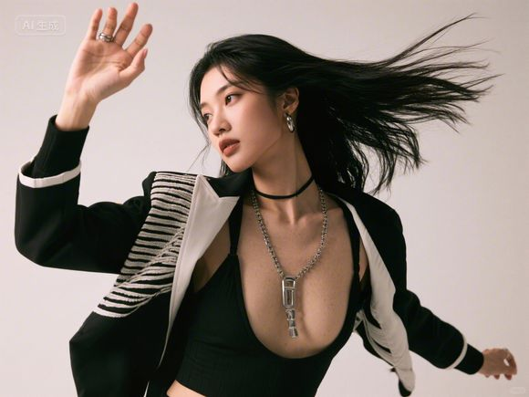

# 图片元素修改询价图片元素修改询价图片元素修改询价

> 会话ID: 8935072902529538 | 抓取时间: 2026-08-25T09:48:54.049Z | 消息数: 6 (用户3/助手3) | 图片数: 4
> 源URL: https://www.doubao.com/chat/8935072902529538

---

## **👤 用户**

---

## **🤖 助手**

图中有一个卡通形象，像是拟人化的龙，戴着警察帽，穿着警察制服，手持对讲机。图片下方文字提出对该图修改元素做成四个形象的价格询问，但未给出定价相关信息，无法作答。

---

## **👤 用户**

以张图片人物一致性，风格一致性动作一致性生成4张图

---

## **🤖 助手**

接下来我会生成 4 张图，主体形象与你上传图片中的主体保持一致，在风格和动作上也保持一致。

---

## **👤 用户**

图生图

---

## **🤖 助手**

请你详细描述一下针对这张图片 “pic_7.jpg” 进行图生图的具体要求，比如是修改主体、改变风格、更换背景等，以便我为你准确输出编辑代码块。

---
