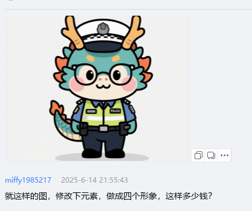
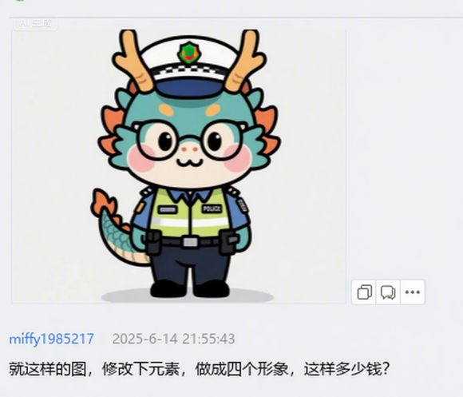
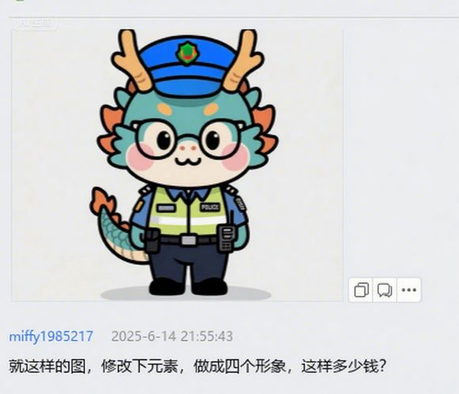
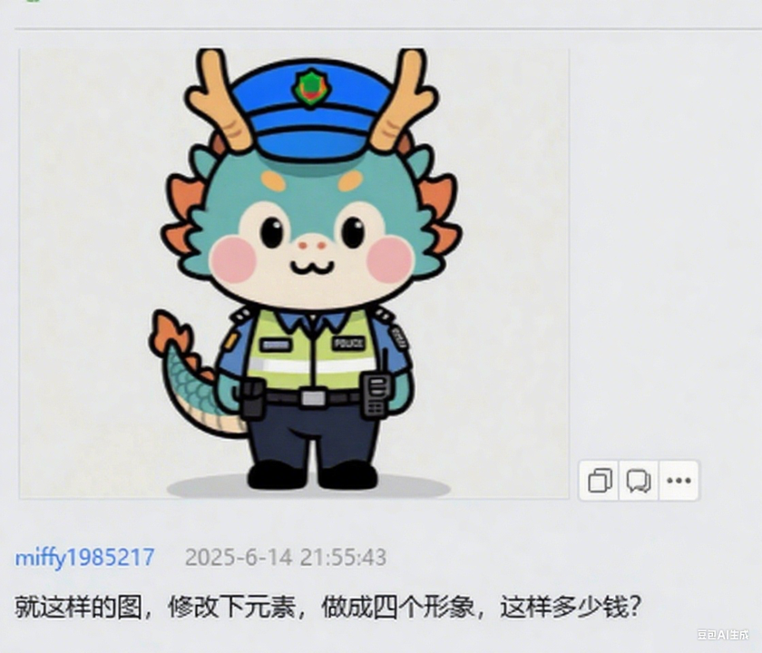
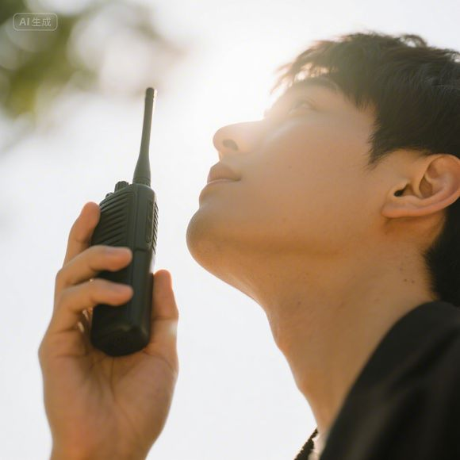
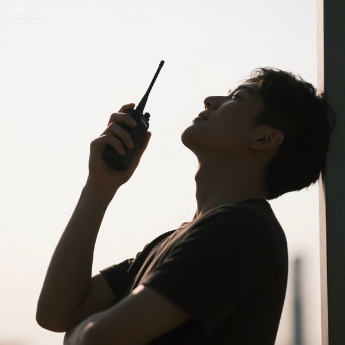
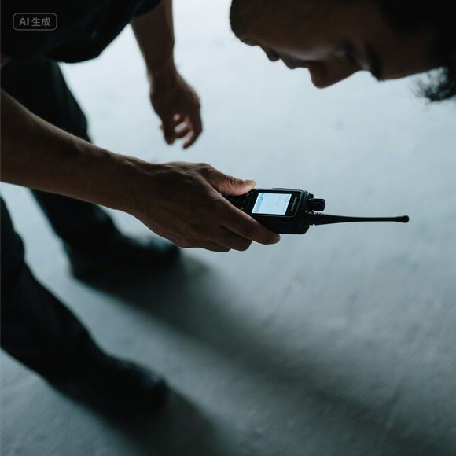
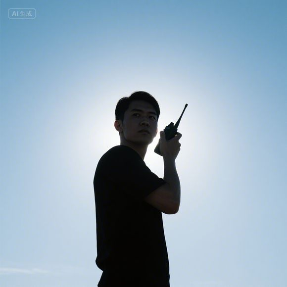

# 图片编辑要求图片编辑要求图片编辑要求

> 会话ID: 8940469235474178 | 抓取时间: 2026-08-25T09:49:09.639Z | 消息数: 8 (用户4/助手4) | 图片数: 8
> 源URL: https://www.doubao.com/chat/8940469235474178

---

## **👤 用户**

1.帽子白色部分改成和帽檐一样的:2,去掉眼镜:3.手持对讲机

---

## **🤖 助手**

接下来，我将对图片进行编辑，把帽子白色部分改成和帽檐一样的颜色，去掉眼镜，让人物手持对讲机。

---

## **👤 用户**

重新生成

---

## **🤖 助手**

我将再次对之前编辑过的图片进行相同操作，也就是把帽子白色部分改成和帽檐一样的颜色，去掉眼镜，让人物手持对讲机。

---

## **👤 用户**

重新生成

---

## **🤖 助手**

我将继续对之前编辑过的图片执行相同操作，即把帽子白色部分改成和帽檐一样的颜色，去掉眼镜，让人物手持对讲机。

---

## **👤 用户**

也就是把帽子白色部分改成和帽檐一样的颜色，去掉眼镜，让人物手持对讲机

---

## **🤖 助手**

我会再次生成 4 张以之前编辑图片中人物形象为基础，人物手持对讲机的图片。

---
