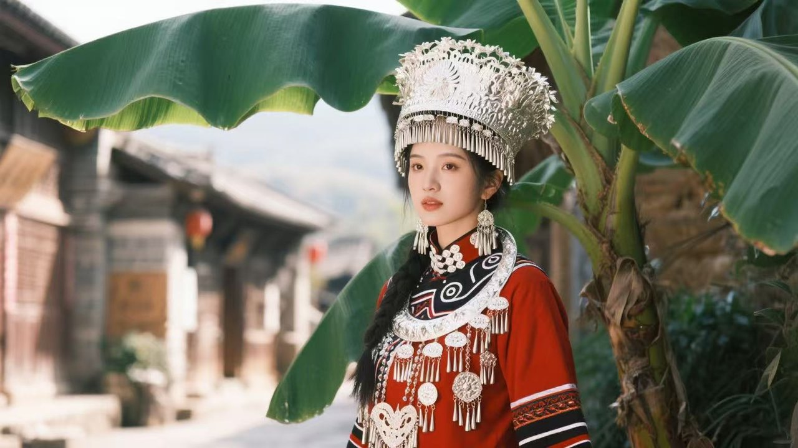
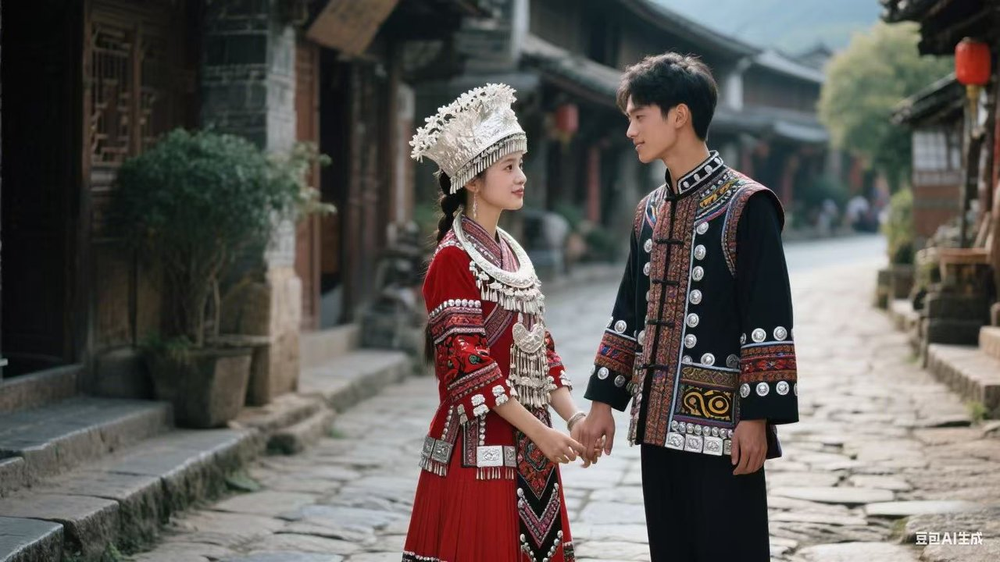

# AI 绘画提示词生成AI 绘画提示词生成AI 绘画提示词生成

> 会话ID: 8941966500906754 | 抓取时间: 2026-08-25T09:49:22.296Z | 消息数: 6 (用户3/助手3) | 图片数: 2
> 源URL: https://www.doubao.com/chat/8941966500906754

---

## **👤 用户**

拆接这张图片生成AI绘画提示词用在mj ,要高效运镜效果中文，不超过100字

---

## **🤖 助手**

身着苗族传统服饰的男女牵手于古巷，女子银饰璀璨，男子绣纹精美。背景是古朴建筑与绿植。提示词：苗族情侣，传统服饰，银饰刺绣，古巷，牵手，阳光氛围，高效运镜，展现民族风情。

---

## **👤 用户**

V1 V2 V3 2025年6月14日 淼淼使用了:blend Midjourney BotAPP20:50 https://s.mj.run/DEYmExOEWtE https://s.mj.run/WlKZ9PGqHXU --v5.2--raw-@淼淼(Waiting to start) image1 First image to add to the blend image1 image2 Drag and drop or click to Drag and drop or click to upload file upload file /blend image1 请添加文件 image2 请添加文件 增加4 王英 Ae Ado... 金山.. 文件... 毒霸... 123 剪映.. 公益... 版本 英 清华同方

---

## **🤖 助手**

已完成思考 我现在需要处理用户的这个请求。首先，用户提供了两个文档，里面都是系统报错信息，显示 “系统内部异常，请稍后重试”。同时，用户还给出了一些其他信息，比如 V1、V2、V3，日期，淼淼使用了 blend，以及 Midjourney 的相关命令和链接，还有一些关于上传文件的提示和乱码内容。 首先，我需要确定用户的实际需求。看起来用户可能是在使用 Midjourney 进行 AI 绘画时遇到了问题，特别是在使用 blend 功能时出现了系统报错。用户可能希望得到关于如何解决这个报错的指导，或者需要生成正确的提示词来避免错误。 接下来，我需要分析提供的文档内容。两个文档都是报错信息，说明用户无法获取正常的内容，可能是在尝试访问 MJ 的链接时遇到了问题。此外，用户提供的命令中包含了 --v5.2 和 --raw 等参数，可能是在使用特定的版本和格式。 然后，结合用户之前的历史对话，用户之前让拆接图片生成提示词，现在可能是在尝试使用 blend 功能时遇到错误，所以需要帮助解决报错问题，或者重新生成正确的提示词。 现在需要判断是否需要告知内容获取失败。因为两个文档都显示系统报错，所以应该先告知用户无法获取内容，并说明原因。然后，根据用户提供的其他信息，比如命令行参数和历史提示词需求，可能需要帮助用户调整提示词或解决运行中的问题。 另外，用户提供的命令中有 “--blend” 参数，说明用户在使用混合图像的功能，但可能由于系统异常导致失败。需要建议用户稍后重试，或者检查命令是否正确，是否有必要的参数，比如图片链接是否有效。 还要注意用户提到的 “高效运镜效果” 和中文提示词的要求，可能需要在回复中结合这些元素，确保提示词符合要求，同时解决报错问题。 总结一下，回复的结构应该是：首先说明文档获取失败，因为系统报错；然后根据用户提供的其他信息，给出可能的解决方案，比如重试、检查命令参数，或者重新生成提示词，确保包含所需的元素如苗族情侣、传统服饰、银饰刺绣、古巷、牵手、阳光氛围、高效运镜等，同时符合 Midjourney 的参数要求，比如 --v5.2 等。 需要确保回复清晰，分点说明，使用 markdown 格式，加粗关键信息，比如解决方案和提示词，帮助用户理解和操作。同时，保持语言简洁，不超过 100 字的提示词要求，但这里可能需要先解决报错问题，再提供提示词。 最后，检查是否有遗漏的信息，比如用户提到的日期、用户名淼淼、命令中的参数等，确保回复中适当提及，让用户知道是针对他们的具体情况给出的建议。 由于文档链接返回 “系统内部异常” 报错，无法获取图片内容。结合历史需求及现有信息，推测需优化 Blend 提示词： 提示词 ：苗族情侣古巷牵手，银饰刺绣细节，古朴建筑绿植背景，阳光穿透光晕，动态运镜感，民族风情浓郁 --v5.2 --blend 操作建议 ： 确认图片链接可正常访问后重新上传； 若持续报错，尝试拆分提示词为单图生成再合并，或降低参数复杂度（如暂去 --raw）。

---

## **👤 用户**

blend 是什么意思，视频教程

---

## **🤖 助手**

“blend” 常见的意思有 “混合；融合；协调” 等。在软件操作中，例如在 Midjourney 里，“blend” 功能通常用于将多张图片融合在一起生成新的图像。 很抱歉，我无法提供视频教程，但你可以通过以下几种方式找到相关视频教程： 在视频网站（如 B 站、YouTube）上搜索 “Midjourney blend 教程”，可以找到很多用户上传的详细教程。 查看 Midjourney 官方网站或帮助文档，可能会有官方的操作指南或教程。 在相关的设计论坛或社区中，询问其他用户是否有推荐的教程资源。

---
