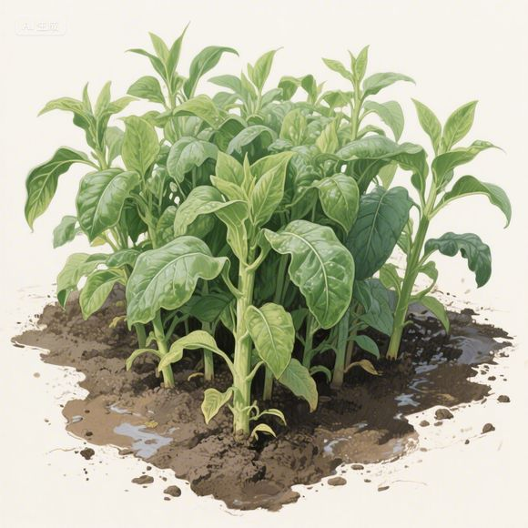
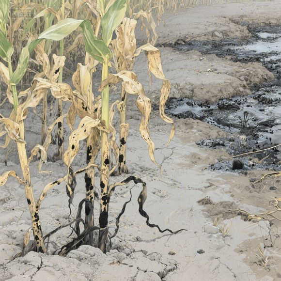
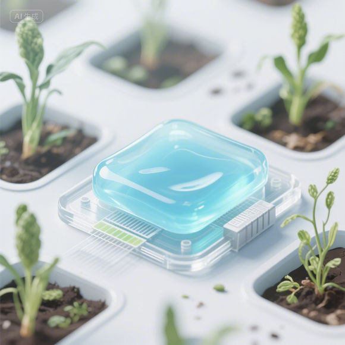
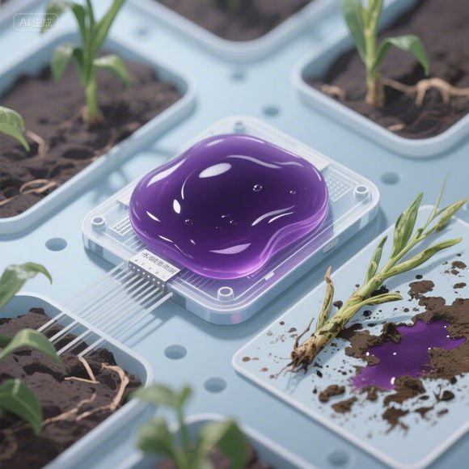
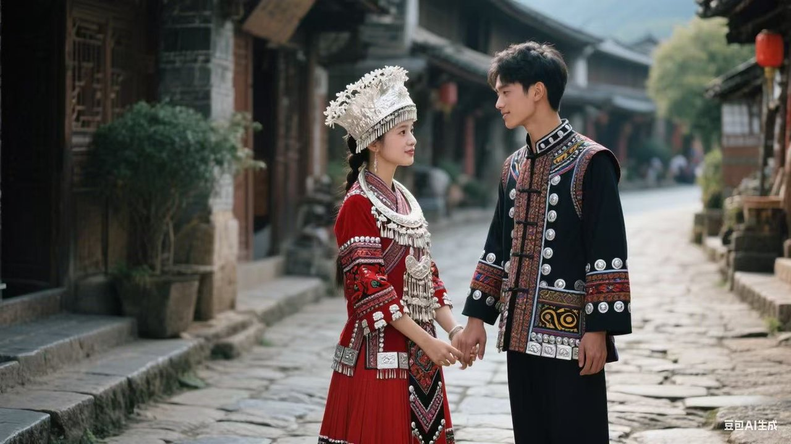
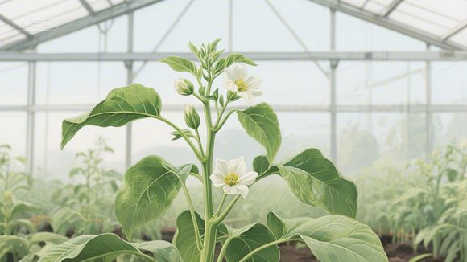
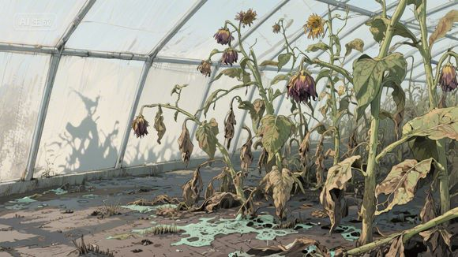
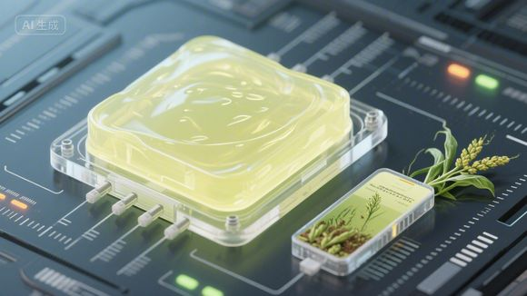

# 绘制对比图绘制对比图绘制对比图

> 会话ID: 8931887353359618 | 抓取时间: 2026-08-25T09:49:37.851Z | 消息数: 6 (用户3/助手3) | 图片数: 8
> 源URL: https://www.doubao.com/chat/8931887353359618

---

## **👤 用户**

让他帮我画一个，就是农作物受到污染之后和受到污染之之前的一个图片对比，以及水凝胶这个传感平台检测之后，它的一个变色的一个对比。然后把这个对比给写出来。也就是相当于这个图片里面有四个要素，一个就是农作物受污染前后，以及这个传感器能够监测它受污染过程中，体内的一个某个物质的含量变化。反映到水凝胶上，就是水凝胶的颜色变化。

---

## **🤖 助手**

接下来我将生成四张图，呈现农作物受污染前后的状态，以及水凝胶传感平台检测时的颜色变化对比。画面风格为写实的科学插画风，突出细节和色彩对比。

---

## **👤 用户**

接下来我将生成四张图，呈现农作物受污染前后的状态，以及水凝胶传感平台检测时的颜色变化对比。画面风格为写实的科学插画风，突出细节和色彩对比。

---

## **🤖 助手**

没问题，我将按照之前的描述再生成四张具有写实科学插画风的图片，呈现农作物受污染前后状态及水凝胶颜色变化对比。

---

## **👤 用户**

接下来我将生成四张图，呈现农作物受污染前后的状态，以及水凝胶传感平台检测时的颜色变化对比。画面风格为写实的科学插画风，突出细节和色彩对比。

---

## **🤖 助手**

由于你没有提供 “pic_9.jpg” 的具体内容，我将继续按照之前的需求生成四张具有写实科学插画风的图片，呈现农作物受污染前后状态及水凝胶颜色变化对比，图片比例为 16:9。

---
