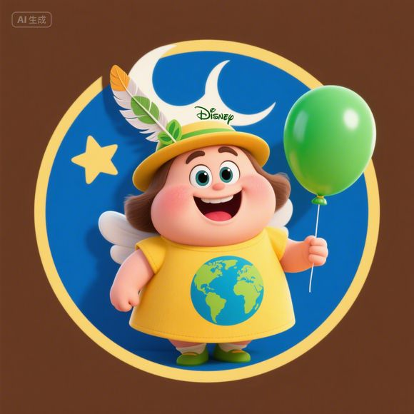
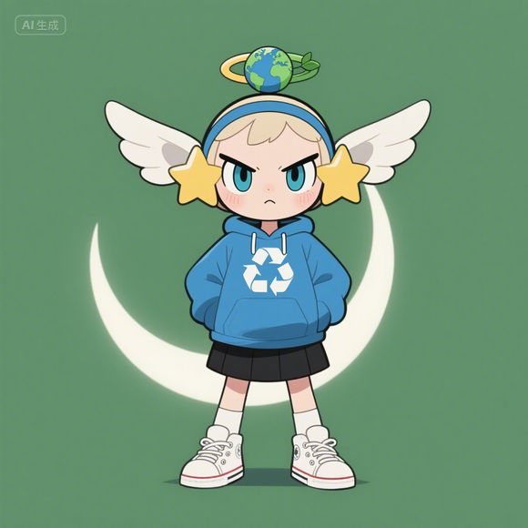
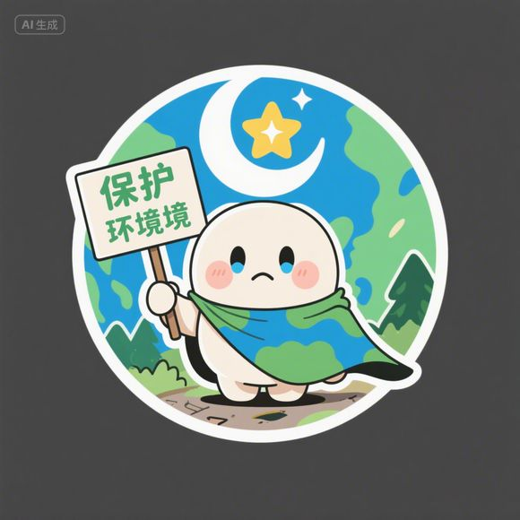
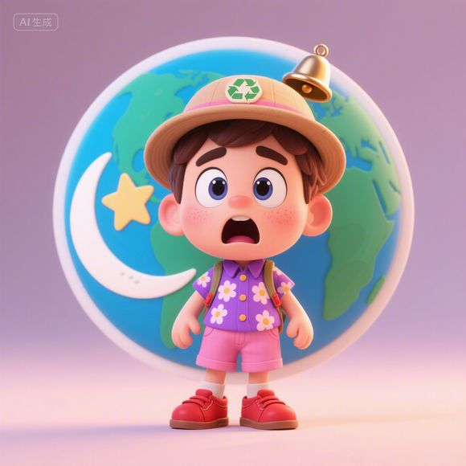
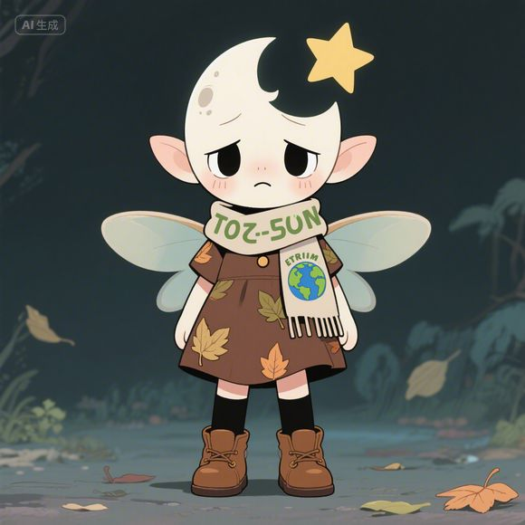

# Logo卡通拟人化Logo卡通拟人化Logo卡通拟人化

> 会话ID: 8917973504262658 | 抓取时间: 2026-08-25T09:49:53.971Z | 消息数: 6 (用户3/助手3) | 图片数: 8
> 源URL: https://www.doubao.com/chat/8917973504262658

---

## **👤 用户**

要将这个logo卡通拟人化，可以按照以下步骤进行： 1. **赋予人格特征** - 从logo中的元素出发，比如将星星和月亮看作脸部的轮廓，给它们添加眼睛、嘴巴等面部特征，使其具有表情。 - 可以想象星星是眼睛，月亮是微笑的嘴巴，或者给它们添加眉毛来表现不同的情绪。 2. **设计身体形态** - 根据logo的形状，设计一个合适的身体形态。例如，如果logo是圆形的，可以给它设计一个圆润可爱的身体。 - 身体的设计可以参考一些常见的卡通形象风格，比如迪士尼风格或者日式动漫风格。 3. **添加服饰和配饰** - 根据公益组织的特点，给拟人化的logo添加相应的服饰和配饰。比如，如果是环保组织，可以给它设计带有绿叶、环保标志的服饰。 - 配饰可以包括帽子、项链、背包等，这些都可以用来体现公益组织的使命和价值观。 4. **设定角色背景和故事** - 为拟人化的logo创造一个背景故事，解释它的来历和使命。例如，它可以是来自环保星球的守护者，来到地球是为了宣传环保理念。 - 故事可以通过漫画、动画或者文字的形式来呈现，使其更加生动有趣。 通过以上步骤，你可以将这个logo成功地卡通拟人化，使其成为一个具有亲和力和代表性的公益形象。

---

## **🤖 助手**

接下来我将按照要求把这个 logo 卡通拟人化，赋予它人格特征、设计身体形态、添加服饰和配饰。

---

## **👤 用户**

重新生成

---

## **🤖 助手**

我将再次以迪士尼和日式动漫风格把 logo 卡通拟人化，赋予不同的人格特征、设计身体形态、添加服饰和配饰。

---

## **👤 用户**

重新生成

---

## **🤖 助手**

我会再次以迪士尼和日式动漫风格对 logo 进行卡通拟人化，赋予新的人格特征、设计身体形态以及添加服饰和配饰。

---
