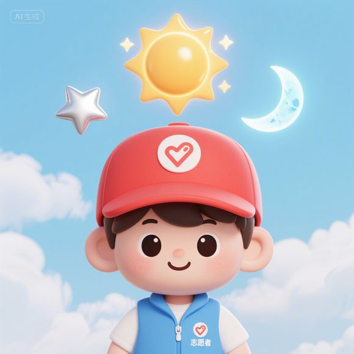
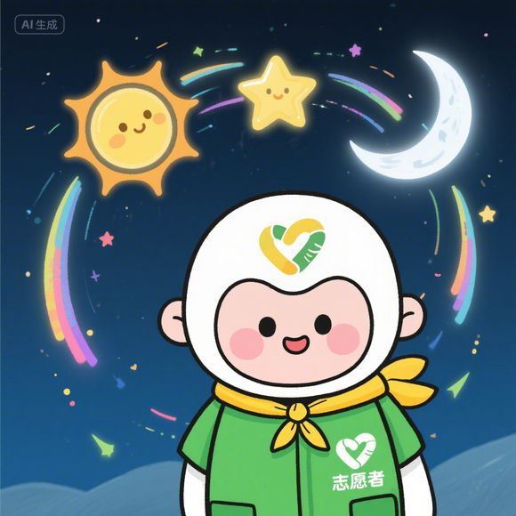
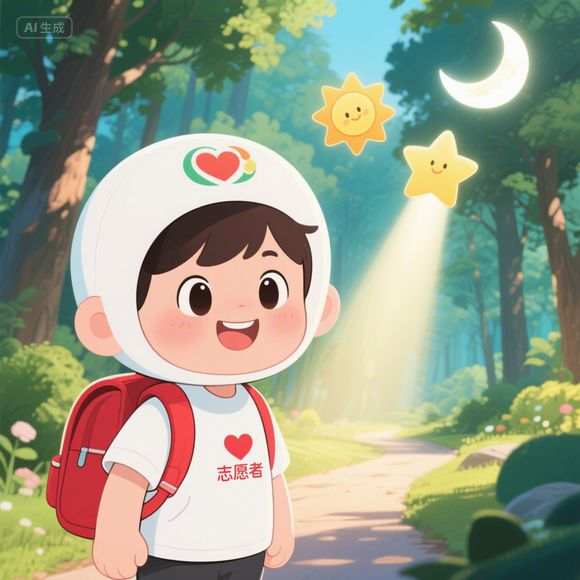
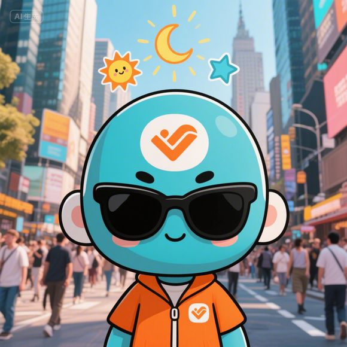
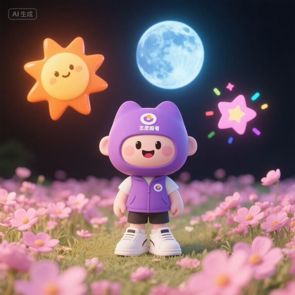
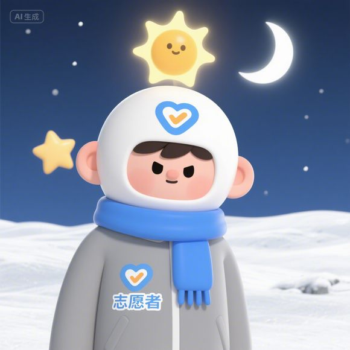
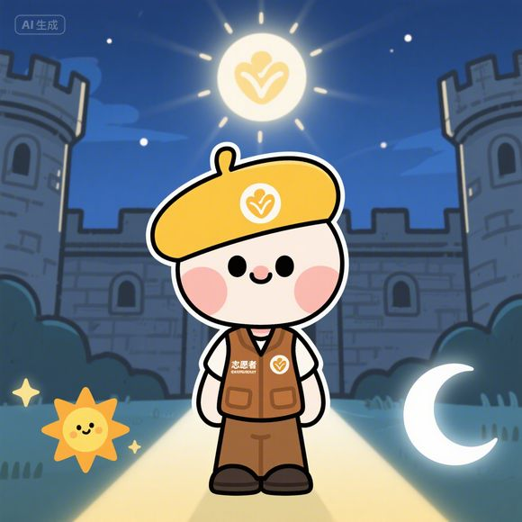
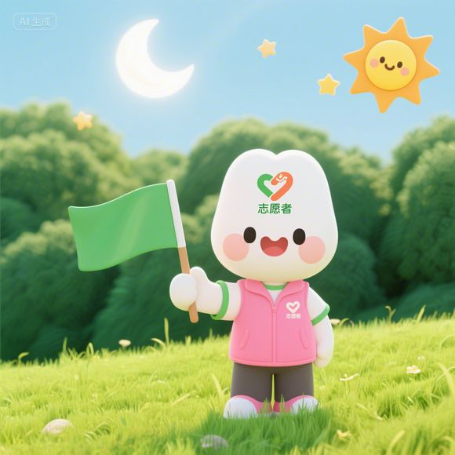

# 公益组织形象 IP 设计公益组织形象 IP 设计公益组织形象 IP 设计

> 会话ID: 8924891619799554 | 抓取时间: 2026-08-25T09:51:06.096Z | 消息数: 8 (用户4/助手4) | 图片数: 8
> 源URL: https://www.doubao.com/chat/8924891619799554

---

## **👤 用户**

这是我们的logo，目前需要为我们的公益组织设计一个形象IP，内容方向是希望出现太阳、星星、月亮这三个元素，一起朗照，心光朗照，衣服可以考虑做成志愿者义工服的风格，logo再卡通化设计一下变成脑袋可行吗

---

## **🤖 助手**

我将为你的公益组织设计形象 IP，形象 IP 主体是一个穿着志愿者义工服的卡通形象，脑袋是由卡通化设计的 logo 构成，周围有太阳、星星、月亮三个元素一起朗照，营造 “心光朗照” 的氛围。

---

## **👤 用户**

重新生成

---

## **🤖 助手**

我将再次为公益组织生成形象 IP，主体依然是穿着志愿者义工服、脑袋由卡通化设计的 logo 构成的卡通形象，周围有太阳、星星、月亮三个元素一起朗照，营造 “心光朗照” 的氛围。

---

## **👤 用户**

太阳、星星、月亮这三个元素 融入到IP人物里

---

## **🤖 助手**

我将把太阳、星星、月亮三个元素融入到之前的IP人物中。

---

## **👤 用户**

logo再卡通化设计一下变成脑袋

---

## **🤖 助手**

由于你没有详细描述 “pic_62.jpg” 的图片内容，我无法直接进行生成。请你描述一下这张图片里有什么主体元素，元素的颜色、形状、姿态，以及背景等情况，这样我就能把它完整融入到 IP 人物中重新生成图片了。

---
