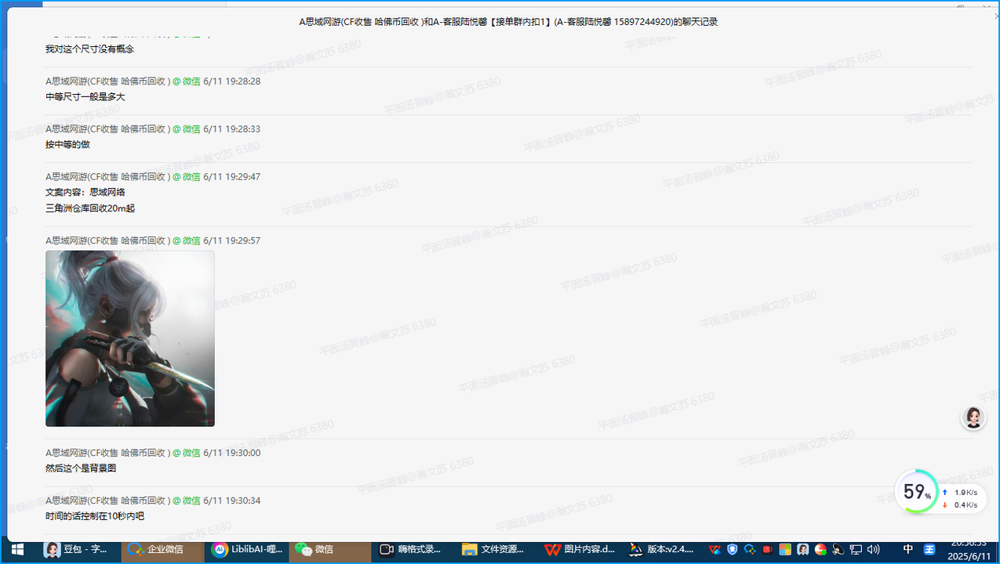
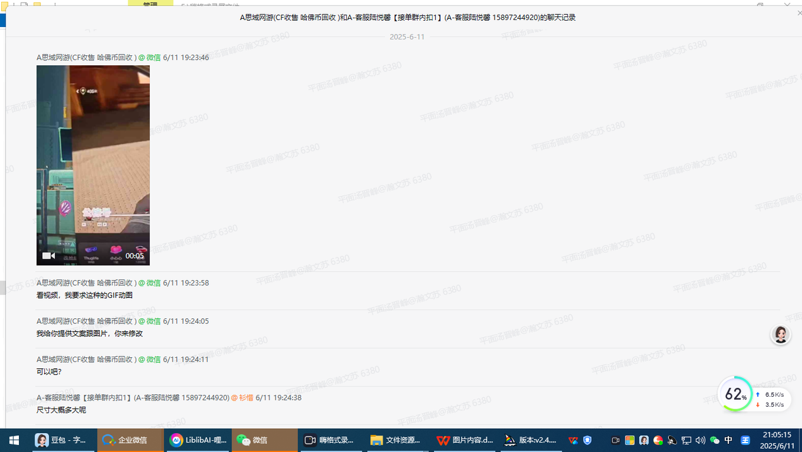

# 生成 AI 视频提示词生成 AI 视频提示词生成 AI 视频提示词

> 会话ID: 8650024908190466 | 抓取时间: 2026-08-25T09:53:14.206Z | 消息数: 2 (用户1/助手1) | 图片数: 3
> 源URL: https://www.doubao.com/chat/8650024908190466

---

## **👤 用户**

第三张为有风格视频的图片，按第一张图和第二张文案，生成ai视频的提示词，要4个分镜头，不超过10秒，要高效运镜，要中文，不超过100字，

---

## **🤖 助手**

已完成思考 用户现在需要根据提供的资料生成 AI 视频提示词，4 个分镜头，不超过 10 秒，高效运镜。首先分析需求：第一张图是银发持刃的赛博风角色，第二张文案是 “思域网络 三角洲仓库回收 20m 起”。还要参考第三张的 GIF 风格，应该是游戏内的运镜。 首先确定风格：赛博朋克，角色动作利落。分镜头需要高效，所以每个镜头短。四个分镜头，10 秒内，运镜要流畅。 镜头 1：特写角色持刃手部，光影赛博蓝红，突出武器细节。 镜头 2：拉远，角色侧身，背景渐变赛博仓库，带出 “三角洲仓库”。 镜头 3：快速横移，角色启动动作，带动态模糊，呼应回收主题。 镜头 4：镜头推进，角色眼神锐利，叠加文案 “思域网络 回收 20m 起”，运镜衔接紧凑。 现在整理，确保中文，分镜头清晰，运镜高效，符合时长。检查字数，控制在 100 字内。 4 分镜，10 秒内，赛博风：①特写银发角色持刃手套，赛博光影闪烁；②拉镜展现角色侧身，背景渐显三角洲仓库；③横移跟拍角色启动挥刃，动态模糊带劲；④推镜聚焦角色眼神，叠加 “思域网络 三角洲仓库回收 20m 起” 文案 。运镜紧凑流畅。

---
