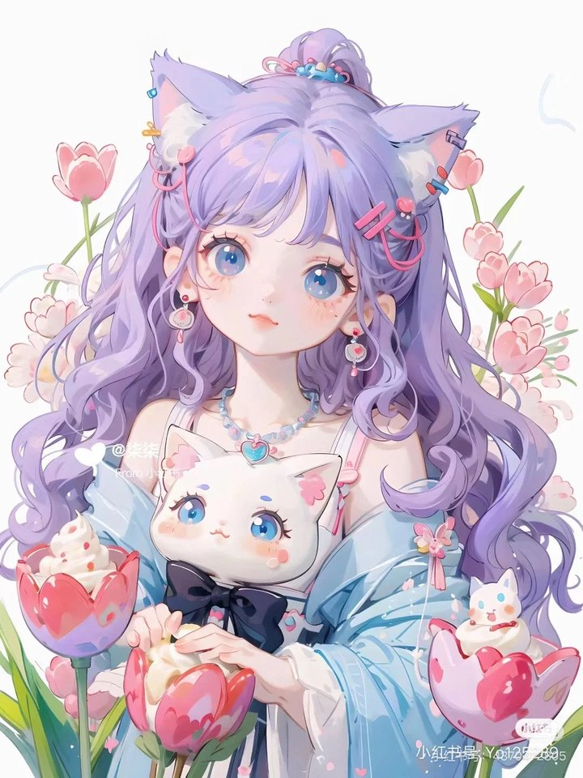
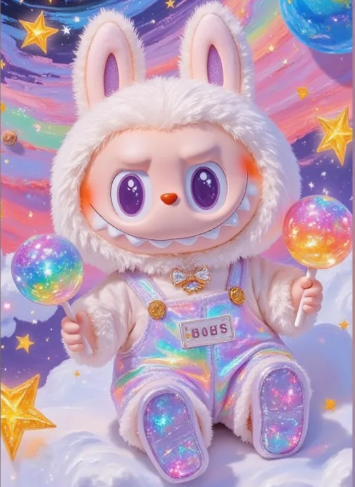
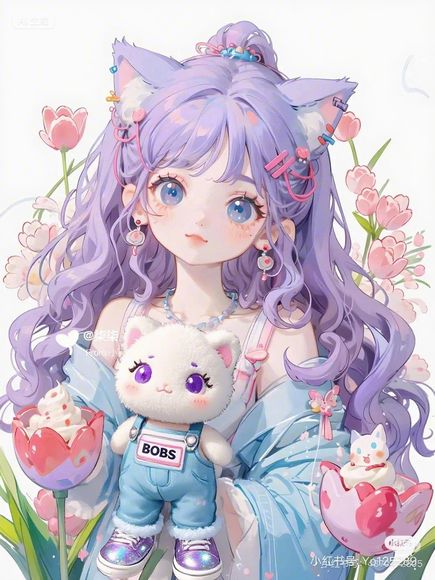

# 图像替换与提示词生成图像替换与提示词生成图像替换与提示词生成

> 会话ID: 8572566615289602 | 抓取时间: 2026-08-25T09:54:43.037Z | 消息数: 4 (用户2/助手2) | 图片数: 3
> 源URL: https://www.doubao.com/chat/8572566615289602

---

## **👤 用户**

让第二张兔子替换到第一张兔子，我就需要能够替换成拉布布，并且以第一张小女孩和第二张兔子角色不变，画风一致，色系一致，并且拉布布得 突出，这个IP风格要鲜明，不能变成三不像 生成ai绘画的提示词，要用到mj的提示词，要写入版本，要高效运镜，人物一致性，风格一致性，中文 ，100字

---

## **🤖 助手**

我将把第一张图中的小猫玩偶替换为拉布布形象，同时保留第一张图中小女孩的形象以及第二张图中兔子的风格和色系，让拉布布风格鲜明突出。

---

## **👤 用户**

我要生成提示词用在mj上

---

## **🤖 助手**

以下是为你转化成 Midjourney 适用的提示词： 一个穿着蓝色裙子、扎着两个马尾辫的小女孩，手中拿着的白色小猫玩偶替换为拉布布形象，拉布布有着毛绒质感的白色“发型”，脸部圆润，眼睛大而紫，脸颊泛红，表情带点小傲娇，穿着带毛绒边且腹部有“BOBS”文字标签的背带裤，脚蹬闪片装饰的鞋子，双手各持一个炫彩棒棒糖，整体保持梦幻甜美卡通风格，与第一张图中小女孩和第二张图兔子画风、色系一致 你可以直接将这个提示词复制到 Midjourney 中进行图片生成。

---
