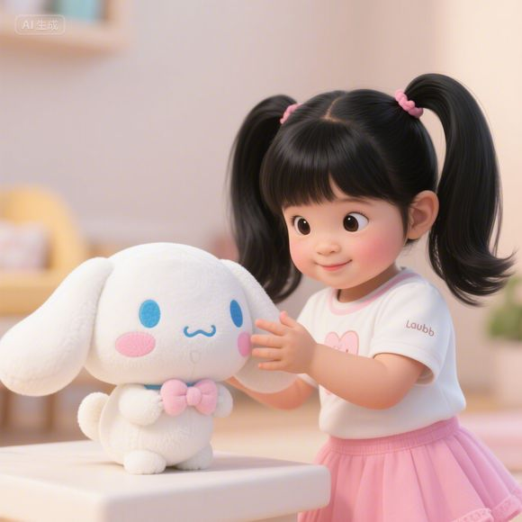
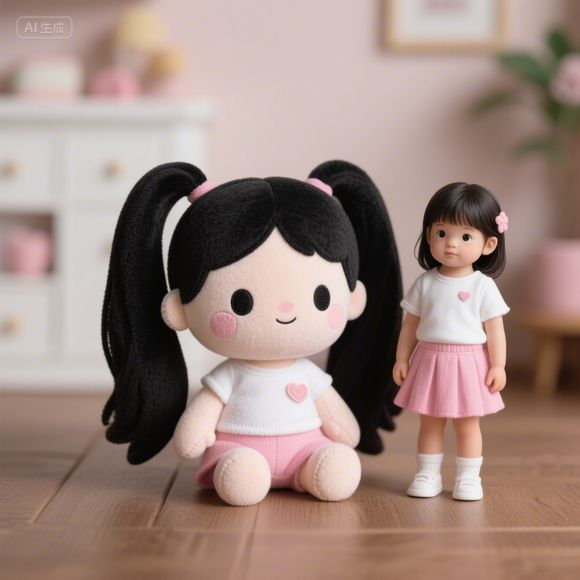
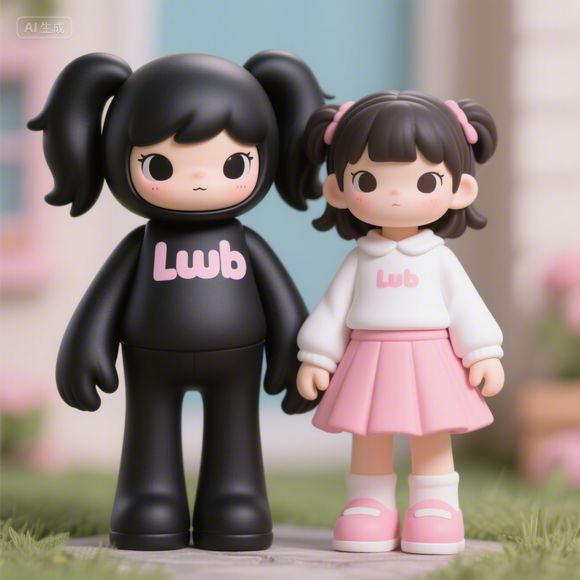
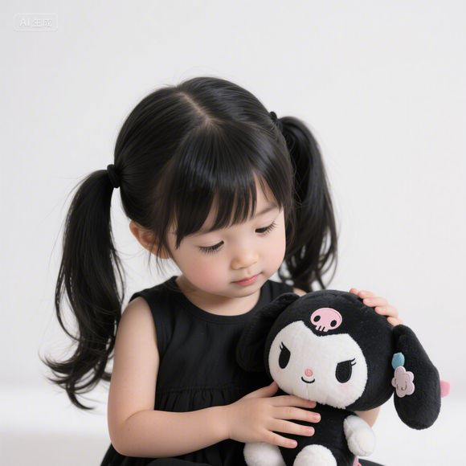

# AI 绘画提示词生成AI 绘画提示词生成AI 绘画提示词生成

> 会话ID: 8573086123077634 | 抓取时间: 2026-08-25T09:54:57.217Z | 消息数: 2 (用户1/助手1) | 图片数: 4
> 源URL: https://www.doubao.com/chat/8573086123077634

---

## **👤 用户**

让第二张兔子替换到第一张兔子，我就需要能够替换成拉布布，并且以第一张小女孩和第二张兔子角色不变，画风一致，色系一致，并且拉布布得 突出，这个IP风格要鲜明，不能变成三不像 生成ai绘画的提示词，要用到mj的提示词，要写入版本，要高效运镜，人物一致性，风格一致性，中文 ，100字

---

## **🤖 助手**

接下来，我将生成四张图片，把第二张图的兔子替换为拉布布形象，同时保持第一张图中小女孩和第二张图中兔子角色原本的样子，确保画风和色系一致，突出拉布布 IP 风格。

---
