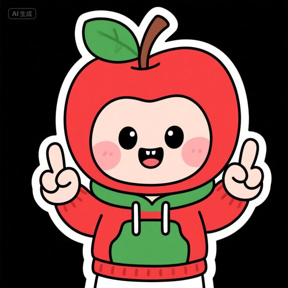
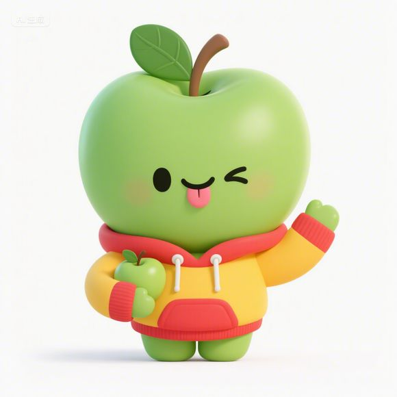
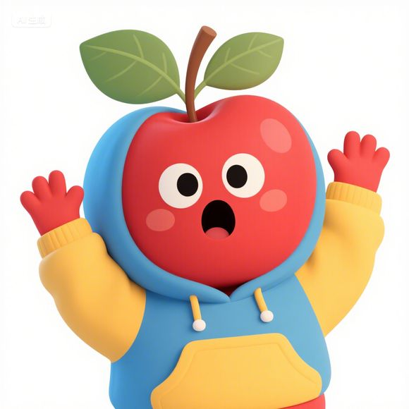
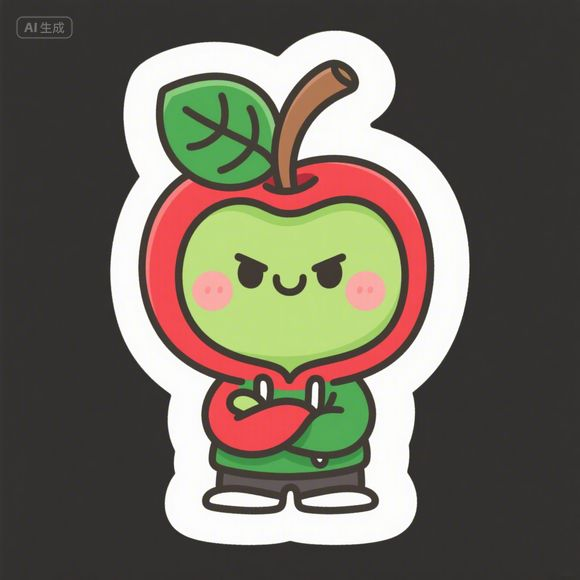

# 拆解图片及生成苹果 AI 绘画提示词拆解图片及生成苹果 AI 绘画提示词拆解图片及生成苹果 AI 绘画提示词

> 会话ID: 8452001572748034 | 抓取时间: 2026-08-25T09:55:40.777Z | 消息数: 8 (用户4/助手4) | 图片数: 8
> 源URL: https://www.doubao.com/chat/8452001572748034

---

## **👤 用户**

帮我拆解图片生成ai绘画的提示词，并且以这张图片风格生成以苹果为主的IP

---

## **🤖 助手**

已完成思考 用户现在需要拆解这张图片的 AI 绘画提示词，然后生成苹果为主的 IP，风格类似。首先分析原图的元素：卡通风格，拟人化动物（猫咪），穿着拼色连帽衫，表情是惊讶或生气，线条简洁，色彩明快，光影柔和。所以第一步拆解提示词： 首先，主体是拟人化的动物，这里是猫，风格是可爱卡通，平面插画，色彩鲜艳，拼色服饰，表情生动（比如惊讶、搞怪），线条简洁，背景简单（可能白色）。所以拆解提示词的结构： 风格：可爱卡通插画，平面设计，明快色彩，柔和光影，简洁线条。 主体：拟人化动物（这里是猫），穿着拼色连帽衫，表情生动（比如瞪大眼睛、嘴巴张开，带点情绪），肢体动作（比如握拳、动态姿势）。 现在要生成以苹果为主的 IP，所以主体换成苹果拟人化，保持同样的风格。首先确定苹果的拟人化形象，比如苹果变成有五官、四肢的卡通角色，穿着类似的拼色服饰，表情生动，风格一致。 所以构建提示词的时候，需要： 风格部分：可爱卡通插画，平面风格，色彩鲜艳明快，柔和的光影效果，简洁的线条勾勒，背景简洁（如白色）。 主体部分：拟人化的苹果角色，有着圆润的外形，带着苹果的特征（比如顶部的梗、红色或绿色的果皮色调），穿着拼色的连帽衫（比如蓝黄或其他明快配色），表情生动（比如惊讶、兴奋、搞怪等，类似原图的情绪），肢体动作活泼（比如挥手、握拳、跳跃等动态姿势），整体形象 Q 版，比例可爱，细节如脸颊的腮红等。 现在整理拆解原图的提示词，然后构建苹果 IP 的提示词： 原图提示词拆解示例（假设）： "可爱卡通风格，拟人化猫咪，穿着蓝黄拼色连帽衫，表情惊讶（瞪大眼睛，嘴巴微张，脸颊腮红），肢体动作动态（握拳），简洁线条，明快色彩，平面插画，白色背景" 然后苹果 IP 的提示词： "可爱卡通风格，拟人化苹果角色，保留苹果的外形特征（顶部果梗，圆润身形，红 / 绿色调），穿着拼色连帽衫（可参考原图的蓝黄或其他明快配色），表情生动（如兴奋、搞怪，类似的动态表情），肢体动作活泼（比如挥手、跳跃），简洁线条，明快色彩，平面插画，柔和光影，背景简洁" 还要考虑细节，比如原图的帽子有猫耳，苹果 IP 可以设计成帽子有苹果叶的元素，增加特征。服饰的拼色可以和苹果的颜色呼应，比如红和绿，或者黄和红。表情方面，原图是惊讶，苹果可以设计成开心、调皮等，保持生动。 所以具体步骤： 分析原图的风格元素：卡通、拟人、拼色服饰、生动表情、动态姿势、简洁线条、明快色彩。 替换主体为苹果，保留风格元素，加入苹果的特征（果梗、叶子、颜色）。 构建提示词，涵盖风格、主体、服饰、表情、动作、细节等。 现在写出拆解和生成的内容： 首先拆解原图的提示词方向： 艺术风格：可爱卡通插画，平面设计，低饱和度但明快的色彩（蓝黄对比），柔和的光影，简洁的轮廓线。 角色设定：拟人化动物（猫咪），Q 版比例（大头小身），穿着连帽衫（拼色，蓝黄），表情（惊讶 / 生气，瞪大眼睛，嘴巴呈波浪形，脸颊腮红），动作（双手握拳，动态姿势），配饰（帽子上的猫耳设计）。 背景：纯色（白色），突出主体。 然后生成苹果 IP 的提示词，需要将角色换成苹果拟人，保留风格： 提示词示例（用于 AI 绘画，如 Midjourney 或 Stable Diffusion）： "可爱卡通风格，拟人化苹果角色，圆润的苹果外形，顶部带有果梗和叶子，穿着蓝黄拼色连帽衫（或苹果色相关拼色，如红 + 绿），表情生动活泼（如兴奋地挥手，嘴巴张开笑，脸颊腮红），Q 版比例，简洁线条勾勒，明快色彩，柔和光影，白色背景，整体形象充满活力，类似插画中的萌系设计" 还可以细化：比如帽子可以设计成带有苹果叶的形状，服饰的细节，动作更具体，比如 “双手向上举起，仿佛在欢呼”，表情 “眼睛明亮，嘴角上扬，露出开心的表情”。 总结，拆解原图的关键元素是卡通拟人、拼色服饰、生动表情动作、简洁明快风格，然后将主体替换为苹果，加入苹果的特征，保持同样的风格元素。 一、原图 AI 绘画提示词拆解（核心元素） 风格定位 ： 可爱卡通插画， 平面化风格 （弱化立体感，强调线条和色块），色彩 明快鲜亮 （蓝黄强对比，搭配柔和腮红色调），光影 柔和清淡 （无强烈明暗，突出清新感）。 线条 简洁流畅 （轮廓清晰，细节克制，突出萌系气质）。 角色设定 ： 拟人化动物 （猫咪）， Q 版比例 （大头小身，强化可爱感）。 服饰： 拼色连帽衫 （蓝黄分割，呼应角色情绪的活泼感），袖口等细节有针织纹理暗示。 表情： 生动情绪 （惊讶 / 委屈，瞪眼、波浪形嘴巴、腮红，传递强烈情绪张力）。 动作： 动态肢体 （握拳、手臂抬起，增强画面故事感）。 二、苹果主题 IP 的 AI 绘画提示词（延续同款风格） 核心思路：将 “拟人动物” 替换为 “拟人苹果”，保留 萌系卡通、拼色服饰、生动情绪 三大核心，融入苹果特征。 prompt（可适配Midjourney/Stable 可爱卡通插画风格，拟人化苹果角色，保留苹果核心特征（圆润外形、顶部果梗+叶子、红/绿色调），Q版大头比例； 穿着 **拼色连帽衫**（参考原图蓝黄对比，或呼应苹果色设计：红+绿/黄+红），帽子可融入苹果叶造型； 表情 **生动活泼**（如“惊喜欢呼”：圆眼发亮、嘴角上扬露小牙，脸颊腮红；或“调皮搞怪”：眯眼吐舌，肢体动态如“双手比耶/抱苹果”）； 线条简洁流畅，色彩明快鲜亮（主色调呼应苹果，搭配撞色服饰），柔和光影，白色背景突出主体； 整体氛围：萌系治愈，充满童趣，类似插画的平面化设计。 三、示例拓展（细化角色性格，强化差异化） 元气苹果 ： 提示词补充 ：“拟人苹果角色，身穿黄红拼色连帽衫，帽子有苹果叶装饰，表情兴奋（眼睛弯成月牙，双手向上挥舞），脚下似有跳跃动态，背景点缀苹果形状的光斑，传递活力感。” 傲娇苹果 ： 提示词补充 ：“拟人苹果角色，身穿蓝绿拼色连帽衫，耳朵状帽子（呼应苹果叶），表情傲娇（斜眼撇嘴，双手抱胸），脸颊微红，背景浅灰渐变，强化小情绪。” 通过 “风格复用 + 主体替换 + 特征植入” ，既能延续原图的萌系卡通质感，又能让苹果 IP 拥有独特识别点（果梗、叶子、色彩呼应），实现风格统一又差异化的设计。

---

## **👤 用户**

可爱卡通插画风格，拟人化苹果角色，保留苹果核心特征（圆润外形、顶部果梗+叶子、红/绿色调），Q版大头比例； 穿着 **拼色连帽衫**（参考原图蓝黄对比，或呼应苹果色设计：红+绿/黄+红），帽子可融入苹果叶造型； 表情 **生动活泼**（如“惊喜欢呼”：圆眼发亮、嘴角上扬露小牙，脸颊腮红；或“调皮搞怪”：眯眼吐舌，肢体动态如“双手比耶/抱苹果”）； 线条简洁流畅，色彩明快鲜亮（主色调呼应苹果，搭配撞色服饰），柔和光影，白色背景突出主体； 整体氛围：萌系治愈，充满童趣，类似插画的平面化设计。

---

## **🤖 助手**

我将以简洁可爱的卡通风格，生成四张拟人化苹果角色的图片。这些苹果角色具有圆润外形、顶部带有果梗和叶子，呈现红或绿色调，采用 Q 版大头比例。它们穿着拼色连帽衫，帽子融入苹果叶造型，表情生动活泼，背景为白色。

---

## **👤 用户**

重新生成

---

## **🤖 助手**

我将再次以简洁可爱的卡通风格，生成四张拟人化苹果角色的图片。这些苹果角色仍具有圆润外形、顶部带果梗和叶子，有红或绿色调，Q版大头比例，穿着拼色连帽衫且帽子有苹果叶造型，表情生动，背景为白色。

---

## **👤 用户**

重新生成

---

## **🤖 助手**

宫崎骏AI漫画生成制作教程，治愈系漫画分屏live制作教程-抖音 教你制作，宫崎骏吉卜力风格视频-抖音 如何打造火爆全网的吉卜力动画🎬 全网都在求的吉卜力动态化教程，其实只需要一个可灵AI～ -抖音 手把手教你成变成吉卜力动画大师-抖音 最近很火的宫崎骏动画live制作教程来啦。-抖音 宫崎骏ai漫画生成入口教程 ai生成吉卜力画风特效入口 一键生成ai吉卜力画风教程入口免费-抖音 把照片变成宫崎骏动画片！治愈系漫画分屏live制作教程来了🔥-抖音 教你怎么做天空之城风格 吉卜力风 的动画 教你怎么做天空之城风格的动画 吉卜力风-抖音 宫崎骏ai漫画生成教程来啦 吉卜力风格ai生成教程-抖音 #用动画live晒出日常小确幸 #即梦AI #分屏 #宫崎骏-抖音 30s学会宫崎骏动漫风格视频-抖音 免费！不用gpt4o，教你做吉卜力动画~-抖音 把照片变成宫崎骏动画片 治愈我宫崎骏漫画live图视频制作教程-抖音 宫崎骏动画live视频制作教程来了-抖音 照片一键转吉卜力风视频，30秒教你怎么制作，超简单！-抖音 宫崎骏ai漫画生成制作教程，治愈系漫画分屏live制作教程-抖音 用吉卜力画风打开经典影视角色-抖音 怎么用AI来制作这种吉卜力风格的影视转绘动画视频呢？ 接下来，我将给你分享一种非常实用的方法，仅供个人学习使用哦~ 只需3步： （1）搜索并录屏影视的封神片段； （2）用可灵AI进行转绘和生视频； （3）用剪辑软件进行成片的制作。 具体操作细节，可以详细观看我的教程进行学习哦～ 有任何问题或想法，都可以留言告诉我，看到后我都会尽力一一解答的。-抖音 宫崎骏ai live动图 教程来喽-抖音 手残党5分钟也能用Ai一键生成吉卜力风格动画视频。-抖音 1分钟搞定吉卜力风AI短片，支持多镜头切换-抖音 宫崎骏AI漫画生成制作教程，治愈系漫画分屏live制作教程-抖音 教你怎么做天空之城风格 吉卜力风 的动画 教你怎么做天空之城风格的动画 吉卜力风-抖音 教你制作，宫崎骏吉卜力风格视频-抖音 最近很火的宫崎骏动画live制作教程来啦。-抖音 宫崎骏ai漫画生成入口教程 ai生成吉卜力画风特效入口 一键生成ai吉卜力画风教程入口免费-抖音 照片一键转吉卜力风视频，30秒教你怎么制作，超简单！-抖音 宫崎骏动画live视频制作教程来了-抖音 宫崎骏ai漫画生成制作教程，治愈系漫画分屏live制作教程-抖音 吉卜力画风教程，真的超级简单，学会的宝子记得在评论区交作业！-抖音 如何打造火爆全网的吉卜力动画🎬 全网都在求的吉卜力动态化教程，其实只需要一个可灵AI～ -抖音 宫崎骏ai漫画生成教程来啦 吉卜力风格ai生成教程-抖音 吉卜力画风免费制作教程-抖音 吉卜力风格ai生成教程来啦 宫崎骏ai漫画生成入口 ai生成吉卜力画风教程 用styleart制作吉卜力图 用即梦制作吉卜力图 吉卜力风格ai生成 吉卜力特效制作软件 吉卜力画风免费一键生成 宫崎骏ai漫画生成特效 把时间变成宫崎骏动画 宫崎骏吉卜力画风-抖音 #用动画live晒出日常小确幸 #即梦AI #分屏 #宫崎骏-抖音 照片转吉卜力漫画风格ai教程来了-抖音 怎么用AI来制作这种吉卜力风格的影视转绘动画视频呢？ 接下来，我将给你分享一种非常实用的方法，仅供个人学习使用哦~ 只需3步： （1）搜索并录屏影视的封神片段； （2）用可灵AI进行转绘和生视频； （3）用剪辑软件进行成片的制作。 具体操作细节，可以详细观看我的教程进行学习哦～ 有任何问题或想法，都可以留言告诉我，看到后我都会尽力一一解答的。-抖音 用吉卜力画风打开经典影视角色-抖音 免费！不用gpt4o，教你做吉卜力动画~-抖音 把照片变成宫崎骏动画片！治愈系漫画分屏live制作教程来了🔥-抖音 30s学会宫崎骏动漫风格视频-抖音 手残党5分钟也能用Ai一键生成吉卜力风格动画视频。-抖音 ⚠️⚠️置顶视频‼️‼️🈶【一键做同款】-抖音 一键生成ai吉卜力画风教程-抖音 你们在找的吉卜力画风教程来啦！-抖音 如何用AI生成宫崎骏风格图片-抖音 小白也能秒学会的AI生图，最近爆火的AI模型-抖音 让子弹飞名场面 吉卜力风格-抖音 【艺闻录】手绘稿超十万张，你知道-抖音 #进入宫崎骏的动漫世界 这种自己生成专属的独家回忆，真的又独特又好看！#头像 #吉卜力-抖音 #二次元ai绘画 #宫崎骏与吉卜力的世界 宫崎骏里的样子-抖音 GPT-4o吉卜力风格爆火，引版权争议：“宫崎骏不会同意的” “这是对生命本身的侮辱。”宫崎骏曾如此评价AI生成的动画。而现在，随着GPT-4o的吉卜力风格爆火，社交平台上充斥着人们用AI生成的类似风格的图片，OpenAI再度陷入版权争议。-抖音 最近很火的吉卜力风格图片，制作起来这么简单！-抖音 #宫崎骏 #你永远可以被宫崎骏治愈 #治愈系 #宫崎骏与吉卜力的世界 #好像看到了宫崎骏的童话世界-抖音 来自吉卜力的童话世界！画风太治愈了！今日欣赏西班牙艺术家阿拉里科的插画！-抖音

---
