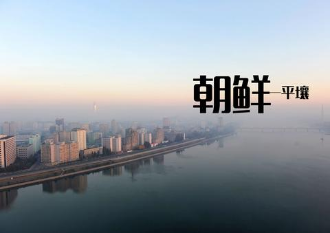

# 介绍朝鲜介绍朝鲜介绍朝鲜

> 会话ID: 7442367934735362 | 抓取时间: 2026-08-25T09:59:33.328Z | 消息数: 2 (用户1/助手1) | 图片数: 1
> 源URL: https://www.doubao.com/chat/7442367934735362

---

## **👤 用户**

搜索一下：朝鲜

---

## **🤖 助手**

以下是关于朝鲜的详细介绍： 基本概况 3 地理位置 ：位于亚洲东部、朝鲜半岛北半部，东濒日本海，西临黄海，北以鸭绿江、图们江与中国为邻，东北一隅隔图们江与俄罗斯相望，南以军事分界线为界与韩国相接。 国土面积与人口 ：国土面积为 12.3 万平方公里，截至 2024 年 10 月，总人口约 2500 万人。 首都 ：平壤，面积 2629.4 平方公里，人口约 325 万，下设 18 个区、4 个郡，是朝鲜的政治、经济和文化中心。 景点 朝鲜平壤 民族与语言 ：朝鲜是世界上民族最单一的国家之一，几乎全部居民是朝鲜人，官方语言为朝鲜语。 地形地貌 ：北部与东部地势高，向西、南渐次降低，山地面积占国土面积的 79.3%，全国平均海拔为 443 米，北部边境的将军峰海拔 2749 米，是朝鲜第一高峰。 气候特征 ：属典型的温带季风气候，四季分明，年平均气温 9.7℃。 历史沿革 4 古代历史 ：正式史料中记载的古朝鲜国家，最早是西周灭商之后，由商朝遗臣箕子到朝鲜半岛与当地土著建立的 “箕氏侯国”，史称 “箕子朝鲜”。公元前 194 年，卫满在平壤一带建立卫氏政权，推翻了箕子朝鲜的政权，称 “卫满朝鲜”。公元前 108 年，卫满朝鲜灭亡，汉武帝在其领域内设置汉四郡。此后，朝鲜半岛经历了高句丽、百济、新罗三国鼎立的时代，668 年，新罗在唐朝的协助下灭亡了高句丽，朝鲜半岛进入统一新罗时代。 近代历史 ：1910 年，“日韩合并”，朝鲜半岛被日本吞并。1945 年日本二战投降后，朝鲜半岛由苏联和美国共同托管，苏联红军和美军以北纬 38° 线为界，分别进驻朝鲜半岛北部和南部。1948 年 9 月 9 日，朝鲜民主主义人民共和国成立。 现代历史 ：1950 年 6 月 25 日，朝鲜战争爆发，1953 年 7 月 27 日，朝鲜半岛沿三十八度线非军事区划分为两个国家，半岛北方即为朝鲜民主主义人民共和国。 政治体制 2 最高权力机关 ：最高人民会议是国家最高权力机关，代表根据普遍、平等、直接选举原则采取投票方式选举产生，每届任期 5 年。 行政机关 ：内阁是国家最高行政执行机关，每届任期 5 年。 司法机构 ：审判机关有中央裁判所（即中央法院）、道（直辖市）裁判所、人民裁判所（基层法院）和特别裁判所。检察机关有中央检察所、道（直辖市）、市（区）、郡检察所和特别检察所。 经济情况 经济体制 ：实行计划经济，据 2024 年 1 月朝鲜官方公布数据，2023 年完成预算收入 100.5%，支出执行 99.8% 2 。 产业发展 ：重视发展冶金、电力、煤炭、铁路运输四大先行产业和采矿、机械、化工、轻工业。集中力量发展粮食生产，继续推行种子改良和二熟制，扩大土豆、大豆种植，粮食生产以水稻和玉米为主 2 。 自然资源 ：已探明矿产 300 多种，其中有用矿 200 多种，石墨、菱镁矿储量居世界前列，铁矿及铝、锌、铜、银等有色金属和煤炭、石灰石、云母、石棉等非金属矿物储量丰富，水力和森林资源较丰富 2 。 对外贸易 ：主要贸易伙伴为中国、俄罗斯、韩国等 2 。 社会生活 教育 ：实行 12 年义务教育制，有大专院校 300 多所，中专 570 多所，大学生和专科学校学生享受国家助学金 2 。 文化 ：朝鲜的文化艺术丰富多彩，包括音乐、舞蹈、戏剧、电影等。朝鲜的传统音乐有盘索里、伽倻琴弹唱等，传统舞蹈有长鼓舞、扇子舞等。 体育 ：朝鲜非常重视体育事业，在足球、乒乓球、举重等项目上取得了不错的成绩。 对外政策 5 外交方针 ：奉行 “自主、和平、友好” 的外交政策，主张按照完全平等、自主、相互尊重、互不干涉内政和互利的原则发展对外关系。 与周边国家关系 ：与中国保持着传统友好合作关系，中国是朝鲜最大的贸易伙伴和经济援助国。与韩国的关系则因历史和现实问题时而紧张时而缓和。与美国自 2019 年河内 “金特会” 破裂后，美朝无核化谈判陷入僵局，美国持续对朝制裁。

---
