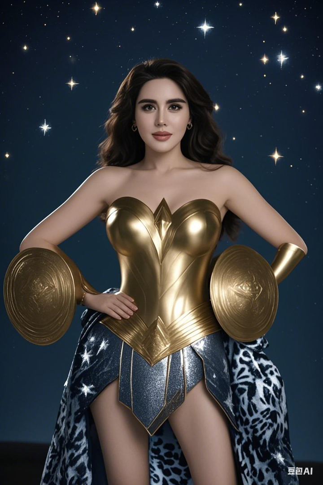
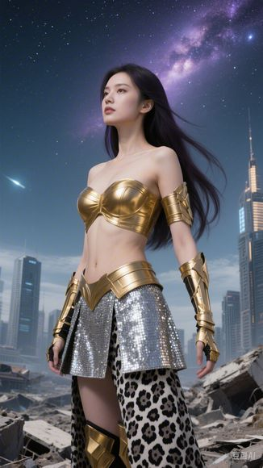
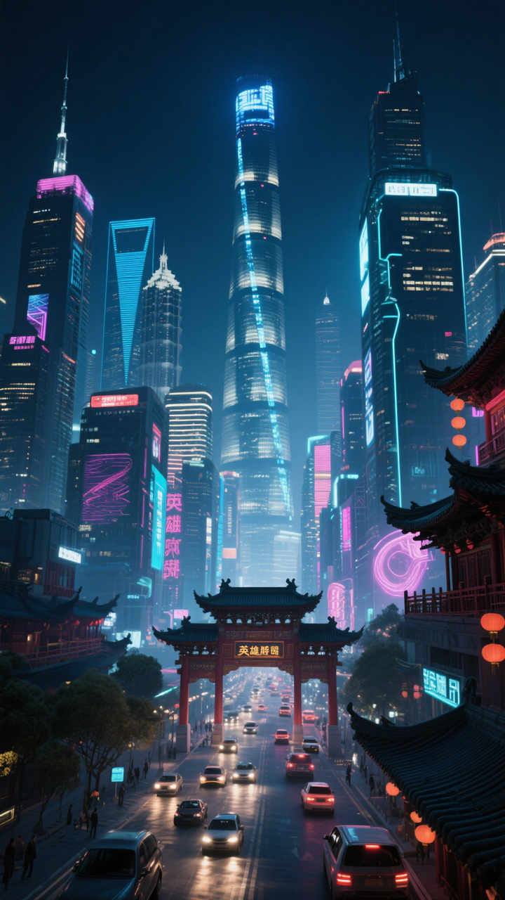

# 视频脚本改编视频脚本改编视频脚本改编

> 会话ID: 7341955834833410 | 抓取时间: 2026-08-25T10:01:49.614Z | 消息数: 4 (用户2/助手2) | 图片数: 3
> 源URL: https://www.doubao.com/chat/7341955834833410

---

## **👤 用户**

好的，以下是将第一章内容改编为1分钟视频脚本的版本。这个脚本适合用于制作短视频，包含画面描述、台词和音效提示，帮助你更好地进行视频创作。 --- ### **脚本：《星际守护者》第一章：危机降临** #### **镜头 1：城市夜景** - **画面**：夜幕下的新上海，霓虹闪烁，高楼林立，车水马龙。 - **台词**：（旁白）“新上海，地球联盟的科技中心，人类文明的骄傲。” - **时长**：5秒 - **音效**：城市夜晚的喧嚣声、车辆穿梭声。 - **镜头运动**：缓慢推进，展现城市的繁华。 #### **镜头 2：天际线被撕裂** - **画面**：天空中突然出现刺眼的光束，划破夜空，高楼大厦在爆炸中倒塌。 - **台词**：（旁白）“然而，这份宁静并未持续太久……” - **时长**：10秒 - **音效**：激光武器声、爆炸声、警报声。 - **镜头运动**：快速切换，展现城市的混乱。 #### **镜头 3：戴安娜降临** - **画面**：戴安娜从天而降，身披星辰战衣，手持神力护盾，出现在废墟之中。 - **台词**：（戴安娜）“我是戴安娜，我将保护你们！” - **时长**：10秒 - **音效**：风声、金属碰撞声。 - **镜头运动**：从高处俯拍，展现戴安娜的英姿。 #### **镜头 4：战斗场景** - **画面**：戴安娜挥舞神剑，与机器人展开激烈战斗。神力护盾闪烁光芒，机器人被击飞。 - **台词**：（戴安娜）“你们这些冷血的机器，休想伤害无辜！” - **时长**：15秒 - **音效**：金属碰撞声、激光声、爆炸声。 - **镜头运动**：快速切换，展现战斗的激烈。 #### **镜头 5：机械战舰出现** - **画面**：巨大的机械战舰从天而降，对准戴安娜。 - **台词**：（机械战舰）“人类的守护者，你的抵抗是徒劳的。黑暗纪元的统治已经无法阻挡！” - **时长**：10秒 - **音效**：战舰引擎声、激光聚集声。 - **镜头运动**：从侧面拍摄，展现战舰的威压。 #### **镜头 6：戴安娜反击** - **画面**：戴安娜高举神剑，神力护盾闪耀光芒，冲击波击中战舰，战舰爆炸。 - **台词**：（戴安娜）“黑暗纪元的统治，今天就到此为止！” - **时长**：10秒 - **音效**：神剑挥动声、爆炸声。 - **镜头运动**：从戴安娜的视角拍摄，展现冲击波的威力。 #### **镜头 7：城市恢复宁静** - **画面**：战舰爆炸后，机器人瘫痪，城市恢复宁静，人们欢呼。 - **台词**：（旁白）“戴安娜，你是我们的英雄！” - **时长**：5秒 - **音效**：人们的欢呼声。 - **镜头运动**：缓慢拉远，展现城市的全貌。 #### **镜头 8：戴安娜的誓言** - **画面**：戴安娜站在废墟之上，望着星空，眼神坚定。 - **台词**：（戴安娜）“我不会让黑暗纪元得逞的。我会保护这个世界，直到最后一刻。” - **时长**：10秒 - **音效**：风声、远处的欢呼声。 - **镜头运动**：固定镜头，展现戴安娜的背影。 --- ### **总结** - **总时长**：60秒 - **核心元素**：戴安娜的英勇形象、战斗场景、黑暗纪元的威胁、城市的混乱与恢复、戴安娜的坚定誓言。 - **视觉风格**：未来科幻感，结合中国城市的现代与传统元素，展现戴安娜的英雄主义。 希望这个脚本能够帮助你顺利制作出精彩的视频！将脚本里戴安娜都替换成紫薇,并且将张照片的人物形象替换掉.戴安娜,重新在生成，比例 「9:16」

---

## **🤖 助手**

接下来，我将按照脚本内容生成图片，其中戴安娜替换为紫薇，紫薇的形象参考你上传图片中的女性，她有着深色的长发，身材苗条，妆容精致，神态自信从容，表情平和。身着一套极具视觉冲击力的服装，上身是金色的无肩带紧身胸衣，设计凸显身材曲线，搭配金色护臂和护裙，护裙下方是带有银色亮片装饰的裙片，下身裙装的下半部分带有黑白豹纹图案。画面是未来科幻感，结合中国城市的现代与传统元素，展现紫薇的英雄主义。 下面是镜头 1 的图片，夜幕下的新上海，霓虹闪烁，高楼林立，车水马龙。 下面是镜头 2 的图片，天空中突然出现刺眼的光束，划破夜空，高楼大厦在爆炸中倒塌。 下面是镜头 3 的图片，紫薇从天而降，身披星辰战衣，手持神力护盾，出现在废墟之中。 下面是镜头 4 的图片，紫薇挥舞神剑，与机器人展开激烈战斗。神力护盾闪烁光芒，机器人被击飞。 下面是镜头 5 的图片，巨大的机械战舰从天而降，对准紫薇。 下面是镜头 6 的图片，紫薇高举神剑，神力护盾闪耀光芒，冲击波击中战舰，战舰爆炸。 下面是镜头 7 的图片，战舰爆炸后，机器人瘫痪，城市恢复宁静，人们欢呼。 下面是镜头 8 的图片，紫薇站在废墟之上，望着星空，眼神坚定。

---

## **👤 用户**

生成视频

---

## **🤖 助手**

---
