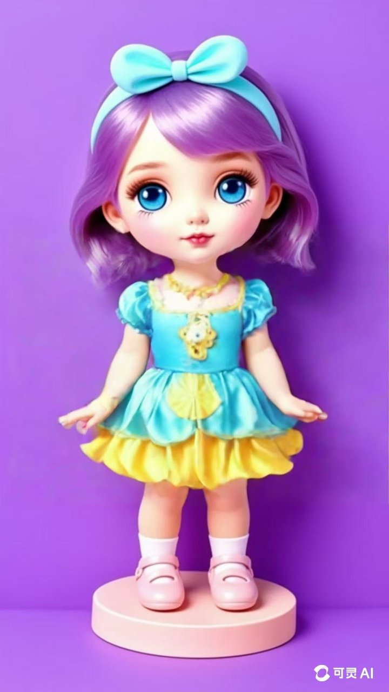
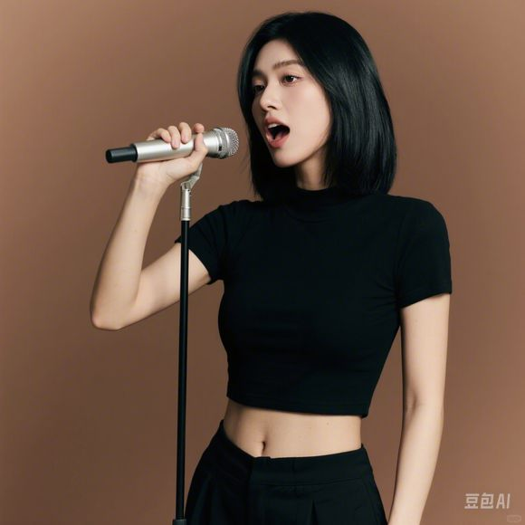
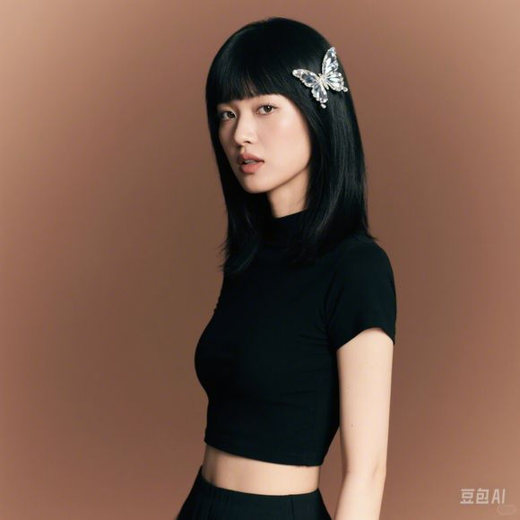
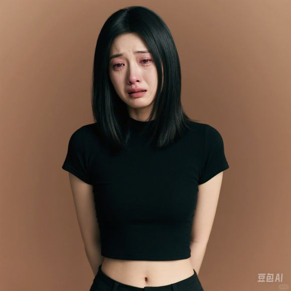
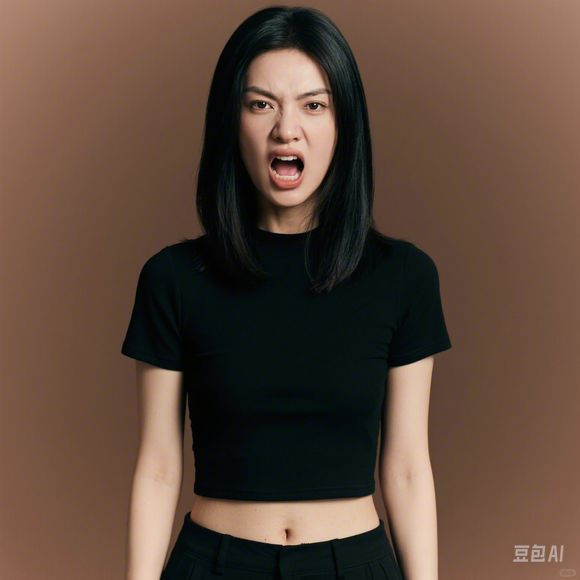
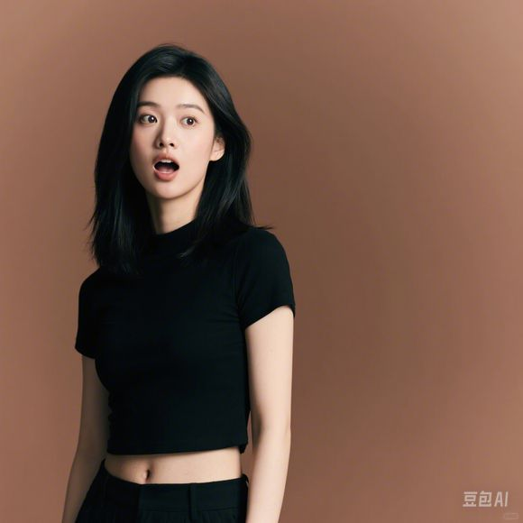
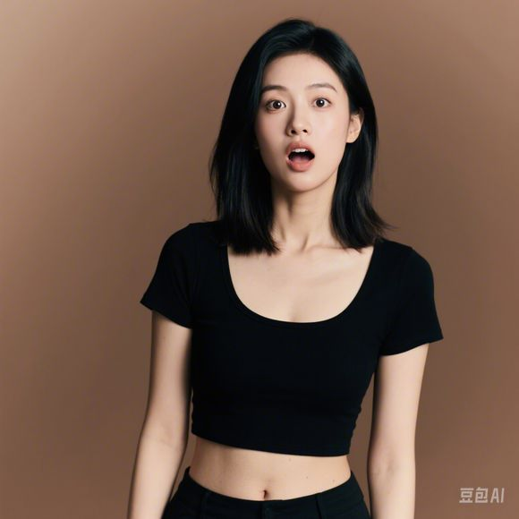

# 按要求生成角色按要求生成角色按要求生成角色

> 会话ID: 6772298643155714 | 抓取时间: 2026-08-25T10:04:23.537Z | 消息数: 11 (用户5/助手6) | 图片数: 8
> 源URL: https://www.doubao.com/chat/6772298643155714

---

## **👤 用户**

比例 「1:1」 生成这个形象一致的角色，嘴张开，6个不同动作和姿势

---

## **🤖 助手**

接下来我会生成 6 张卡通风格的图片，图中是同一个小女孩，嘴张开，且有着 6 种不同的动作和姿势。小女孩齐肩淡紫色短发，身形纤瘦，年幼可爱，穿着上半部分蓝色、下半部分黄色且领口和裙摆有黄色装饰、胸前带黄色小熊图案的连衣裙，脖子戴金色项链，头上戴浅蓝色蝴蝶结发箍，脚穿白色袜子和粉色小皮鞋，站在粉色圆形底座上，背景是纯紫色。

---

## **👤 用户**

比例 「1:1」 生成这个形象一致的角色，第一张抱着吉他唱歌，第二张手拿麦克风，第三张发卡换成水晶蝴蝶，第四要伤心，第五张，要愤怒，第六张要惊喜，第七张要惊讶

---

## **🤖 助手**

接下来我会生成 7 张卡通风格的图片，图中是同一个小女孩，保持形象一致。第一张小女孩抱着吉他唱歌；第二张手拿麦克风；第三张发卡换成水晶蝴蝶；第四张小女孩呈现伤心的表情；第五张小女孩表现出愤怒的神情；第六张小女孩露出惊喜的样子；第七张小女孩呈现惊讶的神态。小女孩齐肩淡紫色短发，身形纤瘦，年幼可爱，穿着上半部分蓝色、下半部分黄色且领口和裙摆有黄色装饰、胸前带黄色小熊图案的连衣裙，脖子戴金色项链，脚穿白色袜子和粉色小皮鞋，站在粉色圆形底座上，背景是纯紫色。

---

## **👤 用户**

比例 「1:1」 生成这个形象一致的角色，第一张抱着吉他唱歌，第二张手拿麦克风，第三张发卡换成水晶蝴蝶，第四要伤心，第五张，要愤怒，第六张要惊喜，第七张要惊讶

---

## **🤖 助手**

接下来我会生成 7 张写实风格的图片，图中是同一个女性，保持形象一致。第一张抱着吉他唱歌；第二张手拿麦克风；第三张将发卡换成水晶蝴蝶；第四张呈现伤心的表情；第五张表现出愤怒的神情；第六张露出惊喜的样子；第七张呈现惊讶的神态。这位女性留着乌黑亮丽的中长发，发型整齐顺滑，面容姣好，身材苗条，身着黑色短袖紧身上衣，搭配黑色下装，露出一小截平坦的腹部。

---

## **👤 用户**

比例 「1:1」 生成这个形象一致的角色，第一张抱着吉他唱歌，第二张手拿麦克风，第三张发卡换成水晶蝴蝶，第四要伤心，第五张，要愤怒，第六张要惊喜，第七张要惊讶

---

## **🤖 助手**

接下来我会生成7张写实摄影风格的图片，图中是同一个女性，保持形象一致。第一张抱着吉他唱歌；第二张手拿麦克风；第三张将发卡换成水晶蝴蝶；第四张呈现伤心的表情；第五张表现出愤怒的神情；第六张露出惊喜的样子；第七张呈现惊讶的神态。这位女性留着整齐的黑色直发，披于身后，面容清秀，身材苗条，身着白色西装外套，内搭白色衬衫，系着一条灰蓝格子领带，背景为纯色的蓝色。

---

## **👤 用户**

比例 「1:1」 生成这个形象一致的角色，第一张抱着吉他唱歌，第二张手拿麦克风，第三张发卡换成水晶蝴蝶，第四要伤心，第五张，要愤怒，第六张要惊喜，第七张要惊讶，并且写出相应的文字，做成表情包gif

---

## **🤖 助手**

以下是生成7张表情包gif的思路： 一、生成图片 第一张：抱着吉他唱歌 画面描述 ： 女性穿着白色西装外套，内搭白色衬衫，系着灰蓝格子领带，黑色长发披肩。她抱着一把吉他，嘴巴张开，似乎在唱歌。 生成代码示例（假设使用图像生成软件） ： python 运行 { "type" : "generate" , "numbers" : 1 , "prompt" : [ "画面风格是通过细腻的光影与细节呈现真实场景的写实摄影风格。一位留着整齐黑色直发、披于身后、面容清秀、身材苗条的女性，身着白色西装外套，内搭白色衬衫，系着一条灰蓝格子领带，站在纯色蓝色背景前。她嘴巴张开唱歌，双手抱着一把棕色的吉他。" ] , "neg_prompt" : [ "画面模糊，低质量" ] , "ratio" : [ "1:1" ] } 第二张：手拿麦克风 画面描述 ： 女性穿着相同的服装，右手拿着一个麦克风，嘴巴张开，可能在说话或唱歌。 生成代码示例 ： python 运行 { "type" : "generate" , "numbers" : 1 , "prompt" : [ "画面风格是通过细腻的光影与细节呈现真实场景的写实摄影风格。一位留着整齐黑色直发、披于身后、面容清秀、身材苗条的女性，身着白色西装外套，内搭白色衬衫，系着一条灰蓝格子领带，站在纯色蓝色背景前。她嘴巴张开，一只手拿着一个银色的麦克风。" ] , "neg_prompt" : [ "画面模糊，低质量" ] , "ratio" : [ "1:1" ] } 第三张：发卡换成水晶蝴蝶 画面描述 ： 女性穿着相同的服装，头上戴着一个水晶蝴蝶发卡，表情自然。 生成代码示例 ： python 运行 { "type" : "generate" , "numbers" : 1 , "prompt" : [ "画面风格是通过细腻的光影与细节呈现真实场景的写实摄影风格。一位留着整齐黑色直发、披于身后、面容清秀、身材苗条的女性，头上戴着水晶蝴蝶发卡，身着白色西装外套，内搭白色衬衫，系着一条灰蓝格子领带，站在纯色蓝色背景前。她神态自然，微微张嘴。" ] , "neg_prompt" : [ "画面模糊，低质量" ] , "ratio" : [ "1:1" ] } 第四张：伤心 画面描述 ： 女性穿着相同的服装，眼睛含泪，嘴巴微张，脸上露出伤心的表情。 生成代码示例 ： python 运行 { "type" : "generate" , "numbers" : 1 , "prompt" : [ "画面风格是通过细腻的光影与细节呈现真实场景的写实摄影风格。一位留着整齐黑色直发、披于身后、面容清秀、身材苗条的女性，身着白色西装外套，内搭白色衬衫，系着一条灰蓝格子领带，站在纯色蓝色背景前。她嘴巴微张，眼睛含泪，脸上露出伤心的表情。" ] , "neg_prompt" : [ "画面模糊，低质量" ] , "ratio" : [ "1:1" ] } 第五张：愤怒 画面描述 ： 女性穿着相同的服装，眉头紧皱，嘴巴大张，脸上露出愤怒的表情。 生成代码示例 ： python 运行 { "type" : "generate" , "numbers" : 1 , "prompt" : [ "画面风格是通过细腻的光影与细节呈现真实场景的写实摄影风格。一位留着整齐黑色直发、披于身后、面容清秀、身材苗条的女性，身着白色西装外套，内搭白色衬衫，系着一条灰蓝格子领带，站在纯色蓝色背景前。她嘴巴大张，眉头紧皱，脸上露出愤怒的表情。" ] , "neg_prompt" : [ "画面模糊，低质量" ] , "ratio" : [ "1:1" ] } 第六张：惊喜 画面描述 ： 女性穿着相同的服装，眼睛睁大，嘴巴张开成O型，脸上露出惊喜的表情。 生成代码示例 ： python 运行 { "type" : "generate" , "numbers" : 1 , "prompt" : [ "画面风格是通过细腻的光影与细节呈现真实场景的写实摄影风格。一位留着整齐黑色直发、披于身后、面容清秀、身材苗条的女性，身着白色西装外套，内搭白色衬衫，系着一条灰蓝格子领带，站在纯色蓝色背景前。她嘴巴张开成O型，眼睛睁大，脸上露出惊喜的表情。" ] , "neg_prompt" : [ "画面模糊，低质量" ] , "ratio" : [ "1:1" ] } 第七张：惊讶 画面描述 ： 女性穿着相同的服装，眼睛圆睁，嘴巴张开，脸上露出惊讶的表情。 生成代码示例 ： python 运行 { "type" : "generate" , "numbers" : 1 , "prompt" : [ "画面风格是通过细腻的光影与细节呈现真实场景的写实摄影风格。一位留着整齐黑色直发、披于身后、面容清秀、身材苗条的女性，身着白色西装外套，内搭白色衬衫，系着一条灰蓝格子领带，站在纯色蓝色背景前。她嘴巴张开，眼睛圆睁，脸上露出惊讶的表情。" ] , "neg_prompt" : [ "画面模糊，低质量" ] , "ratio" : [ "1:1" ] } 二、添加文字 第一张：抱着吉他唱歌 文字 ：“我要高歌一曲~” 第二张：手拿麦克风 文字 ：“听我唱~” 第三张：发卡换成水晶蝴蝶 文字 ：“今天美美的~” 第四张：伤心 文字 ：“呜呜，不开心” 第五张：愤怒 文字 ：“哼，生气了！” 第六张：惊喜 文字 ：“哇，太棒了！” 第七张：惊讶 文字 ：“啊，真意外！” 三、制作成表情包gif 使用图像编辑软件（如Adobe Photoshop）或专门的gif制作软件（如GIMP、Ezgif等）将这7张图片按顺序排列，并添加相应的文字。 设置每帧的停留时间（例如，0.5 - 1秒），然后导出为gif格式。这样就完成了7个表情包gif的制作。

---

## **🤖 助手**

这张图片展示了一个可爱的玩偶形象。反推这张图片的提示词可能如下： 一个可爱的玩偶形象。 玩偶有着长长的紫色头发，头顶戴着一个蓝色的蝴蝶结。 玩偶穿着一件蓝色的连衣裙，裙子上有粉色的装饰。 玩偶站在一个粉色的圆形底座上。 背景是紫色的。

---
