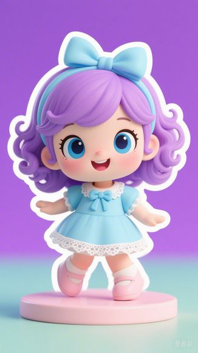

# 图片人物动作编辑图片人物动作编辑图片人物动作编辑

> 会话ID: 6642554015723010 | 抓取时间: 2026-08-25T10:05:24.465Z | 消息数: 10 (用户5/助手5) | 图片数: 1
> 源URL: https://www.doubao.com/chat/6642554015723010

---

## **👤 用户**

写出让这个人物跳舞，弹吉他，嘴巴唱歌，在即梦上生成的提示词

---

## **🤖 助手**

接下来，我将对图片进行编辑，让小女孩跳舞、弹吉他、嘴巴唱歌。

---

## **👤 用户**

写出让这个人物跳舞，弹吉他，嘴巴唱歌，在即梦上生成的提示词

---

## **🤖 助手**

以下是在即梦上生成让这个人物跳舞、弹吉他、嘴巴唱歌的提示词： 让这个穿着粉色鞋子、有着紫色头发和蓝色大眼睛的可爱玩偶女孩，身着绿色毛衣和粉色裙子，头戴蓝色蝴蝶结，欢快地跳舞，右手拨弄着一把彩色的吉他，嘴巴微张做出唱歌的姿态。

---

## **👤 用户**

对图片进行编辑，让小女孩跳舞、弹吉他、嘴巴唱歌

---

## **🤖 助手**

如果你想要对图片进行编辑，让小女孩跳舞、弹吉他、嘴巴唱歌，以下是一些可能的提示词： 在图像处理软件中（如 Photoshop） 使用图层和变换工具，将小女孩的手臂调整到弹吉他的姿势。 从其他图片中找到一把合适的吉他，合成到小女孩的手中。 使用液化工具或变形工具，调整小女孩的身体姿态，使其看起来像是在跳舞。 利用画笔工具或图像素材，添加唱歌的口型效果。 使用 AI 图像编辑工具（如 Dall - E、Midjourney 等） 输入提示词：“一个穿着粉色鞋子、有着紫色头发和蓝色大眼睛的可爱玩偶女孩，身着绿色毛衣和粉色裙子，头戴蓝色蝴蝶结，正在跳舞、弹吉他和唱歌。” 根据生成的图像进行调整和修改，直到达到满意的效果。 使用动画软件（如 Adobe Animate、Toon Boom 等） 将小女孩的图像导入动画软件，创建关键帧。 在关键帧中调整小女孩的姿态和动作，使其表现出跳舞、弹吉他和唱歌的动作。 添加背景音乐和音效，增强动画效果。 希望这些提示词能帮助你实现对图片的编辑。

---

## **👤 用户**

图片进行生成，让小女孩跳舞、弹吉他、嘴巴唱歌

---

## **🤖 助手**

我将生成一张图片，画面中有一个穿着粉色鞋子、紫色头发、头戴蓝色蝴蝶结、身着绿色毛衣和粉色裙子的小女孩，她正在欢快地跳舞、弹吉他且嘴巴唱歌。

---

## **👤 用户**

图片进行生成，让小女孩跳舞、弹吉他、嘴巴唱歌

---

## **🤖 助手**

我将以你上传的图片为参考，生成一张全身的可爱玩偶贴纸风格图片，图中有个紫色头发、蓝眼睛、戴蝴蝶结发带、穿浅蓝色短裙和浅粉色鞋子的女孩，站在玩偶底座上，带着开心好奇的表情，背景是活力紫色。 已生成 ''' python { "type": "generate", "numbers": 1, "prompt": ["画面风格是色彩鲜艳、形象可爱的玩偶贴纸风格。一个有着紫色卷发、蓝色眼睛、面容精致、神态甜美、表情开心又好奇的小女孩，额头戴着一个浅蓝色蝴蝶结发带，身穿一件短款的婴儿蓝色连衣裙，裙子上有白色蕾丝装饰，领口处还有一个浅蓝色蝴蝶结，脚穿一双浅粉色的鞋子，正站在玩偶的浅粉色圆形底座上。背景为充满活力的紫色调。"], "neg_prompt": ["画面模糊，低质量"], "ratio": ["9:16"] }

---
