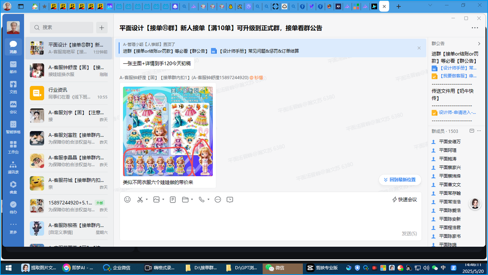
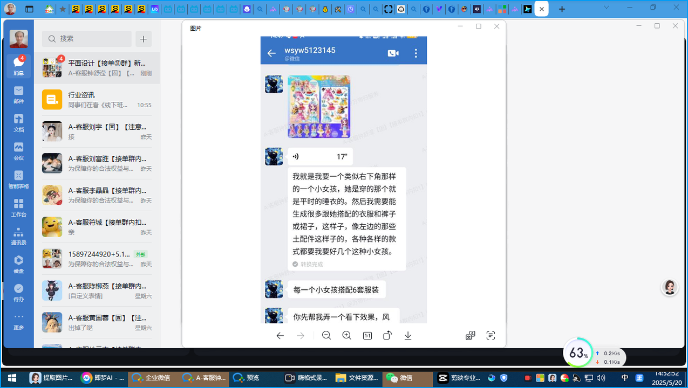

# 提取图片文字换服装教程20250520提取图片文字换服装教程20250520提取图片文字换服装教程20250520

> 会话ID: 6296792414010370 | 抓取时间: 2026-08-25T10:05:36.799Z | 消息数: 19 (用户9/助手10) | 图片数: 8
> 源URL: https://www.doubao.com/chat/6296792414010370

---

## **👤 用户**

提取文字

---

## **🤖 助手**

第一张图文字： 平面设计（接单①群）新人接单（满 10 单）可升级到正式群，接单看群公告 A - 客户张鑫（图案）：在吗？我要下单了 A - 客户张鑫（图案）：一条主题图，详情看手绘图 1-20 张初稿 行业动态：同友们在看《接单下班》 A - 客户刘宁（图标）（注：明天...）：为我的新的合法版权设计一下 A - 客户刘宁（图标）：为我的新的合法版权设计一下 A - 客户李晶晶（接单①群）：为我的新的合法版权设计一下 A - 客户张城（接单①群）：接单群内接单 15897244920+S1：为我的新的合法版权设计一下 A - 客户陈洋洋（接单①群）：（自定义表情） 第二张图文字： 平面设计（接单①群）新人接单（满 10 单）可升级到正式群，接单看群公告 A - 客户刘宁（图标）（注：明天...）：为我的新的合法版权设计一下 A - 客户刘宁（图标）：为我的新的合法版权设计一下 A - 客户李晶晶（接单①群）：为我的新的合法版权设计一下 A - 客户张城（接单①群）：接单群内接单 15897244920+S1：为我的新的合法版权设计一下 A - 客户陈洋洋（接单①群）：（自定义表情） 17：我就是我要一个类似右下角那样的一个小女孩，她是穿的那个就是平时的睡衣的。然后我需要能生成很多跟她搭配的衣服或裙子或裤子，这样子，像左边的那些土配件这样子的，各种各样的款式都要我要好这种小女孩。 每一个小女孩搭配 3 套服装 你先帮我弄一个效果，风

---

## **👤 用户**

我就是我要一个类似右下角那样的一个小女孩，她是穿的那个就是平时的睡衣的。然后我需要能生成很多跟她搭配的衣服或裙子或裤子，这样子，像左边的那些土配件这样子的，各种各样的款式都要我要好这种小女孩。出方案并且有视频教程

---

## **🤖 助手**

以下是根据你的需求生成的方案： 一、小女孩形象设计 基本形象 与右下角小女孩相似的外貌特征，包括发型、脸型等。 设计一套日常睡衣，包括上衣和裤子，睡衣风格可以是可爱、简约或其他你喜欢的风格。 睡衣颜色可以选择柔和的色调，如粉色、浅蓝色等。 配件设计 设计多种款式的衣服、裙子和裤子，确保有不同的风格，如休闲、正式、复古等。 每种类型的服装至少设计3 - 5款，确保款式多样。 设计与服装搭配的配件，如帽子、包包、鞋子等，增加搭配的丰富性。 二、视频教程制作 视频内容规划 开场 ：介绍本次设计的主题和目标，展示小女孩的基本形象。 服装展示 ：逐一展示设计好的服装和配件，介绍每套服装的设计灵感和风格特点。 搭配演示 ：演示如何将不同的服装和配件搭配在小女孩身上，展示多种搭配效果。 结尾 ：总结本次设计的重点，鼓励观众尝试自己设计搭配。 视频制作步骤 脚本编写 ：根据上述内容规划，编写详细的视频脚本，包括台词和镜头安排。 录制准备 ：准备好录制设备，确保画面清晰、声音清楚。可以使用绘图软件进行操作演示。 录制过程 ：按照脚本进行录制，注意操作步骤的演示要清晰、缓慢，方便观众理解。 视频剪辑 ：使用视频剪辑软件（如Adobe Premiere Pro、剪映等）对录制好的视频进行剪辑，添加字幕、音乐和特效，增强视频的观赏性。 视频导出 ：将剪辑好的视频导出为常见的视频格式（如MP4），确保视频质量和大小适中。 希望这个方案能满足你的需求，如果你还有其他问题或需要进一步修改，可以随时告诉我。

---

## **👤 用户**

有视频教程保姆级的

---

## **🤖 助手**

这些是我帮你搜索到的视频。

---

## **🤖 助手**

彩铅时装画完整步骤分享 假期开始啦，祝大家节日快乐呦！-抖音 野生打版基础篇1️⃣人体测量-抖音 今天教大家画人体结构，希望能帮到你们！-抖音 新手学服装，从这里开始吧！ 今天学习上衣原型的立裁，很多宝宝不知道原型是怎么出现的，我们一起来学习一下吧~-抖音 一个我平时画款式图的方法！-抖音 拿起你的笔，画起来吧-抖音 绝对实用！零基础成服装设计师的入门秘籍-抖音 服装设计考研线稿绘制教程-抖音 服设教程-抖音 #服装设计专业 #服装款式图 #服装设计手绘 礼服、连衣裙款式图绘制步骤教程-抖音 procreate画衬衫的技巧-抖音 一片式连衣裙，喜欢的动手试试吧-抖音 超详细教程 | 牛仔衣马克笔上色-抖音 服装设计裤子AI款式图怎么画，快来看看吧-抖音 一分钟看懂14款基础裙子的变化，自己动手的话这不得省个小几千💰-抖音 穿搭视频制作教程-抖音 变装视频教程来啦！想学的姐妹们，点赞收藏，多看几遍你们应该都会拍了。-抖音 穿搭卡点变装制作教程，喜欢搞穿搭的赶快学起来-抖音 教你学会用即梦AI让人物换装并且唱歌跳舞-抖音 服装小白学剪辑，服装店高级穿搭视频一分钟就能学会，提升店铺格调-抖音 镜中穿搭效果原来是这样做的！-抖音 Ai一键换衣，太强大了！服装赛道香喷喷啦！赶紧学起来！-抖音 这是我拍穿搭的几个视角以及剪辑要点大家可以参考一下，相信我认真看的话真的会有收获-抖音 移形换影变装太酷了，全网最详细教程来了-抖音 你们喜欢的变装视频 拍摄剪辑全过程来了-抖音 最近很火的走路变装如何拍摄制作，教程来了-抖音 十秒教会你走路变装视频-抖音 631配色法，让你的穿搭0失败！-抖音 解构时尚底层逻辑，解锁「1234」高阶穿搭密码-抖音 8件COS基础单品完成2周穿搭-抖音 DeepSeek+穿搭赛道！AI帮你做穿搭图文！教程来了-抖音 这是一个职业模特的穿版教程，不要问我衣服是哪买的-抖音 剪映又有惊喜了，添加一张照片，可以给自己喜欢的人物换装了-抖音 #剪映 #剪辑教程 帅气的人物走路变装视频教程-抖音

---

## **👤 用户**

我是平面设计师模特试穿衣服，有新动作的网站

---

## **🤖 助手**

以下是一些适合平面设计师查看模特试穿衣服及新动作的网站： 一、3D模型与动作相关 Mixamo 特点：这是Adobe旗下的一个免费3D角色动画服务网站。它提供了大量的3D人物模型，并且有各种各样的预设动作可供选择。平面设计师可以下载这些带有动作的3D模型，用于服装设计的展示。 网址：https://www.mixamo.com/ Sketchfab 特点：这是一个3D模型分享平台，里面有许多专业和用户自制的3D模型。部分模型带有动画效果，你可以从中找到适合的模特动作来展示服装。一些模型可以免费下载，部分需要付费。 网址：https://sketchfab.com/ 二、服装设计与展示相关 Vogue Runway 特点：作为时尚界的权威网站之一，Vogue Runway有大量的时装秀视频和图片。你可以从中看到专业模特在T台上展示服装的各种动作，获取服装设计展示的灵感。 网址：https://www.vogue.com/fashion-shows WGSN 特点：这是一个时尚趋势预测和分析的网站，除了时尚趋势，它也有很多时装展示的图片和视频资料，能帮助你了解不同风格服装在模特身上的展示效果。 网址：https://www.wgsn.com/

---

## **👤 用户**

有哪些免费的视频编辑软件可以添加模特试穿衣服的动作？

---

## **🤖 助手**

以下是一些可以添加模特试穿衣服动作的免费视频编辑软件： 可灵 AI ：这是一个在线的 AI 平台，其 “AI 试衣” 功能可以让用户上传产品图和模特图，AI 自动进行换装，并能将换衣后的模特图转换成视频，增加动态展示。操作简便，无需复杂的操作，只需上传图片即可生成效果。 NAOshow 1 ：这是一款虚拟走秀软件，用户可以将各类虚拟服装穿在虚拟模特上，动态展现其上身效果，还能一键生成视频，并进行导入导出。通过动态走秀模拟，在实时设计的不同场景下完成走秀，轻松几步操作即可让用户体验虚拟走秀盛宴。 剪映 ：需要先拍摄模特穿不同衣服的视频素材，然后导入剪映进行剪辑。可以利用剪映的画中画功能、关键帧动画等，实现模特试穿衣服的对比展示效果，通过调整透明度、添加关键帧来让视频呈现出动态的试穿对比效果，还能添加音频等元素完善视频。 视频换脸助手 5 ：一款集 AI 换脸、虚拟试衣等功能于一体的 APP。用户能通过其 AI 试衣功能预览服装搭配效果，在 “虚拟试衣间” 浏览品牌专区或上传自定义服装图片，选择 “全身照” 或 “半身照” 模式，系统自动匹配最佳试穿角度，左右滑动可切换不同服装搭配，支持缩放、旋转查看细节，点击 “保存穿搭” 可生成对比图，也可进一步制作成视频。 一键变装视频秀 2 ：拥有强大的视频编辑功能，模板超多，分类齐全，模特风格百变，妆造专业。用户可以轻松导入视频文件，快速选择各式各样的模板，打造独特的视频风格，支持丰富的服装造型、贴图等模块，能让小白也快速上手制作出模特试穿衣服的视频。

---

## **👤 用户**

有网址吗，有视频教程吗

---

## **🤖 助手**

以下是这些软件的网址和相关视频教程介绍： 可灵 AI 1 网址 ： https://kling.kuaishou.com/ 视频教程 ：进入可灵官网主页，点击【AI 图片】，再点击【AI 试衣】。点击【模特规则】查看上传服装图规则。点击【AI 模特】-【+ 生成模特】，输入模特提示词生成模特图片。点击【AI 换装】，选择衣服点击【立即生成】得到换装图。点击【生成视频】，自动带出模特图片，默认选择可灵 1.6 及提示词，点击【立即生成】，生成后点击【下载图标】下载视频。 NAOshow 网址 ：暂无专门独立官网网址，可通过其相关公众号等渠道了解，如微信公众号 “青甲科技”。 视频教程 ：选择人模，选择人模穿的服饰，选择或上传服饰面料样式，选择人模的走秀动作，选择人模走秀的场景，点击保存按钮，点击生成视频自动渲染生成走秀视频，点击保存视频可将视频下载至本地相册。 剪映 网址 ： https://www.capcut.com/ 视频教程 ：准备模特穿与未穿衣服的视频素材，保持背景、光线、角度一致，模特摆相同姿势。打开剪映点击 “开始创作” 导入视频，将两个视频轨道对齐模特摆姿势的帧，用 “分割” 功能精准剪辑。点击 “画中画” 功能，将 “穿衣状态” 视频拖到 “裸状态” 视频上面，调整透明度。在 “穿衣状态” 视频轨道添加关键帧，将时间线拖到视频最后，把透明度调到 100%，通过添加更多关键帧调整动画速度。点击 “音频” 功能添加音频，点击右上角 “导出” 按钮导出视频。 视频换脸助手 ：应用市场搜索下载安装，在 APP 内操作。一般是通过其 AI 试衣功能，在 “虚拟试衣间” 浏览品牌专区或上传自定义服装图片，选择 “全身照” 或 “半身照” 模式，系统自动匹配最佳试穿角度，左右滑动切换不同服装搭配，支持缩放、旋转查看细节，点击 “保存穿搭” 生成对比图，进一步制作成视频，具体步骤因 APP 版本可能略有不同。目前未找到其官方网址，可在手机应用商店搜索下载。 一键变装视频秀 ：通常在手机应用商店搜索下载。一般是导入视频文件，选择模特试穿衣服相关模板，根据模板提示进行操作，如选择服装造型、贴图等模块来制作视频，具体操作因软件版本和界面设计有所差异。目前未找到其官方网址，可在手机应用商店搜索下载。

---

## **👤 用户**

有免费网站吗

---

## **🤖 助手**

以下是一些免费的模特试穿衣服相关网站： 触站 AI 7 ：国内顶尖的 AI 电商工具平台，其 AI 电商虚拟模特智能试穿换衣功能强大。用户可以通过 AI 人台图生成虚拟模特试穿、AI 平铺图生成虚拟模特试衣等方式，实现模特换装，还能一键适配多平台，扩大商品曝光，提升商品展示的互动性，加快产品上市速度。 豆绘 AI 5 ：提供模特试衣功能，用户可单独上传上装、下装，或同时上传连体服装图片，再选择推荐模特，即可进行试衣展示。 [Fashion - VDM]( https://johannakarras.github.io/fashion - vdm/) ：只需给定一张衣物图像和一段人物视频，就能生成该人物穿上输入衣物后的视频效果，且人物的动作、表情和身体姿势保持一致，还能模拟衣服的动态变化，如褶皱、摆动等。 美图设计室 8 ：美图秀秀旗下的在线设计网站，其 AI 模特试衣功能可解决衣服和实物不符的问题。用户只需上传摆好姿势的人台照片，或平整展开的衣服、自己穿衣服的实拍照，然后选择喜欢的模特，点击创建，就能生成模特穿衣展示照片。 看往 AI 8 ：无需下载，在电脑中搜索 “看往 AI 官网” 即可使用。页面上方有 “智能换模特 / 背景” 选项，可实现相关功能。

---

## **👤 用户**

有跟可灵一样的免费生成网站吗

---

## **🤖 助手**

以下是一些跟可灵类似的免费生成模特试穿衣服效果的网站： 绘蛙 ：功能比较齐全，支持控制模特的姿势，不但可以给模特换装，还支持包包和鞋子的模特展示。每天赠送 100 积分，新用户还送 300 积分，生图一次消耗 20 积分。用户可训练自己的商品模型和模特模型，通过 AI 生成商拍图和种草文案，创作小红书图片、电商商品主图等。其虚拟试衣功能使用 AI 时装模特展示服装，帮助电商卖家快速生成产品图片，提升点击率。 LinkFox ：专为跨境电商提供的 AI 工具，提供 AI 模特、商品图模特、AI 穿衣、换脸等功能。用户只需上传商品图片，即可快速生成高质量的模特效果图，真实反映服装的质感和款式。 爱云画 AI ：既是电商设计工具也是个人穿搭设计工具，具有 AI 试衣功能，通过上传照片或虚拟形象，能让用户提前预览服装上身效果。 Sih ai ：能自动为图像中的人物换上不同的服装或配饰，可用于生成模特试穿衣服的图片。 POP·AI ：POP 是服装行业资讯网站，支持虚拟试衣和换模特，可为用户提供模特试穿衣服的相关服务。

---

## **👤 用户**

还有免费网站吗

---

## **🤖 助手**

以下是一些其他的免费模特试穿衣服的网站： [FitRoom]( https://fitroom.app/zh - CN/) 2 ：上传清晰的服装图片，选择模特照片或从模特库中挑选模特，AI 会将衣服完美贴合到模特身上，生成试穿效果，网站设计直观，操作简单，无需专业技能。 Change Clothes AI 6 ：基于人工智能技术，可通过上传照片和服装图像，在几秒内生成让人物穿上衣服的新图像，效果逼真，可用于在线购物、社交媒体等场景，帮助用户尝试不同款式。 AI Try On 5 ：新用户注册有 100 积分，每日签到可得 20 积分，可用于体验虚拟试穿。用户先创建数字头像，再浏览风格库选择服装，最后可下载高分辨率图像，能用于个人造型或电商视觉展示等。 [Pollo AI]( https://pollo.ai/zh/video - effects/ai - virtual - try - on) 7 ：上传肖像和服装图片，添加提示可定制造型，能生成虚拟试穿视频，可用于个人时尚探索或专业展示。 [Kolors - Virtual - Try - On]( https://huggingface.co/spaces/Kwai - Kolors/Kolors - Virtual - Try - On) 8 ：免费使用，但需要科学上网。操作简单，上传模特图片和衣服图片即可生成试穿结果。 OOTDiffusion 8 ：免费但需科学上网，有生成上半身图和全身图两个功能，可同时生成多张图片。

---
