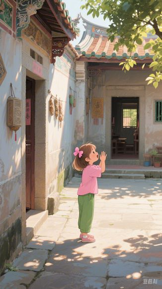
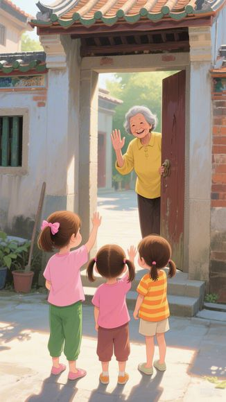
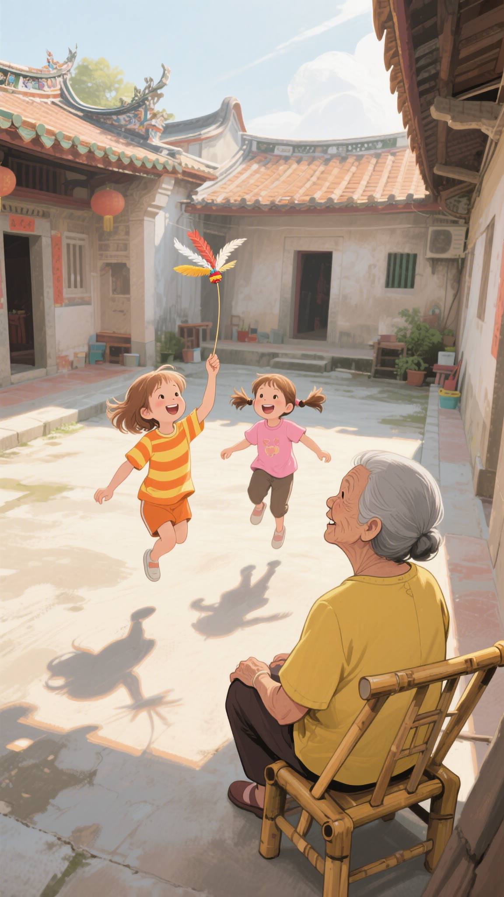
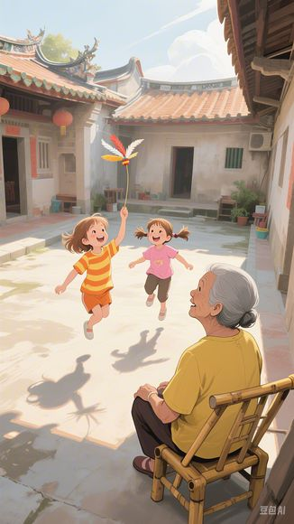

# 根据图片创作故事及图片根据图片创作故事及图片根据图片创作故事及图片

> 会话ID: 5585652565536002 | 抓取时间: 2026-08-25T10:07:38.015Z | 消息数: 4 (用户2/助手2) | 图片数: 4
> 源URL: https://www.doubao.com/chat/5585652565536002

---

## **👤 用户**

手绘板绘类似风格9-10张有脚本故事

---

## **🤖 助手**

根据你上传的图片，我推测故事围绕潮汕院落里老奶奶和小女孩们的爱与陪伴展开。接下来我会按照手绘板绘风格，依据故事发展生成 9 张图片。 首先，我为故事中的角色设计了形象：老奶奶头发灰白，梳着简单发髻，体型稍胖，常穿着带有花纹的上衣和棕色裤子或者黄色上衣；小女孩们头发浅棕色，其中一个扎着粉色发饰、穿着粉色上衣和绿色裤子，另一个扎着双马尾、穿着粉色上衣，还有一个穿着橙黄条纹衣服。 以下是后续故事图片的生成： 场景一：清晨的呼唤 画面是手绘板绘风格。一个扎着粉色发饰、穿着粉色上衣和绿色裤子的小女孩站在潮汕风格的院落门口，朝着屋内喊着头发灰白、梳着简单发髻、穿着带有花纹上衣和棕色裤子的老奶奶，阳光洒在院落里。视角为正面，场景是潮汕风格的院落门口。 场景二：一起浇花 画面是手绘板绘风格。头发灰白、穿着黄色上衣的老奶奶和扎着双马尾、穿着粉色上衣的小女孩一起在院落里浇花，花朵娇艳欲滴。视角为侧面，场景是潮汕风格的院落花园。 场景三：学习编织 画面是手绘板绘风格。老奶奶坐在木质椅子上教扎着粉色发饰的小女孩编织手工艺品，小女孩学得很认真。视角为正面，场景是潮汕风格的院落室内。 场景四：午后游戏 画面是手绘板绘风格。穿着橙黄条纹衣服的小女孩和扎着双马尾的小女孩在院落里玩踢毽子，老奶奶在一旁微笑着观看。视角为斜上方，场景是潮汕风格的院落空地。 场景五：准备晚餐 画面是手绘板绘风格。老奶奶和扎着粉色发饰的小女孩在厨房准备晚餐，炉灶上冒着热气。视角为侧面，场景是潮汕风格的厨房。 场景六：晚餐时光 画面是手绘板绘风格。老奶奶和三个小女孩围坐在桌旁吃晚餐，桌上摆满了丰盛的菜肴。视角为正面，场景是潮汕风格的餐厅。 场景七：月下谈心 画面是手绘板绘风格。老奶奶和扎着双马尾的小女孩坐在院落的台阶上，在月光下谈心。视角为背面，场景是潮汕风格的院落台阶。 场景八：睡前故事 画面是手绘板绘风格。老奶奶在房间里给三个小女孩讲睡前故事，小女孩们听得入神。视角为正面，场景是潮汕风格的卧室。 场景九：温馨道别 画面是手绘板绘风格。三个小女孩站在院落门口和老奶奶挥手道别，老奶奶站在门口微笑着目送。视角为正面，场景是潮汕风格的院落门口。

---

## **👤 用户**

提高清晰度

---

## **🤖 助手**

---
