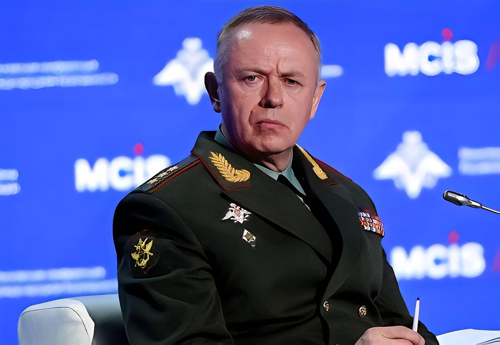
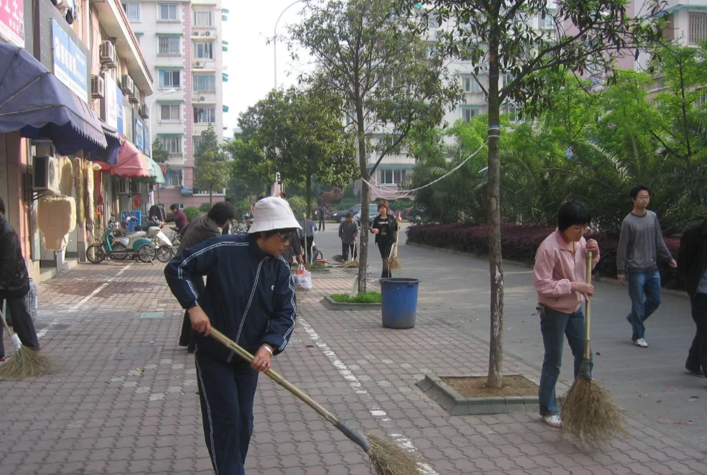

# 关于福明的介绍关于福明的介绍关于福明的介绍

> 会话ID: 5514152536572674 | 抓取时间: 2026-08-25T10:08:01.553Z | 消息数: 2 (用户1/助手1) | 图片数: 2
> 源URL: https://www.doubao.com/chat/5514152536572674

---

## **👤 用户**

搜索一下：福明

---

## **🤖 助手**

以下是一些名为 “福明” 的人物、地点及企业等相关信息： 人物 亚历山大・福明 ：1959 年 5 月 25 日出生于东哈萨克斯坦地区列宁诺戈尔斯克，俄罗斯国防部副部长，上将军衔。他毕业于国防部红旗军事学院，拥有技术科学博士学位，精通葡萄牙语、西班牙语、英语和克里奥尔语等多门语言 1 。 军事人物 俄罗斯国防部副部长亚历山大·福明 张福明 ：广东以色列理工学院材料科学与工程院系在读博士生，研究方向为锂电池高压 / 宽温电解液。在校期间发表六篇 SCI 论文、两篇专利，获得 2022 年 “创新种子” 公益项目资助等多个项目资助 6 。 地点 福明街道 ：地处宁波市三江片东部，北濒甬江，南临潘火，东联邱隘、新明，西接东柳、明楼，辖区面积 14.2 平方公里，下辖 14 个城市社区和 16 个股份经济合作社，常住人口 9.1 万人，是市行政中心和东部新城核心区属地街道 2 。 地点 宁波福明街道 企业 北京福明浩天国际贸易有限公司 ：位于海淀区高粱桥斜街 59 号院 - 1 中坤大厦 6 层 609。 张家港市福明防水防腐材料有限公司 ：始创于 1998 年 6 月 8 日，是一家集研发、生产、销售、施工于一体的现代专业化防水企业，拥有现代化的生产基地、先进的生产设备和高性价比的高新技术产品 4 。 深圳市福明电子科技有限公司 ：成立于 2004 年 4 月 16 日，是一家专业从事焊锡制品销售的专业化企业，代理美国阿尔法 Alpha 锡膏、Alpha 锡丝、Alpha 锡条、Alpha 助焊剂等产品 5 。

---
