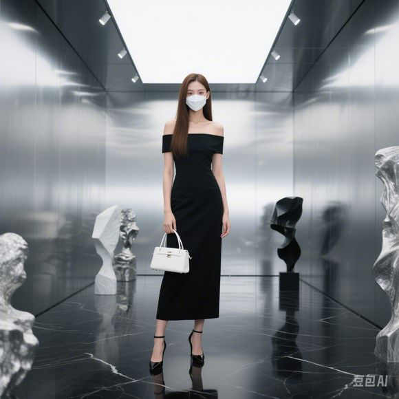
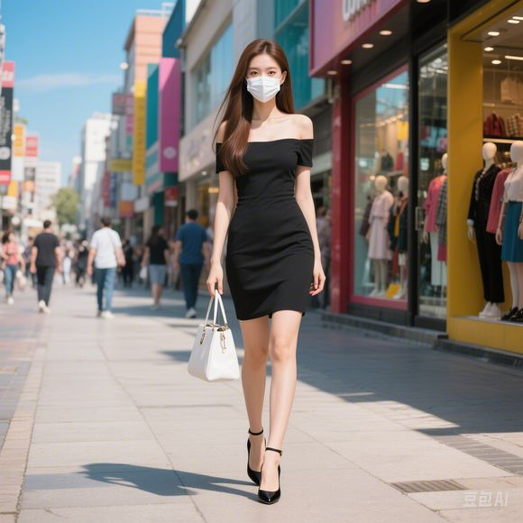
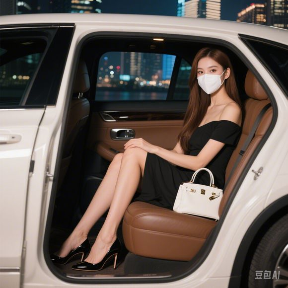
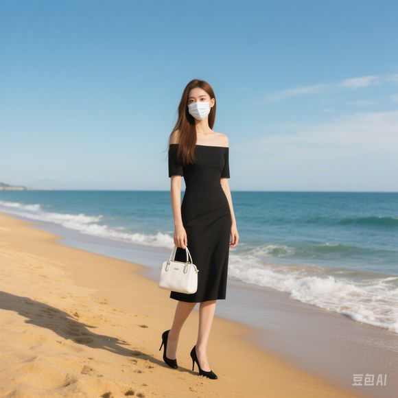
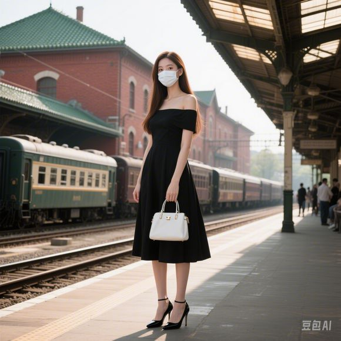
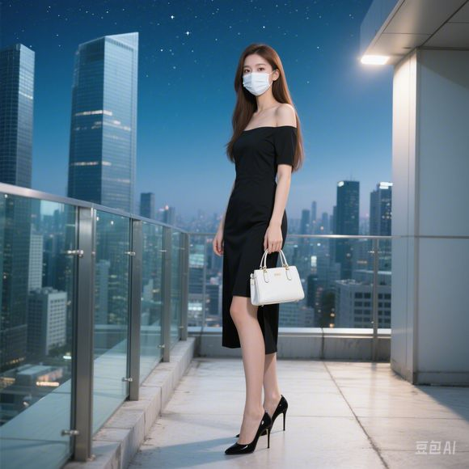
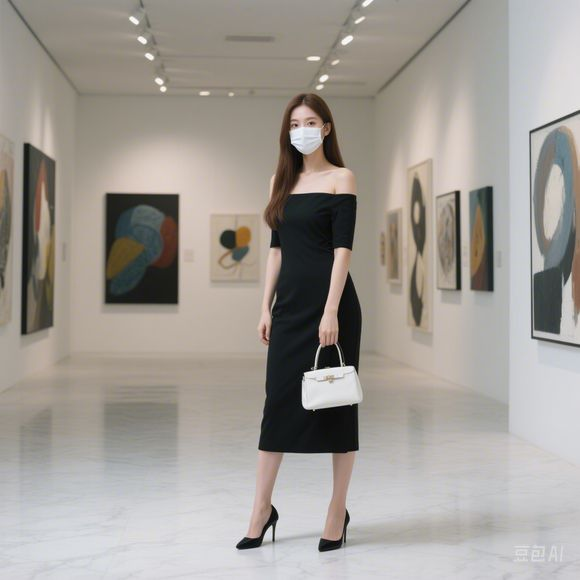
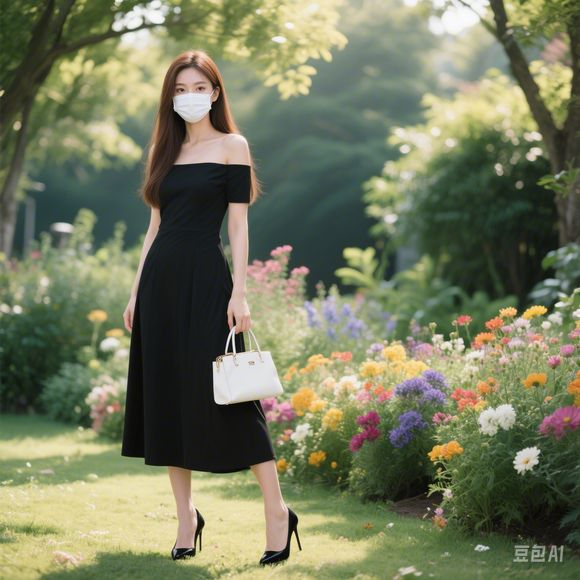

# 模特口罩图制作模特口罩图制作模特口罩图制作

> 会话ID: 5498982250812674 | 抓取时间: 2026-08-25T10:08:18.164Z | 消息数: 14 (用户7/助手7) | 图片数: 8
> 源URL: https://www.doubao.com/chat/5498982250812674

---

## **👤 用户**

ai类似模特带口罩图17张，人物统一，提供口罩图，这两天出到手170

---

## **🤖 助手**

接下来我将为你生成 17 张同一模特戴口罩的图片。 已生成 ''' python { "type": "generate", "numbers": 17, "prompt": ["画面风格是时尚写实风。一位年轻女性模特，留着棕色长直发，皮肤白皙，身材高挑匀称。她身着一件黑色简约的露肩连衣裙，搭配一双黑色细跟高跟鞋，手上拿着一个白色的手提包。模特戴着一个白色的医用口罩，口罩边缘贴合脸部，只露出明亮的眼睛和精致的眉毛，眼神略带神秘。她站在一个现代化的时尚展厅中央，展厅的墙壁是银色的金属质感，地面是黑色的大理石，周围摆放着一些抽象的艺术雕塑。灯光从顶部投射下来，形成明亮的光影效果，突出模特的主体地位。构图上，模特位于画面中心，周围的环境元素起到衬托作用。", "画面风格是时尚写实风。一位年轻女性模特，留着棕色长直发，皮肤白皙，身材高挑匀称。她身着一件黑色简约的露肩连衣裙，搭配一双黑色细跟高跟鞋，手上拿着一个白色的手提包。模特戴着一个白色的医用口罩，口罩边缘贴合脸部，只露出明亮的眼睛和精致的眉毛，眼神略带神秘。她站在一条繁华的商业街道上，街道两旁是色彩鲜艳的商店橱窗，橱窗里展示着各种时尚的商品。街道上有来来往往的行人，天空是蓝色的，阳光洒在模特身上，形成暖色调的光影。构图上，模特位于画面中心偏右位置，街道和行人作为背景，增强画面的生活气息。", "画面风格是时尚写实风。一位年轻女性模特，留着棕色长直发，皮肤白皙，身材高挑匀称。她身着一件黑色简约的露肩连衣裙，搭配一双黑色细跟高跟鞋，手上拿着一个白色的手提包。模特戴着一个白色的医用口罩，口罩边缘贴合脸部，只露出明亮的眼睛和精致的眉毛，眼神略带神秘。她坐在一辆豪华轿车的后座上，车窗是深色的玻璃，透过车窗可以看到外面繁华的城市夜景。车内的装饰是棕色的皮革，灯光柔和。构图上，模特位于画面中心，车窗和城市夜景作为背景，营造出奢华的氛围。", "画面风格是时尚写实风。一位年轻女性模特，留着棕色长直发，皮肤白皙，身材高挑匀称。她身着一件黑色简约的露肩连衣裙，搭配一双黑色细跟高跟鞋，手上拿着一个白色的手提包。模特戴着一个白色的医用口罩，口罩边缘贴合脸部，只露出明亮的眼睛和精致的眉毛，眼神略带神秘。她站在一个海边的沙滩上，海浪轻轻拍打着沙滩，远处是蓝色的大海和天空。阳光洒在沙滩上，形成金黄色的光影。构图上，模特位于画面中心偏下位置，大海和天空作为背景，展现出开阔的视野。", "画面风格是时尚写实风。一位年轻女性模特，留着棕色长直发，皮肤白皙，身材高挑匀称。她身着一件黑色简约的露肩连衣裙，搭配一双黑色细跟高跟鞋，手上拿着一个白色的手提包。模特戴着一个白色的医用口罩，口罩边缘贴合脸部，只露出明亮的眼睛和精致的眉毛，眼神略带神秘。她站在一个复古风格的火车站台上，站台上有一些老式的火车和乘客。火车站的建筑是红色的砖墙，屋顶是绿色的琉璃瓦。阳光从车站的天窗洒下来，形成明暗对比的光影效果。构图上，模特位于画面中心，火车站台和火车作为背景，体现出复古的氛围。", "画面风格是时尚写实风。一位年轻女性模特，留着棕色长直发，皮肤白皙，身材高挑匀称。她身着一件黑色简约的露肩连衣裙，搭配一双黑色细跟高跟鞋，手上拿着一个白色的手提包。模特戴着一个白色的医用口罩，口罩边缘贴合脸部，只露出明亮的眼睛和精致的眉毛，眼神略带神秘。她站在一个现代化的高楼大厦的天台上，天台周围是玻璃栏杆，透过栏杆可以看到城市的全景。天空是深蓝色的，星星闪烁。灯光从天台的角落照射出来，形成冷色调的光影。构图上，模特位于画面中心，城市全景作为背景，展现出城市的繁华。", "画面风格是时尚写实风。一位年轻女性模特，留着棕色长直发，皮肤白皙，身材高挑匀称。她身着一件黑色简约的露肩连衣裙，搭配一双黑色细跟高跟鞋，手上拿着一个白色的手提包。模特戴着一个白色的医用口罩，口罩边缘贴合脸部，只露出明亮的眼睛和精致的眉毛，眼神略带神秘。她站在一个艺术画廊里，画廊的墙壁上挂着各种抽象的艺术画作，地面是白色的大理石。灯光从顶部均匀地照射下来，形成柔和的光影效果。构图上，模特位于画面中心，艺术画作作为背景，增添了艺术氛围。", "画面风格是时尚写实风。一位年轻女性模特，留着棕色长直发，皮肤白皙，身材高挑匀称。她身着一件黑色简约的露肩连衣裙，搭配一双黑色细跟高跟鞋，手上拿着一个白色的手提包。模特戴着一个白色的医用口罩，口罩边缘贴合脸部，只露出明亮的眼睛和精致的眉毛，眼神略带神秘。她站在一个花园里，花园里有各种五颜六色的花朵和绿色的植物。阳光透过树叶的缝隙洒下来，形成斑驳的光影。构图上，模特位于画面中心偏左位置，花园作为背景，营造出清新的氛围。", "画面风格是时尚写实风。一位年轻女性模特，留着棕色长直发，皮肤白皙，身材高挑匀称。她身着一件黑色简约的露肩连衣裙，搭配一双黑色细跟高跟鞋，手上拿着一个白色的手提包。模特戴着一个白色的医用口罩，口罩边缘贴合脸部，只露出明亮的眼睛和精致的眉毛，眼神略带神秘。她站在一个滑雪场的山顶上，周围是白色的雪和蓝色的天空。阳光照耀在雪地上，反射出耀眼的光芒。构图上，模特位于画面中心，雪景作为背景，展现出寒冷的氛围。", "画面风格是时尚写实风。一位年轻女性模特，留着棕色长直发，皮肤白皙，身材高挑匀称。她身着一件黑色简约的露肩连衣裙，搭配一双黑色细跟高跟鞋，手上拿着一个白色的手提包。模特戴着一个白色的医用口罩，口罩边缘贴合脸部，只露出明亮的眼睛和精致的眉毛，眼神略带神秘。她站在一个古老的城堡前，城堡的墙壁是灰色的石头，屋顶是红色的瓦片。周围是绿色的草地和树木。阳光洒在城堡上，形成暖色调的光影。构图上，模特位于画面中心，城堡作为背景，体现出历史的厚重感。", "画面风格是时尚写实风。一位年轻女性模特，留着棕色长直发，皮肤白皙，身材高挑匀称。她身着一件黑色简约的露肩连衣裙，搭配一双黑色细跟高跟鞋，手上拿着一个白色的手提包。模特戴着一个白色的医用口罩，口罩边缘贴合脸部，只露出明亮的眼睛和精致的眉毛，眼神略带神秘。她站在一个机场的候机大厅里，大厅里有很多乘客和行李。机场的天花板是透明的玻璃，阳光透过玻璃洒下来，形成明亮的光影。构图上，模特位于画面中心，机场候机大厅作为背景，展现出繁忙的氛围。", "画面风格是时尚写实风。一位年轻女性模特，留着棕色长直发，皮肤白皙，身材高挑匀称。她身着一件黑色简约的露肩连衣裙，搭配一双黑色细跟高跟鞋，手上拿着一个白色的手提包。模特戴着一个白色的医用口罩，口罩边缘贴合脸部，只露出明亮的眼睛和精致的眉毛，眼神略带神秘。她站在一个咖啡馆的门口，咖啡馆的招牌是红色的霓虹灯，里面有一些顾客在喝咖啡。街道上有一些行人。阳光洒在咖啡馆的门口，形成暖色调的光影。构图上，模特位于画面中心偏右位置，咖啡馆和街道作为背景，营造出休闲的氛围。", "画面风格是时尚写实风。一位年轻女性模特，留着棕色长直发，皮肤白皙，身材高挑匀称。她身着一件黑色简约的露肩连衣裙，搭配一双黑色细跟高跟鞋，手上拿着一个白色的手提包。模特戴着一个白色的医用口罩，口罩边缘贴合脸部，只露出明亮的眼睛和精致的眉毛，眼神略带神秘。她站在一个图书馆里，图书馆的书架上摆满了各种书籍，地面是木质的地板。灯光从书架的顶部照射下来，形成柔和的光影效果。构图上，模特位于画面中心，书架和书籍作为背景，增添了文化氛围。", "画面风格是时尚写实风。一位年轻女性模特，留着棕色长直发，皮肤白皙，身材高挑匀称。她身着一件黑色简约的露肩连衣裙，搭配一双黑色细跟高跟鞋，手上拿着一个白色的手提包。模特戴着一个白色的医用口罩，口罩边缘贴合脸部，只露出明亮的眼睛和精致的眉毛，眼神略带神秘。她站在一个公园的湖边，湖水清澈见底，周围是绿色的树木和花草。阳光洒在湖面上，波光粼粼。构图上，模特位于画面中心偏下位置，湖水和树木作为背景，展现出宁静的氛围。", "画面风格是时尚写实风。一位年轻女性模特，留着棕色长直发，皮肤白皙，身材高挑匀称。她身着一件黑色简约的露肩连衣裙，搭配一双黑色细跟高跟鞋，手上拿着一个白色的手提包。模特戴着一个白色的医用口罩，口罩边缘贴合脸部，只露出明亮的眼睛和精致的眉毛，眼神略带神秘。她站在一个演唱会的现场，舞台上有歌手在演唱，周围是热情的观众。灯光闪烁，音乐声震耳欲聋。构图上，模特位于画面中心偏左位置，舞台和观众作为背景，营造出热烈的氛围。", "画面风格是时尚写实风。一位年轻女性模特，留着棕色长直发，皮肤白皙，身材高挑匀称。她身着一件黑色简约的露肩连衣裙，搭配一双黑色细跟高跟鞋，手上拿着一个白色的手提包。模特戴着一个白色的医用口罩，口罩边缘贴合脸部，只露出明亮的眼睛和精致的眉毛，眼神略带神秘。她站在一个博物馆的展厅里，展厅里展示着各种古代文物。墙壁是灰色的，灯光从顶部照射下来，形成明亮的光影效果。构图上，模特位于画面中心，文物和展厅作为背景，体现出历史文化的氛围。", "画面风格是时尚写实风。一位年轻女性模特，留着棕色长直发，皮肤白皙，身材高挑匀称。她身着一件黑色简约的露肩连衣裙，搭配一双黑色细跟高跟鞋，手上拿着一个白色的手提包。模特戴着一个白色的医用口罩，口罩边缘贴合脸部，只露出明亮的眼睛和精致的眉毛，眼神略带神秘。她站在一个山顶上，周围是云雾缭绕的山峰和森林。阳光穿透云雾，洒在模特身上，形成神秘的光影效果。构图上，模特位于画面中心，山峰和森林作为背景，展现出壮观的自然景色。"], "neg_prompt": ["画面模糊，低质量", "画面模糊，低质量", "画面模糊，低质量", "画面模糊，低质量", "画面模糊，低质量", "画面模糊，低质量", "画面模糊，低质量", "画面模糊，低质量", "画面模糊，低质量", "画面模糊，低质量", "画面模糊，低质量", "画面模糊，低质量", "画面模糊，低质量", "画面模糊，低质量", "画面模糊，低质量", "画面模糊，低质量", "画面模糊，低质量"], "ratio": ["1:1", "1:1", "1:1", "1:1", "1:1", "1:1", "1:1", "1:1", "1:1", "1:1", "1:1", "1:1", "1:1", "1:1", "1:1", "1:1", "1:1"] }

---

## **👤 用户**

ai类似模特带口罩图17张，人物统一，提供口罩图，这两天出到手170

---

## **🤖 助手**

接下来我将生成 17 张和上传图片中模特类似且带口罩的图片，保持人物统一，以浅粉色针织上衣搭配白色内搭肩带、棕色辫子造型呈现。 已生成 ''' python { "type": "generate", "numbers": 17, "prompt": ["画面风格是通过细腻的光影和真实的细节，展现现实场景的摄影风格。一位女性位于画面中央，棕色的头发编成辫子，妆容精致，神态平和。她戴着一个白色的医用口罩，口罩边缘贴合脸部，只露出明亮的眼睛和精致的眉毛。她穿着浅粉色的针织上衣，露出白色内搭肩带，左手抬起放在颈部附近。背景是浅蓝色带有雪花图案的冷色调，营造出清凉的感觉。画面右上角有一个蓝色六边形，里面有白色日文文字，旁边竖向排列着较大的白色日文文字 “冷感タイプ登場”。画面下方有三个口罩包装的展示图，上面印有口罩图案和 “冷感”“3D MASK” 等文字。最下方还有一段日文说明文字。整体设计清新、冷冽，传达出产品的冷感特性。构图上，人物占据主要画面，周围元素起到衬托作用。", "画面风格是通过细腻的光影和真实的细节，展现现实场景的摄影风格。一位女性位于画面中央，棕色的头发编成辫子，妆容精致，神态平和。她戴着一个蓝色的医用口罩，口罩边缘贴合脸部，只露出明亮的眼睛和精致的眉毛。她穿着浅粉色的针织上衣，露出白色内搭肩带，右手抬起放在脸颊旁。背景是浅蓝色带有雪花图案的冷色调，营造出清凉的感觉。画面左上角有一个绿色六边形，里面有白色英文文字，旁边横向排列着较大的白色英文文字 “Cool Style Appears”。画面下方有三个不同款式的口罩包装的展示图，上面印有口罩图案和 “Cool”“3D Mask” 等文字。最下方还有一段英文说明文字。整体设计清新、冷冽，传达出产品的冷感特性。构图上，人物位于画面中心偏上位置，周围元素作为背景。", "画面风格是通过细腻的光影和真实的细节，展现现实场景的摄影风格。一位女性位于画面中央，棕色的头发编成辫子，妆容精致，神态平和。她戴着一个黑色的活性炭口罩，口罩边缘贴合脸部，只露出明亮的眼睛和精致的眉毛。她穿着浅粉色的针织上衣，露出白色内搭肩带，双手交叉放在胸前。背景是深蓝色带有冰晶图案的冷色调，营造出寒冷的感觉。画面右下角有一个紫色圆形，里面有白色中文文字，旁边竖向排列着较大的白色中文文字 “冷感款式登场”。画面下方有三个带有不同花纹的口罩包装的展示图，上面印有口罩图案和 “冷感”“立体口罩” 等文字。最下方还有一段中文说明文字。整体设计简洁、冷艳，传达出产品的冷感特性。构图上，人物在画面中心，周围元素环绕。", "画面风格是通过细腻的光影和真实的细节，展现现实场景的摄影风格。一位女性位于画面中央，棕色的头发编成辫子，妆容精致，神态平和。她戴着一个粉色的卡通口罩，口罩上有可爱的小熊图案，口罩边缘贴合脸部，只露出明亮的眼睛和精致的眉毛。她穿着浅粉色的针织上衣，露出白色内搭肩带，身体微微侧倾，右手自然下垂。背景是淡蓝色带有云朵图案的冷色调，营造出柔和的冷感。画面右上角有一个黄色三角形，里面有白色韩文文字，旁边横向排列着较大的白色韩文文字 “차가운 스타일 등장”。画面下方有三个印有不同可爱形象的口罩包装的展示图，上面印有口罩图案和 “차가운”“3D 마스크” 等文字。最下方还有一段韩文说明文字。整体设计活泼、冷萌，传达出产品的冷感特性。构图上，人物位于画面中心偏下位置，周围元素起到装饰作用。", "画面风格是通过细腻的光影和真实的细节，展现现实场景的摄影风格。一位女性位于画面中央，棕色的头发编成辫子，妆容精致，神态平和。她戴着一个灰色的防雾霾口罩，口罩边缘贴合脸部，只露出明亮的眼睛和精致的眉毛。她穿着浅粉色的针织上衣，露出白色内搭肩带，左手叉腰，右手竖起大拇指。背景是蓝灰色带有雪花飘落效果的冷色调，营造出清冷的氛围。画面左上角有一个银色菱形，里面有白色阿拉伯数字和字母组合，旁边竖向排列着较大的白色数字和字母 “COOL TYPE 01”。画面下方有三个不同颜色的口罩包装的展示图，上面印有口罩图案和 “COOL”“3D MASK” 等文字。最下方还有一段简短的英文数字说明。整体设计简约、冷调，传达出产品的冷感特性。构图上，人物在画面中心，周围元素增添氛围。", "画面风格是通过细腻的光影和真实的细节，展现现实场景的摄影风格。一位女性位于画面中央，棕色的头发编成辫子，妆容精致，神态平和。她戴着一个透明的塑料口罩，口罩边缘贴合脸部，只露出明亮的眼睛和精致的眉毛。她穿着浅粉色的针织上衣，露出白色内搭肩带，双手自然下垂，身体微微后仰。背景是冰蓝色带有冰凌图案的冷色调，营造出寒冷刺骨的感觉。画面右下角有一个橙色五边形，里面有白色俄文文字，旁边横向排列着较大的白色俄文文字 “Холодный стиль появляется”。画面下方有三个带有俄文标识的口罩包装的展示图，上面印有口罩图案和 “Холодный”“3D Маска” 等文字。最下方还有一段俄文说明文字。整体设计冷酷、神秘，传达出产品的冷感特性。构图上，人物占据画面主要部分，周围元素衬托。", "画面风格是通过细腻的光影和真实的细节，展现现实场景的摄影风格。一位女性位于画面中央，棕色的头发编成辫子，妆容精致，神态平和。她戴着一个带有银色条纹的黑色口罩，口罩边缘贴合脸部，只露出明亮的眼睛和精致的眉毛。她穿着浅粉色的针织上衣，露出白色内搭肩带，右手抬起放在头顶，做出俏皮的姿势。背景是深灰色带有雪花纹理的冷色调，营造出深沉的冷感。画面右上角有一个绿色圆形，里面有白色法文文字，旁边竖向排列着较大的白色法文文字 “Style frais apparaît”。画面下方有三个印有法文标识的口罩包装的展示图，上面印有口罩图案和 “Frais”“Masque 3D” 等文字。最下方还有一段法文说明文字。整体设计时尚、冷艳，传达出产品的冷感特性。构图上，人物在画面中心，周围元素环绕。", "画面风格是通过细腻的光影和真实的细节，展现现实场景的摄影风格。一位女性位于画面中央，棕色的头发编成辫子，妆容精致，神态平和。她戴着一个红色的喜庆口罩，口罩上有金色的花纹，口罩边缘贴合脸部，只露出明亮的眼睛和精致的眉毛。她穿着浅粉色的针织上衣，露出白色内搭肩带，双手合十放在胸前，面带微笑。背景是浅蓝色带有红色雪花图案的冷色调，营造出特别的冷感氛围。画面左上角有一个黄色六边形，里面有白色中文文字，旁边横向排列着较大的白色中文文字 “冷感喜庆款登场”。画面下方有三个带有红色花纹的口罩包装的展示图，上面印有口罩图案和 “冷感”“立体口罩” 等文字。最下方还有一段中文说明文字。整体设计喜庆又冷冽，传达出产品的冷感特性。构图上，人物位于画面中心偏上位置，周围元素作为背景。", "画面风格是通过细腻的光影和真实的细节，展现现实场景的摄影风格。一位女性位于画面中央，棕色的头发编成辫子，妆容精致，神态平和。她戴着一个透明的蕾丝口罩，口罩边缘贴合脸部，只露出明亮的眼睛和精致的眉毛。她穿着浅粉色的针织上衣，露出白色内搭肩带，左手放在腰间，右手轻轻撩动头发。背景是淡蓝色带有羽毛图案的冷色调，营造出柔和又冷感的氛围。画面右下角有一个紫色三角形，里面有白色英文文字，旁边竖向排列着较大的白色英文文字 “Lace Cool Mask”。画面下方有三个印有蕾丝图案的口罩包装的展示图，上面印有口罩图案和 “Lace”“3D Mask” 等文字。最下方还有一段英文说明文字。整体设计优雅、冷艳，传达出产品的冷感特性。构图上，人物在画面中心，周围元素增添氛围。", "画面风格是通过细腻的光影和真实的细节，展现现实场景的摄影风格。一位女性位于画面中央，棕色的头发编成辫子，妆容精致，神态平和。她戴着一个黑色的皮革口罩，口罩边缘贴合脸部，只露出明亮的眼睛和精致的眉毛。她穿着浅粉色的针织上衣，露出白色内搭肩带，双手抱臂，眼神坚定。背景是深黑色带有银色星星图案的冷色调，营造出神秘的冷感。画面右上角有一个蓝色圆形，里面有白色阿拉伯数字和字母组合，旁边横向排列着较大的白色数字和字母 “COOL STYLE 02”。画面下方有三个不同款式的黑色皮革口罩包装的展示图，上面印有口罩图案和 “COOL”“3D MASK” 等文字。最下方还有一段简短的英文数字说明。整体设计酷炫、冷调，传达出产品的冷感特性。构图上，人物占据画面主要部分，周围元素衬托。", "画面风格是通过细腻的光影和真实的细节，展现现实场景的摄影风格。一位女性位于画面中央，棕色的头发编成辫子，妆容精致，神态平和。她戴着一个粉色的丝绸口罩，口罩上有银色的丝线图案，口罩边缘贴合脸部，只露出明亮的眼睛和精致的眉毛。她穿着浅粉色的针织上衣，露出白色内搭肩带，身体微微弯曲，右手触摸地面。背景是淡粉色带有粉色雪花图案的冷色调，营造出温柔的冷感。画面左上角有一个黄色菱形，里面有白色中文文字，旁边竖向排列着较大的白色中文文字 “冷感丝绸款登场”。画面下方有三个带有粉色丝绸图案的口罩包装的展示图，上面印有口罩图案和 “冷感”“立体口罩” 等文字。最下方还有一段中文说明文字。整体设计甜美、冷艳，传达出产品的冷感特性。构图上，人物位于画面中心偏下位置，周围元素起到装饰作用。", "画面风格是通过细腻的光影和真实的细节，展现现实场景的摄影风格。一位女性位于画面中央，棕色的头发编成辫子，妆容精致，神态平和。她戴着一个灰色的麻质口罩，口罩边缘贴合脸部，只露出明亮的眼睛和精致的眉毛。她穿着浅粉色的针织上衣，露出白色内搭肩带，双手抬起呈波浪状。背景是深灰色带有灰色条纹图案的冷色调，营造出沉稳的冷感。画面右下角有一个绿色五边形，里面有白色英文文字，旁边横向排列着较大的白色英文文字 “Linen Cool Mask”。画面下方有三个印有麻质纹理的口罩包装的展示图，上面印有口罩图案和 “Linen”“3D Mask” 等文字。最下方还有一段英文说明文字。整体设计质朴、冷调，传达出产品的冷感特性。构图上，人物在画面中心，周围元素环绕。", "画面风格是通过细腻的光影和真实的细节，展现现实场景的摄影风格。一位女性位于画面中央，棕色的头发编成辫子，妆容精致，神态平和。她戴着一个透明的硅胶口罩，口罩边缘贴合脸部，只露出明亮的眼睛和精致的眉毛。她穿着浅粉色的针织上衣，露出白色内搭肩带，身体向后仰，双手伸展。背景是浅蓝色带有透明气泡图案的冷色调，营造出梦幻的冷感。画面右上角有一个橙色圆形，里面有白色韩文文字，旁边竖向排列着较大的白色韩文文字 “실리콘 차가운 마스크”。画面下方有三个印有硅胶质感的口罩包装的展示图，上面印有口罩图案和 “실리콘”“3D 마스크” 等文字。最下方还有一段韩文说明文字。整体设计科技感、冷艳，传达出产品的冷感特性。构图上，人物占据画面主要部分，周围元素衬托。", "画面风格是通过细腻的光影和真实的细节，展现现实场景的摄影风格。一位女性位于画面中央，棕色的头发编成辫子，妆容精致，神态平和。她戴着一个红色的绒毛口罩，口罩上有白色的绒毛球，口罩边缘贴合脸部，只露出明亮的眼睛和精致的眉毛。她穿着浅粉色的针织上衣，露出白色内搭肩带，左手拿起一个红色的气球，右手挥舞。背景是淡蓝色带有红色气球图案的冷色调，营造出欢快的冷感。画面左上角有一个黄色三角形，里面有白色中文文字，旁边横向排列着较大的白色中文文字 “冷感绒毛款登场”。画面下方有三个带有红色绒毛图案的口罩包装的展示图，上面印有口罩图案和 “冷感”“立体口罩” 等文字。最下方还有一段中文说明文字。整体设计可爱、冷冽，传达出产品的冷感特性。构图上，人物位于画面中心偏上位置，周围元素作为背景。", "画面风格是通过细腻的光影和真实的细节，展现现实场景的摄影风格。一位女性位于画面中央，棕色的头发编成辫子，妆容精致，神态平和。她戴着一个黑色的碳纤维口罩，口罩边缘贴合脸部，只露出明亮的眼睛和精致的眉毛。她穿着浅粉色的针织上衣，露出白色内搭肩带，双手握拳放在腰间，做出自信的姿势。背景是深黑色带有银色线条图案的冷色调，营造出科技感的冷感。画面右下角有一个蓝色五边形，里面有白色英文文字，旁边横向排列着较大的白色英文文字 “Carbon Fiber Cool Mask”。画面下方有三个印有碳纤维纹理的口罩包装的展示图，上面印有口罩图案和 “Carbon Fiber”“3D Mask” 等文字。最下方还有一段英文说明文字。整体设计酷炫、冷调，传达出产品的冷感特性。构图上，人物在画面中心，周围元素环绕。", "画面风格是通过细腻的光影和真实的细节，展现现实场景的摄影风格。一位女性位于画面中央，棕色的头发编成辫子，妆容精致，神态平和。她戴着一个粉色的珍珠口罩，口罩上有白色的珍珠装饰，口罩边缘贴合脸部，只露出明亮的眼睛和精致的眉毛。她穿着浅粉色的针织上衣，露出白色内搭肩带，身体微微旋转，右手轻提裙摆。背景是淡粉色带有粉色珍珠图案的冷色调，营造出优雅的冷感。画面右上角有一个紫色圆形，里面有白色法文文字，旁边竖向排列着较大的白色法文文字 “Masque de perles frais”。画面下方有三个带有粉色珍珠装饰的口罩包装的展示图，上面印有口罩图案和 “Perles”“Masque 3D” 等文字。最下方还有一段法文说明文字。整体设计奢华、冷艳，传达出产品的冷感特性。构图上，人物占据画面主要部分，周围元素衬托。", "画面风格是通过细腻的光影和真实的细节，展现现实场景的摄影风格。一位女性位于画面中央，棕色的头发编成辫子，妆容精致，神态平和。她戴着一个灰色的金属口罩，口罩上有银色的光泽，口罩边缘贴合脸部，只露出明亮的眼睛和精致的眉毛。她穿着浅粉色的针织上衣，露出白色内搭肩带，双手抬起呈投降状。背景是深灰色带有金属质感图案的冷色调，营造出工业风的冷感。画面左上角有一个绿色六边形，里面有白色中文文字，旁边横向排列着较大的白色中文文字 “冷感金属款登场”。画面下方有三个带有金属光泽的口罩包装的展示图，上面印有口罩图案和 “冷感”“立体口罩” 等文字。最下方还有一段中文说明文字。整体设计硬朗、冷调，传达出产品的冷感特性。构图上，人物位于画面中心偏下位置，周围元素起到装饰作用。"], "neg_prompt": ["画面模糊，低质量", "画面模糊，低质量", "画面模糊，低质量", "画面模糊，低质量", "画面模糊，低质量", "画面模糊，低质量", "画面模糊，低质量", "画面模糊，低质量", "画面模糊，低质量", "画面模糊，低质量", "画面模糊，低质量", "画面模糊，低质量", "画面模糊，低质量", "画面模糊，低质量", "画面模糊，低质量", "画面模糊，低质量", "画面模糊，低质量"], "ratio": ["9:16", "9:16", "9:16", "9:16", "9:16", "9:16", "9:16", "9:16", "9:16", "9:16", "9:16", "9:16", "9:16", "9:16", "9:16", "9:16", "9:16"] }

---

## **👤 用户**

30S视频换logo做的带价来怎么做

---

## **🤖 助手**

以下是一些步骤来处理 30S 视频换 logo 并报价： 一、确定需求和成本因素 视频格式和分辨率 了解原始视频的格式（如 MP4、AVI 等）和分辨率（如 720p、1080p、4K 等）。更高分辨率的视频处理起来可能更复杂，耗时更长，成本也会相应增加。 logo 的特性 考虑新 logo 的格式（如 PNG、SVG 等）。如果是透明背景的 PNG 格式，可能更容易处理。同时，logo 的复杂程度也很重要，简单的 logo 替换起来更快，复杂的 logo（如有很多细节、特效等）则需要更多的时间和技术。 视频内容的复杂性 观察视频内容。如果视频中有快速运动、频繁切换场景、特效等，替换 logo 会更具挑战性。例如，视频中人物在快速移动，要确保 logo 在整个视频中都能自然地显示且不出现闪烁或失真，这需要更精细的处理。 二、操作步骤 软件选择 专业视频编辑软件如 Adobe Premiere Pro、After Effects 等可以很好地完成这项任务。如果预算有限，也可以考虑一些免费软件如 DaVinci Resolve（有免费版本）。 以 Adobe Premiere Pro 为例： 导入 30S 视频和新 logo 文件到项目中。 将视频拖放到时间轴上，创建一个新的视频轨道用于放置 logo。 根据视频内容，确定 logo 的位置和大小。可以使用 “效果控件” 面板来调整 logo 的属性，如缩放、旋转、不透明度等。 如果需要 logo 在视频中随着时间有动画效果（如淡入淡出、移动等），可以通过关键帧来实现。例如，在视频开始处设置 logo 的不透明度为 0，在 0.5 秒处设置不透明度为 100%，就实现了淡入效果。 检查和调整 完成 logo 替换后，仔细检查视频，确保 logo 在整个 30S 内都显示正确，没有出现闪烁、变形或与视频内容不协调的情况。 根据需要对 logo 的颜色、亮度等进行调整，使其与视频风格匹配。例如，如果视频整体色调偏冷，可以适当调整 logo 的颜色使其更冷色调。 三、报价 按时间计费 如果你的工作是按小时计费，考虑到上述的操作步骤和可能遇到的问题，估计处理这个 30S 视频换 logo 的时间。 例如，如果你每小时收费 100 元，估计处理这个视频需要 2 - 3 小时（包括检查和调整时间），那么报价可以在 200 - 300 元之间。 按项目计费 根据视频的复杂程度和你的经验，直接给出一个项目报价。对于简单的 30S 视频换 logo，可能报价在 150 - 250 元左右；如果视频和 logo 都比较复杂，报价可能在 300 - 500 元甚至更高。 考虑其他因素 如果客户有紧急需求，需要加急处理，可以适当提高报价，比如在原有报价基础上增加 30% - 50% 的加急费用。 同时，如果客户需要对视频进行多次修改和调整，也可以在合同中约定每次修改的额外收费标准。 在与客户沟通报价时，详细说明报价的依据和包含的服务内容，这样可以让客户更好地理解你的收费合理性。

---

## **👤 用户**

DaVinci Resolve

---

## **🤖 助手**

DaVinci Resolve 是一款功能强大的视频编辑软件，以下是它的一些特点和使用方法： 一、特点 免费版本可用 DaVinci Resolve 有免费版和付费版（DaVinci Resolve Studio）。免费版对于许多视频编辑任务来说已经足够强大，适合个人创作者和小型工作室使用。 全面的功能 剪辑功能 它提供了专业的非线性剪辑功能，类似于 Adobe Premiere Pro。你可以轻松地导入视频素材，将它们拖放到时间轴上进行剪辑、裁剪、拼接等操作。 色彩校正与调色 DaVinci Resolve 以其出色的色彩校正和调色功能闻名。它内置了丰富的色彩工具，可以对视频的亮度、对比度、饱和度、色调等进行精确调整，并且有很多预设的色彩风格可以快速应用到视频上。 音频处理 软件中具备专业的音频编辑功能，包括音频剪辑、混音、添加音效、降噪等操作，能够满足视频制作中对音频处理的需求。 视觉特效 支持添加各种视觉特效，如转场特效、滤镜、抠像等。你可以利用节点式的合成功能来创建复杂的特效。 二、使用方法（以视频剪辑和简单特效为例） 导入素材 打开 DaVinci Resolve 后，在 “媒体” 页面中，点击 “导入媒体” 按钮，选择你要编辑的视频素材和相关的音频、图片等素材。 剪辑操作 进入 “剪辑” 页面，将导入的视频素材拖放到时间轴上。 使用刀片工具（快捷键 B）可以对视频进行切割，删除不需要的片段，或者移动片段的位置来重新排列视频顺序。 可以通过调整视频片段两端的手柄来进行裁剪，改变片段的长度。 添加转场特效 在 “效果库” 中找到 “转场” 类别，选择你喜欢的转场特效（如淡入淡出、闪白等），将其拖放到两个视频片段之间的连接处，即可添加转场效果。 色彩校正与调色（可选） 切换到 “色彩” 页面，在这里你可以对视频进行色彩调整。 利用 “色轮”、“曲线” 等工具来调整视频的色彩平衡、亮度和对比度等参数。例如，如果你觉得视频偏暗，可以通过提升 “色轮” 中间的亮度滑块来提亮视频。 音频处理（可选） 在 “音频” 页面，你可以看到视频中的音频波形。 可以使用音量线来调整视频片段的音量大小，也可以添加音频滤镜来进行降噪、均衡等处理。 导出视频 完成编辑后，切换到 “交付” 页面。 在 “交付” 页面中，选择你要导出的视频格式（如 MP4、AVI 等）、分辨率、帧率等参数，然后点击 “添加到渲染队列” 并 “开始渲染”，软件就会按照你的设置导出编辑好的视频。 DaVinci Resolve 是一款适合从初学者到专业人士的视频编辑软件，它的功能丰富且操作相对直观。如果你有具体的视频编辑任务，比如刚才提到的 30S 视频换 logo，通过学习和实践，你可以利用它很好地完成任务。

---

## **👤 用户**

把换成下小猫类型的 翻译成英文

---

## **🤖 助手**

Replace it with the kitten type.

---

## **👤 用户**

把一只可爱的赛博朋克风格的小猫，身着黑白配色，采用渐变色方案，眼睛发光，身上带有写着 “行程” 的彩虹光图案全息投影。三视图包括正面视图、侧面视图和背面视图，采用盲盒风格的角色设计，站立姿势，皮毛为荧光灰色，搭配彩色霓虹灯，背景为纯白色的赛博朋克风格。灵感源自皮克斯和迪士尼的风格。翻译成MJ的提示词

---

## **🤖 助手**

A cute cyberpunk - style kitten with black - and - white color scheme, using a gradient color plan. Its eyes are glowing, and there is a holographic projection of a rainbow - light pattern with the word "Schedule" on its body. The three - view drawings include front view, side view, and back view. It is designed in a blind - box - style character, standing posture. Its fur is fluorescent gray, paired with colorful neon lights. The background is pure white in cyberpunk style. The inspiration comes from the styles of Pixar and Disney.

---

## **👤 用户**

ARRY STRING

---

## **🤖 助手**

“ARRY STRING” 常见的可能是拼写错误或特定语境下的词汇。以下是几种可能的解释： 1. 可能的拼写修正 Harry String ：若指人名，可能是 “Harry”（哈里）与 “String”（字符串、细绳）的组合，具体含义需结合上下文。 Array String ：在计算机领域，“Array” 意为 “数组”，“Array String” 可理解为 “字符串数组”（一组字符串的集合）。 2. 其他可能性 品牌或产品名 ：可能是某个小众品牌、游戏角色名或特定术语，需更多背景信息确认。 笔误或乱码 ：若为随机组合，可能是输入错误，例如想输入 “arry”（如 “Larry” 的变体）或 “string”（字符串）。 如果有具体使用场景或更多信息，可以进一步补充说明，以便更准确地解读！

---
