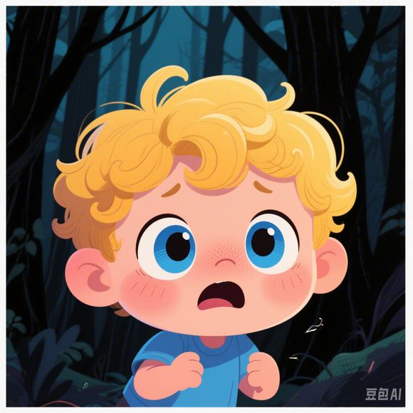

# 查询 PHASE 网址查询 PHASE 网址查询 PHASE 网址

> 会话ID: 4296677918356226 | 抓取时间: 2026-08-25T10:10:46.651Z | 消息数: 6 (用户3/助手3) | 图片数: 3
> 源URL: https://www.doubao.com/chat/4296677918356226

---

## **👤 用户**

PHASE的网址

---

## **🤖 助手**

不同的 “PHASE” 有不同的网址，以下为你介绍一些常见的： PHASE Worldwide 1 ：是一个公益组织，网址为 https://phaseworldwide.org/ 。 PHASE DJ 2 ：与 DJ 设备相关，网址为 https://www.phasedj.com/ 。 PHASE One 3 ：全球领先的高分辨率数字成像技术公司，网址为 https://www.phaseone.com/ 。 PHASE community 5 ：聚焦体育、健康等教育领域的全球教育者社区，网址为 https://phase.community/ 。 PHASE Analytical Solutions 6 ：油品在线分析仪表公司，其中国代表处网址为 http://phase70xos.com.cn 。

---

## **👤 用户**

静态表情包

---

## **🤖 助手**

接下来我将生成四张不同的静态表情包图片。

---

## **👤 用户**

提取文字，并出图

---

## **🤖 助手**

文字内容如下： 我是游泳中心的 7 岁以上的销售顾问，我需做拍一张抖音账户头像图片，请帮我写一份图片意境稿，7 岁以上用户认为游泳是为了孩子防溺水自救，再者健康，再是体育考试最后是游泳考级，而我是一个游泳的推动者，我拿着海螺，站在游泳池出发台边，出发台的选手正好跳入水中的影像，我此时就像一个打仗时的号手，海螺就是我的冲锋号，意为向人们发出倡导，我身着泳装，斜面对着跳水的选手，一拿拿海螺，一手做着出发开始的手势。整个画面有激情，有号召力，有带入感。 关于出图，很抱歉我无法直接为你出图，但你可以根据这段意境稿找设计师或者使用绘图软件来绘制图片。以下是一些简单的步骤建议： 使用绘图软件自行绘制（以 Adobe Photoshop 为例） 新建画布 ：打开 Photoshop，新建一个适合头像尺寸的画布（例如 500px×500px）。 绘制背景 ：选择合适的颜色或背景元素来表现游泳池场景，比如蓝色的泳池水。 绘制人物 ： 根据意境稿描绘销售顾问的形象，包括泳装、拿着海螺的姿势和手势。 绘制出发台和跳水选手入水的瞬间。 调整细节 ：对颜色、光影等进行调整，让画面更生动。 保存图片 ：完成后保存为合适的格式（如 JPEG 或 PNG）。 寻找设计师帮助 准备资料 ：将这份意境稿整理好，准备好相关的素材（如果有），例如你对人物形象、场景的一些参考图片。 寻找设计师 ：可以通过在线平台（如站酷、猪八戒网等）寻找擅长人物场景绘制的设计师，或者向身边的设计朋友求助。 沟通需求 ：和设计师详细沟通你的想法，包括场景、人物表情、动作等细节。 审核修改 ：设计师完成初稿后，进行审核，提出修改意见，直到得到满意的图片。

---
