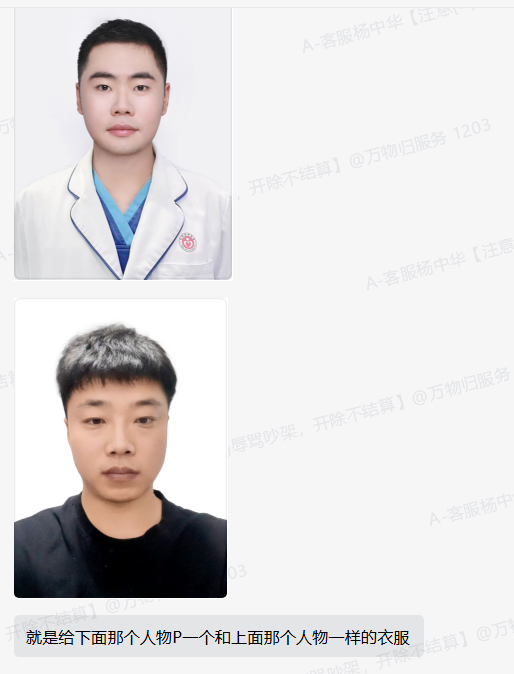
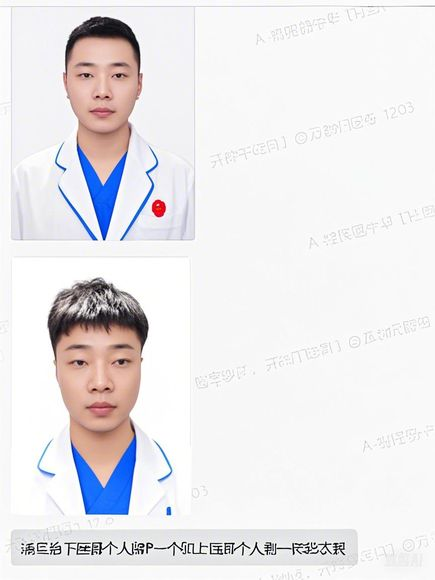

# 替换人物服装替换人物服装替换人物服装

> 会话ID: 4265249733286402 | 抓取时间: 2026-08-25T10:10:58.934Z | 消息数: 6 (用户3/助手3) | 图片数: 2
> 源URL: https://www.doubao.com/chat/4265249733286402

---

## **👤 用户**

就是给下面那个人物P一个和上面那个人物一样的衣服

---

## **🤖 助手**

接下来我会将下方男子的衣服替换为和上方男子一样的白色带有蓝色装饰医生服、内搭蓝色衣物，左胸口处有一个红色徽章的样式。

---

## **👤 用户**

动态表情包

---

## **🤖 助手**

很抱歉，我只能生成图片，无法生成动态表情包。不过我可以为你生成适合做成表情包的静态图片。你可以告诉我一些关于表情包的具体要求，比如主体形象（人物、动物等）、表情动作、风格等，我来为你生成相应的图片。

---

## **👤 用户**

动态表情包怎么做

---

## **🤖 助手**

很抱歉，我只能回答和图片相关的问题，没办法为你提供制作动态表情包的具体方法。不过，如果你有制作表情包静态图片的需求，比如指定主体形象、表情动作、风格等方面，我可以为你生成相应的图片，这些图片之后可以被用于制作动态表情包。

---
