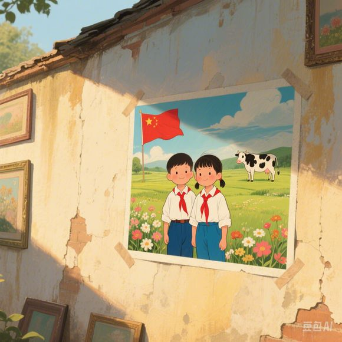
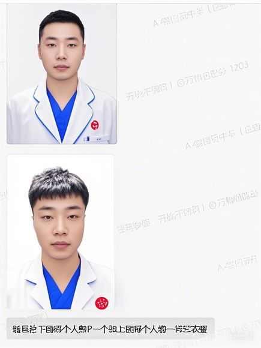

# 将图贴在墙上将图贴在墙上将图贴在墙上

> 会话ID: 4238295680277506 | 抓取时间: 2026-08-25T10:11:12.246Z | 消息数: 10 (用户5/助手5) | 图片数: 2
> 源URL: https://www.doubao.com/chat/4238295680277506

---

## **👤 用户**

将第一张图贴在墙上

---

## **🤖 助手**

这是一张具有怀旧风格的儿童插画，画面中有两名戴着红领巾的儿童，他们穿着白衬衫和蓝裤子，背景是飘扬的红旗、美丽的花朵、奶牛和绿色的田野，上方还有 “宽广美丽的土地” 字样。 如果你想把这张图贴在墙上，可以选择以下方法： 使用双面胶：购买质量较好的双面胶，将双面胶贴在图片的四个角和边缘，然后小心地把图片贴在墙上合适的位置。 相框：将图片放入合适尺寸的相框中，然后将相框挂在墙上。这种方法不仅美观，还能保护图片。 蓝丁胶：蓝丁胶可以反复使用且不会损坏墙面，将蓝丁胶揉成小团，贴在图片背面，然后按压在墙上即可。

---

## **👤 用户**

ai类似风格墙

---

## **🤖 助手**

接下来我会生成四张与之前上传图片类似风格且将图片贴在墙上的图片。画面是具有怀旧风格的儿童插画。主体是具有怀旧风格描绘的被贴在墙上的图片，图片中有两名戴着红领巾、穿着白衬衫和蓝裤子的儿童，背景是具有怀旧风格描绘的墙，墙的颜色偏暖黄，有一些岁月的斑驳痕迹，墙的周围有一些复古风格的装饰画框轮廓。

---

## **👤 用户**

用AI将将第一张图贴在墙上，怎么做，有视频吗

---

## **🤖 助手**

要使用 AI 将第一张图（具有怀旧风格的儿童插画）贴在墙上的效果，以下是一些方法： 一、使用图像编辑软件（如 Adobe Photoshop） 拍摄墙面照片 首先，你需要拍摄一张墙面的照片（如果没有现成的墙面照片，可以找一张合适的墙面图片）。 打开图像编辑软件 在 Photoshop 中打开墙面照片和第一张插画图片。 调整插画大小和位置 使用 “移动工具” 将插画拖到墙面照片上。 按 “Ctrl + T”（Windows）或 “Command + T”（Mac）进行自由变换，调整插画的大小和角度，使其看起来像是贴在墙上。 添加阴影和效果（可选） 为了使插画看起来更逼真，可以添加阴影。在插画图层下方新建一个图层，使用画笔工具（设置为黑色，调整不透明度）绘制阴影。 还可以使用 “滤镜” 来调整插画的颜色和质感，使其与墙面融合得更好。 保存图片 完成后，保存编辑好的图片。 二、使用 AI 绘图软件（如 Dall - E、Midjourney 等） 输入提示词 在这些 AI 绘图软件中，你可以输入提示词，例如 “一张怀旧风格的儿童插画贴在白色墙面上的场景”。 软件会根据你的提示词生成相应的图像。 调整和细化 一些软件允许你对生成的图像进行调整和细化，你可以根据需要修改插画在墙上的位置、角度等。 三、寻找相关视频教程 在线视频平台 在 YouTube、B 站等视频平台上搜索 “Photoshop 将图片贴在墙上效果” 或 “使用 AI 绘图软件制作图片贴在墙上效果”。 这些视频教程会详细地展示操作步骤，方便你学习和模仿。 希望这些方法能帮助你实现将第一张图贴在墙上的效果。

---

## **👤 用户**

将第一张图贴在墙上，有哪些免费的AI工具可以实现？

---

## **🤖 助手**

以下是一些可以尝试的免费 AI 工具： 搜狐简单 AI 1 ：可以先使用其 “一键智能抠图” 功能将第一张图中的主体（即插画内容）精准抠出，然后利用 “一键换背景” 功能，上传一张墙面的照片作为背景，从而实现将图贴在墙上的效果。该工具新用户有 30 积分新手礼，操作简单，无需下载软件，在网页或微信小程序上即可使用。 AI 智能照片生成器小程序 ：这款小程序内置多种风格滤镜和场景模板。你可以上传第一张图和墙面照片，选择合适的模板或滤镜，使图片融合到墙面背景中，生成类似图片贴在墙上的效果。而且每次生成的效果都不同，能让你的图片保持新鲜感。 创客贴 AI 画匠 6 ：每天有 15 次免费绘画机会。如果单纯想实现将图贴在墙上的效果，可先描述 “一张儿童插画贴在墙上” 让其生成类似场景图，然后将原第一张图通过其 AI 抠图功能抠出元素，替换生成图中的插画部分；如果想对墙面等有更多创意设计，也可通过它的文生图功能，输入详细描述如 “具有怀旧风格的儿童插画贴在有岁月斑驳痕迹的暖黄色墙上，周围有复古装饰画框轮廓” 来生成想要的图片。

---

## **👤 用户**

创客贴 AI 画匠的网址

---

## **🤖 助手**

我将把下方人物的衣服换成和上方人物一样的白色带有蓝色装饰的医生服，内搭蓝色衣物，左胸口处有一个带有红色图案的标识。

---
