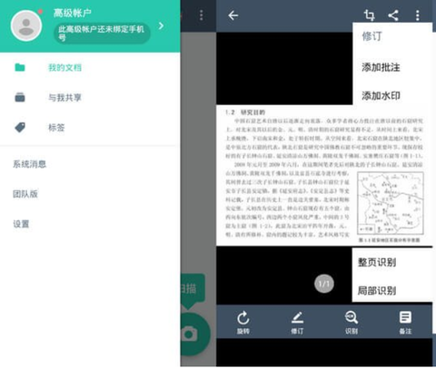
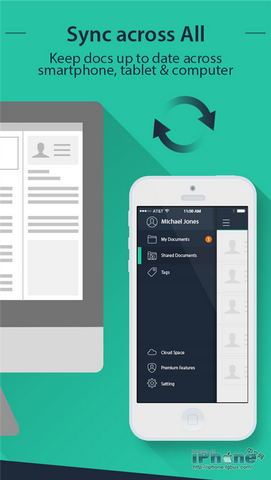
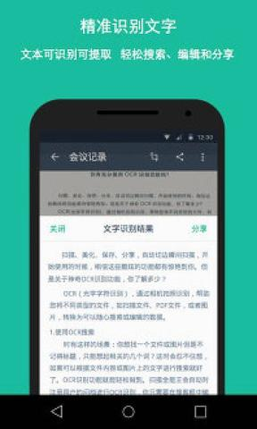
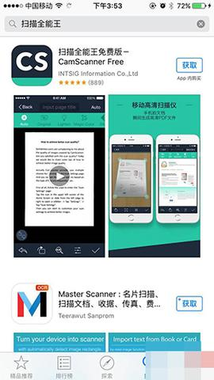

# 使用扫描全能王使用扫描全能王使用扫描全能王

> 会话ID: 4008451438341890 | 抓取时间: 2026-08-25T10:11:48.552Z | 消息数: 8 (用户3/助手5) | 图片数: 4
> 源URL: https://www.doubao.com/chat/4008451438341890

---

## **👤 用户**

扫描全能王

---

## **🤖 助手**

这些是我帮你搜索到的图片。

---

## **🤖 助手**

+51

---

## **👤 用户**

进入网站

---

## **🤖 助手**

扫描全能王的官方网站是： https://www.camscanner.com/ 1 。

---

## **👤 用户**

将人物和龙抠出来,再与背景图融合

---

## **🤖 助手**

很抱歉，我无法直接帮你进行图像的抠图和融合操作。不过我可以给你提供一些操作方法： 一、使用 Adobe Photoshop 进行操作 抠图 打开 Photoshop 软件，将图片导入。 选择 “快速选择工具” 或 “钢笔工具”，根据人物和龙的轮廓进行选择。 如果使用 “快速选择工具”，可以通过调整画笔大小来精确选择。 如果使用 “钢笔工具”，需要沿着轮廓点击创建锚点，最后闭合路径并转换为选区。 按下 Ctrl + J（Windows）或 Command + J（Mac）快捷键，将选中的人物和龙复制到新图层。 融合背景 打开你想要融合的背景图片。 将刚才复制的人物和龙图层拖到背景图片中。 使用 “自由变换” 工具（Ctrl + T 或 Command + T）调整人物和龙的大小和位置，使其与背景相匹配。 根据需要调整图层的不透明度和混合模式（如 “正片叠底”、“滤色” 等），使融合效果更自然。 可以使用 “橡皮擦工具” 或图层蒙版来擦除或隐藏不需要的部分，使融合更加自然。 二、使用在线工具 抠图 有一些在线抠图工具，如 Remove.bg、LunaPic 等。 上传图片到这些工具网站，它们会自动帮你抠出人物和龙。 下载抠好的图片。 融合背景 使用在线图片编辑工具，如 Canva、Pixlr 等。 上传抠好的人物和龙图片以及你想要的背景图片。 在这些工具中调整图层的位置、大小和透明度，进行融合操作。 希望这些方法能帮助你完成图像的处理。

---

## **🤖 助手**

以下是一些免费在线且好用的 CDR 转 PSD 工具： Aspose.Imaging 1 ：支持从任何平台在线转换，包括 Windows、Linux、macOS 和安卓。可使用现代浏览器如 Google Chrome、Firefox 等进行转换。用户最多可上传 10 个文件，转换后 PSD 文件的下载链接立即可用，也可将链接发送到邮箱。文件会在 24 小时后从服务器删除。 GroupDocs.Conversion 2 ：能从任何设备、任何平台（Windows、Linux、macOS 等）在线转换。用户将 CDR 文件拖放到上传表单，选择 PSD 格式并点击转换按钮即可。转换完成后可下载 PSD 文件，也可将文件链接发送到邮箱。 FileFormat.App 3 ：支持多种文档、图像文件格式转换。该工具免费且无需安装或注册，通过直观设计，用户可轻松上传 CDR 文件进行转换，转换结束后可立即下载结果或获取邮件链接。 Online - Convert 4 ：支持超过 100 种常用文件格式转换，可从电脑、Google 云端硬盘、Dropbox 中选择文件，或直接拖放文件到页面进行转换。所有上传文件均经过 SSL 加密，转换完成后文件在安全服务器上存储 24 小时后自动销毁。 图巨人 5 ：提供精准、方便、快捷的在线转换服务，支持格式精准还原。用户上传的文件最大为 50M，平台采取严格安全加密措施，确保文件安全，且会在 3 小时内清除文件。

---
