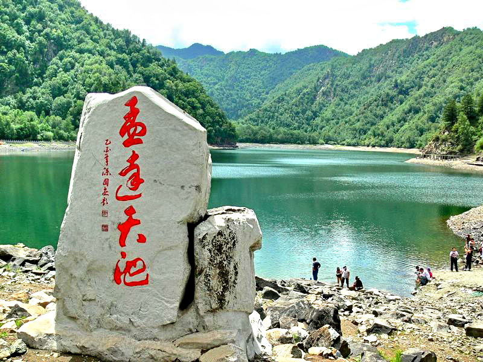

# 介绍高士一介绍高士一介绍高士一

> 会话ID: 4012027017298946 | 抓取时间: 2026-08-25T10:12:24.002Z | 消息数: 6 (用户3/助手3) | 图片数: 2
> 源URL: https://www.doubao.com/chat/4012027017298946

---

## **👤 用户**

搜索一下：高士一

---

## **🤖 助手**

高士一是中国抗日战争时期的著名抗日将领，以下是关于他的详细介绍： 人物生平 早年经历 ：1895 年出生于河北省任丘市大苟各庄村的地主家庭，号贯之，人称 “高四爷”。幼时读过几年家塾，后随二哥步入社会闯荡，曾被推荐为国民党政府河北省河务委员 1 。 投身抗日 ：1937 年 “七七事变” 后，在共产党抗日民族统一战线政策感召下，10 月与共产党员杨琪良、高万德共同组织起抗日武装 “人民自卫军第五路”，任总指挥。1938 年 6 月，第五路改番号为八路军三纵队独立第一支队，高士一任支队司令员。9 月，部队改为八路军冀中军区独立第四支队，他仍任司令员。1939 年 3 月，独立四支队的三个团和一二〇师的七一五团组成一二〇师独立第一旅，高士一任旅长 1 。 后期经历 ：1943 年 4 月调延安中央党校学习，后任党校生产工作处处长。日寇投降后，先后任晋绥军区后勤部副部长，西北财经委员会副秘书长，陕西省交通厅厅长，接管西北交通系统的军代表等职。1961 年奉调到北京任国务院参事室参事，1968 年 6 月 16 日因病逝世，终年 75 岁 1 。 主要事迹 毁家纾难 组建武装 ：高士一出身富裕家庭，但在国难当头之际，他毅然捐出 5000 大洋，并变卖 4000 亩良田和房产购置军火，组建抗日队伍。在他的带动下，家族中众多子弟纷纷加入革命队伍，如侄子高万玉、高万亭、高万秋、高万峰，侄孙高洪达、高洪忠、高洪飞等，满门忠烈投身抗日 2 。 收编武装 壮大力量 ：为扩大抗日武装队伍，经八路军冀中军区同意，高士一积极收编地方武装。他利用与苏桥商团团长邢荫堂的关系，成功说服其率五六百人的商团加入抗日队伍。此外，还先后收编了霸县黄久征部、胜芳戈福生保安团、永清县魏大光和辛育明部等，将辛育明领导的回民抗日队伍组建为回民大队，后并入冀中回民支队，使抗日队伍不断发展壮大 2 5 。 抗击日寇 屡立战功 ：高士一率领部队与日军展开了多次激烈战斗，给日军以沉重打击。在河间齐会 —— 南留路战斗中，他带领一二〇师独立第一旅，在贺龙师长、关向应政委指挥下，与日军第二十七师团第三联队吉田大队激战三昼夜，歼灭日军七百余人。在鄚州伏击战、黑马张庄包围战等战斗中也表现出色，其部队打出了雄州子弟兵的威风 1 6 。 拒绝诱降 坚定决心 ：1938 年底，日军纠集日伪军五百余人，对 “高家场” 进行突然袭击，火烧部分房子，并抓走高士一的侄子高万玉、高万峰等人做人质，放回高万峰让他带信诱降高士一。高士一毅然撕毁诱降信，坚定表示绝不投降，日军诱降失败后杀害了人质，这更坚定了他抗日的决心 1 。

---

## **👤 用户**

搜索一下：国务院参事室参事

---

## **🤖 助手**

国务院参事是国务院参事室成员，由国务院总理亲自聘任 1 。他们是有德、有才、有名望之士，其中多为中国各民主党派人士、无党派人士、著名专家学者以及富有宏观管理经验的领导干部 1 。以下是部分现任国务院参事： 卢琦 10 ：获联合国环境规划署 2024 年 “地球卫士奖”，参加了《联合国气候变化框架公约》第 29 次缔约方大会（COP29）中国角边会。 薛澜 10 ：参加了首届中国卫生管理学大会。 王丽方 5 ：主持了推进城市更新政府参事座谈会的互动交流。 李卓彬 5 ：主持了推进城市更新政府参事座谈会的互动交流。 李武 5 ：参加了推进城市更新政府参事座谈会。 何秀荣 5 ：参加了推进城市更新政府参事座谈会。 尹中立 5 ：参加了推进城市更新政府参事座谈会。 如果你还想了解更多关于国务院参事室参事的信息，可以访问 国务院参事室官方网站 进行查询 4 。

---

## **👤 用户**

八仙过海

---

## **🤖 助手**

瑶池是中国神话中西王母所居住的地方，以下是关于瑶池的详细介绍： 神话传说中的瑶池 地理位置 ：传说中瑶池位于昆仑山上，是西王母的居所，也被视为仙界的天池 4 6 。 相关传说 西王母与周穆王相会 ：《列子・周穆王》等古籍记载，西周天子周穆王姬满曾坐八匹日行三万里的骏马，沿天山到瑶池会见西王母。西王母在瑶池以隆重礼节迎接，两人宴饮对歌，周穆王还赠送大量礼物，离别时西王母唱歌表达不舍与期待，周穆王也举酒唱和，约定三年后再见，但周穆王最终未能赴约 1 。 蟠桃盛会 ：每年农历三月初三、六月初六、八月初八，西王母会在瑶池水边的平台设蟠桃盛会，各路神仙从四面八方赶来向其贺寿。《西游记》中孙悟空混入蟠桃会，偷吃蟠桃，大闹天宫的情节，让蟠桃会的故事家喻户晓 7 。 现实中的瑶池 天山天池 ：位于新疆维吾尔自治区昌吉回族自治州阜康市境内，博格达峰北坡山腰，古称 “瑶池”，是以高山湖泊为中心的自然风景区。湖面海拔 1910 米，南北长 3.5 公里，东西宽 0.8-1.5 公里，最深处 103 米。湖滨云杉环绕，雪峰辉映，非常壮观，为著名避暑和旅游地 1 。 青海湖 ：被认为是西王母最大的瑶池。它是中国最大的内陆湖、咸水湖，位于青藏高原东北部、青海省境内，湖面辽阔，景色壮美，拥有独特的自然风光和生态环境。 德令哈市褡链湖 ：被称作西王母最古老的瑶池，位于青海省海西蒙古族藏族自治州德令哈市，由两个湖泊组成，宛如褡链状，周边景色独特，具有一种原始而古朴的美。 孟达天池 ：被视为西王母美丽神妙的瑶池，位于青海省循化撒拉族自治县东部的孟达自然保护区内，天池犹如一颗璀璨的明珠镶嵌在群山之中，湖水清澈，周围森林茂密，景色秀丽迷人。 景点 青海孟达天池 昆仑河源头的黑海 ：是神秘而海拔最高的西王母瑶池，位于昆仑山深处，这里人迹罕至，保持着原始的自然风貌，周围雪山环绕，湖水湛蓝，给人一种神秘莫测的感觉 1 。 景点 昆仑河源头的黑海

---
