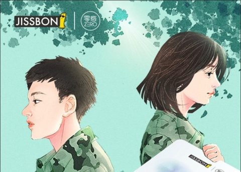

# 解释图片解释图片解释图片

> 会话ID: 2785129344064514 | 抓取时间: 2026-08-25T10:18:33.669Z | 消息数: 8 (用户4/助手4) | 图片数: 1
> 源URL: https://www.doubao.com/chat/2785129344064514

---

## **👤 用户**

解释这张图片

---

## **🤖 助手**

好的，请把图片内容提供给我，这样我才能为你解释。

---

## **👤 用户**

image.webp 图片中都有哪些元素？

---

## **🤖 助手**

很抱歉，你还没有把图片内容告诉我，我无法回答图片中有哪些元素。

---

## **👤 用户**

解释这张图片

---

## **🤖 助手**

这是一张宣传海报，主题为 “ChunFen Green Theme”，翻译为 “春分 绿色主题”。海报的背景是一幅美丽的自然景观，画面中央是一条蜿蜒的瀑布，水流从高处层层落下，形成多个小瀑布和水潭。瀑布两侧是茂密的绿色竹林，竹子高大挺拔，显得生机勃勃。竹林中还点缀着一些红色和橙色的树叶，增加了画面的色彩层次感。 在海报的上方，用白色大字写着 “ChunFen Green Theme”，字体简洁现代。下方有日期 “2024/03/20 //06”，表明这可能是与 2024 年春分相关的宣传内容。海报的底部有一段较长的英文文字，可能是关于活动的详细信息或版权声明，但由于文字较小且内容较多，具体细节不太容易辨认。 海报的整体氛围清新自然，传达出一种与春天和自然相关的主题，可能是与环保、户外活动或自然景观相关的活动宣传。

---

## **👤 用户**

春分20250407 风格.jpg 推荐一些关于春天和自然的宣传海报案例

---

## **🤖 助手**

以下是一些关于春天和自然的宣传海报案例： 节气主题海报 《雨至》 3 设计元素 ：将 “雨” 字设计成房屋形态，竹子元素贯穿 “雨水” 二字，海报中有小水洼组成汉字笔画。 色彩搭配 ：以清新的蓝绿色为主，搭配柔和的渐变背景。 整体意境 ：营造出宁静而充满生机的氛围，生动体现了雨水节气春雨细密、润物无声的气候特点。 《晨雨・耕春》 3 设计元素 ：画面融合了节气的自然与人文景观，可能包含农田、耕牛、春雨、新芽等元素。 色彩搭配 ：以青绿与水墨灰为主色调，呼应春雨润泽、万物复苏的意象。 整体意境 ：展现出春天里农耕开始，大地复苏的美好景象，富有诗意和视觉感染力。 《春分至，万物生》 设计元素 ：包含柳树吐绿、桃花绽放、燕子归来、布谷鸟啼鸣等春分时节特有的自然景象，还可能有人们竖蛋、放风筝等习俗活动的画面 4 。 色彩搭配 ：采用清新明亮的色彩，如粉色、绿色、蓝色等，突出春天的明媚与生机。 整体意境 ：传达出春分时节万物复苏、生机勃勃的氛围，以及人们对春天的喜爱和对美好生活的向往。 旅游宣传海报 古蔺旅游海报 10 设计元素 ：展现了古蔺不同地方的春色，如徐家林林场的绿色林带和苗圃、神龟花谷的粉色樱花、德耀凤凰村的赭石色梯田、白沙场镇的金黄色油菜花等。 色彩搭配 ：运用丰富多样的色彩，将古蔺春天的多彩景色生动呈现出来，给人以强烈的视觉冲击。 整体意境 ：吸引人们前往古蔺旅游，感受那里多姿多彩的春天景色，体验大自然的魅力。 通州公园海报 8 设计元素 ：以千年大运河畔的公园为背景，可能包含绿色的植被、盛开的花朵、清澈的河水、休闲的行人等元素。 色彩搭配 ：以绿色为主色调，搭配其他鲜艳的花朵颜色，突出公园的生机与活力。 整体意境 ：传达出通州公园 “含绿量极高” 的特点，邀请人们走进公园，感受自然，享受春天的美好时光。 品牌借势海报 杰士邦海报 设计元素 ：以 “东风解冻万物生” 为主题，画面中可能有解冻的河流、新生的植物、活泼的动物等代表春天生机的元素，同时融入品牌相关元素 9 。 色彩搭配 ：使用明亮、温暖的色彩，如绿色、蓝色、黄色等，营造出春天生机勃勃的氛围。 整体意境 ：将品牌与春天的活力相结合，传达出积极向上的情感，提升品牌形象。 海报 杰士邦春天主题海报 吉利汽车海报 设计元素 ：宣传语为 “春去春又来，每年春常在”，海报可能展示汽车行驶在春天的道路上，周围是美丽的自然风景，如青山绿水、鲜花盛开等 9 。 色彩搭配 ：以自然风景的色彩为主，如绿色的草地、蓝色的天空、粉色的花朵等，突出春天的美好，同时汽车的颜色也会与整体环境相协调，形成和谐的画面。 整体意境 ：体现出吉利汽车与自然的紧密联系，以及品牌的长久与稳定，让消费者在感受春天美好的同时，也对品牌产生好感。

---
