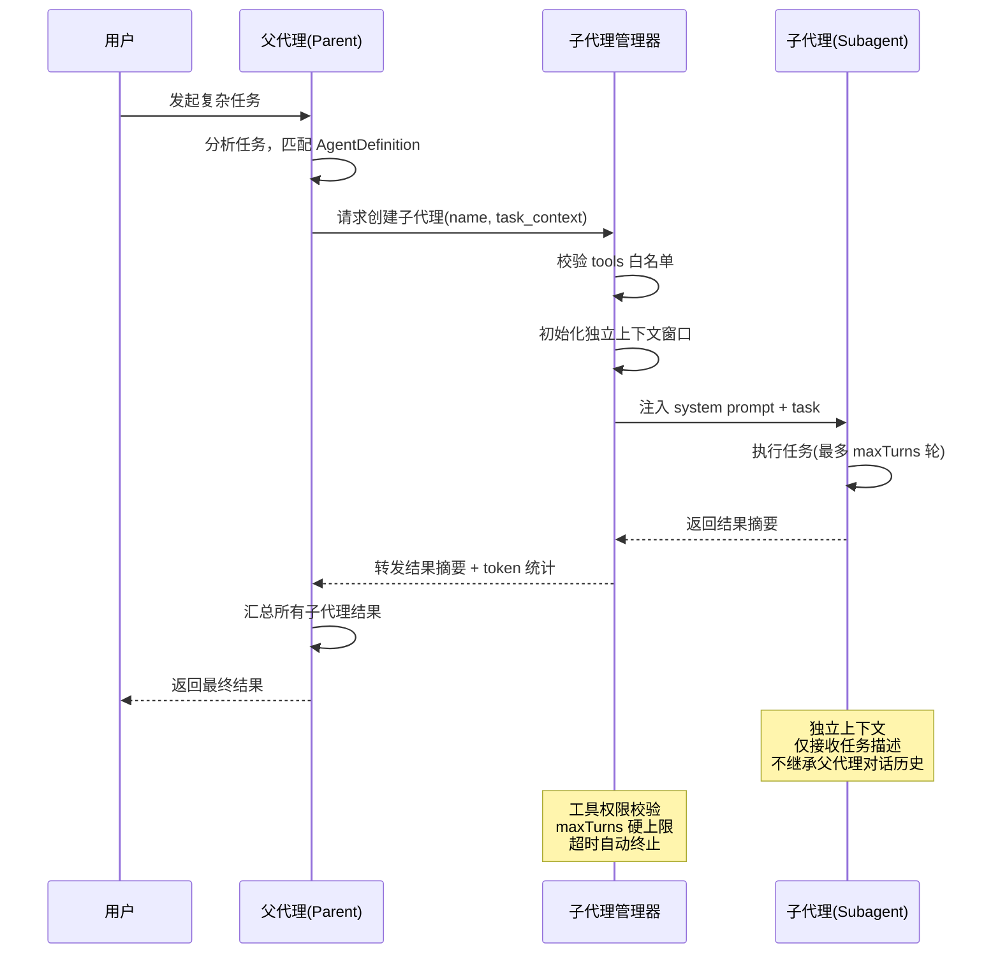

# Anthropic官方课程-390节全集

> **版本**：R6（2026-06-18）
> **来源**：Anthropic Academy 官方课程体系 + Anthropic Engineering Blog + Claude Agent SDK 官方文档
> **说明**：本文档系统梳理 Anthropic 官方公开的全部课程与核心技术文档，涵盖 18 门 Academy 课程、Claude Agent SDK 子代理模式、Claude Code 五层扩展架构、MCP 协议等核心知识。

---

## 第一部分：Anthropic Academy 完整课程目录

Anthropic Academy 共开设 **18 门官方课程**，分为四大类别，覆盖从 AI 通识到企业级开发的完整学习路径。

### 一、非技术类课程（6门）

| 序号 | 课程名称 | 适用人群 | 课程描述 |
|------|---------|---------|---------|
| 1 | **Claude 101** | 所有用户 | Claude 基础入门，了解 AI 助手核心能力、使用场景与交互最佳实践。无前置要求。 |
| 2 | **AI Fluency: Framework & Foundations** | 管理人员/决策者 | AI 素养框架与基础，建立对 AI 能力的系统认知，学会评估 AI 在组织中的应用价值。前置：无。 |
| 3 | **AI Fluency for Students** | 学生群体 | 面向学生的 AI 素养课程，教授如何有效、负责任地使用 AI 工具辅助学习与研究。前置：无。 |
| 4 | **AI Fluency for Educators** | 教育工作者 | 面向教师的 AI 教学整合课程，涵盖课堂 AI 应用策略、学术诚信与 AI 辅助教学方法。前置：无。 |
| 5 | **AI Fluency for Nonprofits** | 非营利组织 | 面向非营利机构的 AI 素养课程，重点在有限资源下最大化 AI 工具效用。前置：无。 |
| 6 | **AI Fluency for Small Businesses** | 中小企业主 | 面向中小企业的 AI 应用课程，涵盖客户服务、营销、运营效率提升等场景。前置：无。 |

### 二、开发者类课程（7门）

| 序号 | 课程名称 | 适用人群 | 课程描述 |
|------|---------|---------|---------|
| 7 | **Claude Code 101** | 开发者入门 | Claude Code 命令行工具入门，学习在终端中与 Claude 协作编码。前置：基本命令行技能。 |
| 8 | **Claude Code in Action** | 中级开发者 | Claude Code 实战进阶，涵盖复杂项目中的高级用法、调试技巧与工作流优化。前置：Claude Code 101。 |
| 9 | **Introduction to Agent Skills** | 开发者 | Skills 机制入门，学习通过 SKILL.md 文件为 Claude 注入可复用的领域知识与流程。前置：Claude Code 101。 |
| 10 | **Introduction to Subagents** | 中级开发者 | 子代理机制入门，掌握 AgentDefinition 配置、上下文隔离与多代理协作模式。前置：Claude Code in Action。 |
| 11 | **MCP 入门** | 所有开发者 | Model Context Protocol 基础，学习 Tools/Resources/Prompts 三原语与 stdio 传输方式。前置：基本编程能力。 |
| 12 | **MCP 进阶** | 高级开发者 | MCP 高级主题，包括 HTTP 传输、多服务器编排、安全最佳实践与生产部署。前置：MCP 入门。 |
| 13 | **Building with the Claude API** | API 开发者 | Claude API 编程实战，涵盖 Messages API、流式响应、函数调用与多模态输入。前置：编程基础（Python/JS）。 |

### 三、云平台课程（2门）

| 序号 | 课程名称 | 适用人群 | 课程描述 |
|------|---------|---------|---------|
| 14 | **Claude with Amazon Bedrock** | 云架构师/开发者 | 在 AWS Bedrock 上部署与调用 Claude，涵盖 IAM 权限、成本优化与 VPC 集成。前置：AWS 基础。 |
| 15 | **Claude with Google Vertex AI** | 云架构师/开发者 | 在 GCP Vertex AI 上部署与调用 Claude，涵盖服务账号、配额管理与监控告警。前置：GCP 基础。 |

### 四、进阶课程（3门）

| 序号 | 课程名称 | 适用人群 | 课程描述 |
|------|---------|---------|---------|
| 16 | **Teaching AI Fluency** | 培训师/教育者 | 教授 AI 素养的教学方法论，学习课程设计、评估体系与培训效果衡量。前置：AI Fluency 系列。 |
| 17 | **Introduction to Claude Cowork** | 所有用户 | Claude 协作工作模式，学习人机协作的最佳实践、任务委托与反馈循环。前置：Claude 101。 |
| 18 | **AI Capabilities and Limitations** | 所有用户 | AI 能力边界认知，深入理解 LLM 的强项、弱项、幻觉问题与安全使用原则。前置：Claude 101。 |

---

## 第二部分：Claude Agent SDK 子代理核心模式

Claude Agent SDK 定义了 **5 种核心子代理模式**，覆盖从简单任务分解到复杂错误恢复的完整场景。

### Pattern 1: Divide-and-Conquer（分治并行）

**核心机制**：父代理将大任务拆解为 N 个独立子任务，分发到 N 个子代理并行处理，最终汇总结果。

**设计铁律**：
- 子任务必须**无状态依赖**，可完全并行
- 每个子代理拥有独立上下文窗口，互不干扰
- 父代理仅接收子代理的**结果摘要**，不接收完整对话历史

**成本对比**：
| 指标 | 单代理串行 | 分治并行 |
|------|-----------|---------|
| 处理 20 文件摘要 | 约 12 min | 约 1.5 min |
| Token 消耗 | 基线（约 80K） | 约 11K（节省 86%） |
| 模型选择 | Sonnet | Haiku × N 子代理 + Sonnet 汇总 |

**适用场景**：多文件批量处理、独立数据源分析、多文档摘要。

### Pattern 2: Specialist Routing（专家路由）

**核心机制**：父代理根据输入特征将任务**路由**到最合适的专家子代理，每个专家拥有独立的系统提示词和工具集。

**设计铁律**：
- 路由分类器使用**轻量模型**（Haiku），快速决策
- 专家子代理拥有**领域专用 Prompt** 和**最小工具集**
- 不同专家的上下文完全隔离，防止知识污染

**典型路由场景**：
| 输入类型 | 路由到 | 工具权限 |
|---------|--------|---------|
| 代码审查请求 | code-reviewer | read + grep + glob |
| 测试执行请求 | test-runner | bash + read |
| 代码调试请求 | debugger | read + bash + grep |
| 文档生成请求 | doc-writer | read + write |

### Pattern 3: Parallel Research（多角度并行研究）

**核心机制**：针对同一问题，从多个不同角度同时发起研究，每个子代理采用不同的分析框架或视角，最终**合成**为综合报告。

**设计铁律**：
- 每个研究角度需要有**明确的差异化视角**（如技术/商业/风险）
- 子代理使用**不同提示词模板**引导差异化分析
- 合成阶段由父代理（Sonnet）完成，需评估各信息来源的一致性

**适用场景**：竞品分析、技术选型评估、市场调研、多维度风险评估。

### Pattern 4: Judge-and-Iterate（评判迭代）

**核心机制**：Writer 子代理生成初稿 → Judge 子代理评估质量 → Writer 根据反馈修订，**最多迭代 3 轮**。

**设计铁律**：
- Judge 使用**结构化评分标准**（如准确性 1-5、完整性 1-5、可读性 1-5）
- 每轮迭代 Judge 返回**具体修改建议**，非模糊评价
- 设置硬上限（3 轮），防止无限循环
- Judge 使用 Sonnet（需要深度判断），Writer 可使用 Haiku

**适用场景**：报告撰写、代码质量优化、文案打磨、策略方案评审。

### Pattern 5: Error Recovery（错误恢复）

**核心机制**：主任务执行过程中捕获错误 → 启动 Debugger 子代理 → 在**隔离沙箱**中调试 → 返回修复方案。

**设计铁律**：
- Debugger 子代理拥有**独立的隔离工具集**，不能污染主任务状态
- 错误信息**完整传递**给 Debugger，但剥离敏感数据
- Debugger 返回**修复方案**（而非直接修改），由父代理决策是否应用
- 最多尝试 2 次修复，失败后**优雅降级**返回部分结果

**适用场景**：代码执行错误、API 调用失败、数据格式异常、配置错误。

### 五大模式总结

| 模式 | 子代理数 | 并行度 | 模型策略 | 成本效率 |
|------|---------|--------|---------|---------|
| Divide-and-Conquer | N（5-12） | 全并行 | Haiku × N + Sonnet | 极高 |
| Specialist Routing | 1（路由） | 串行 | Haiku 路由 + Sonnet 专家 | 高 |
| Parallel Research | 3-5 | 全并行 | Haiku × N + Sonnet | 高 |
| Judge-and-Iterate | 2 | 串行 | Sonnet + Haiku/Sonnet | 中 |
| Error Recovery | 1 | 按需 | Sonnet | 中 |

---

## 第三部分：Claude Code 五层扩展架构

Claude Code 采用**五层渐进扩展架构**，从轻量级知识注入到完整插件打包分发，逐层增强。

### 架构总览

```
Layer 5: Plugins        ← 打包分发层（plugin.json + 六组件）
Layer 4: Hooks          ← 事件驱动自动化（PreToolUse/PostToolUse/SessionStart 等）
Layer 3: Agents/Subagents ← 独立上下文子代理（AgentDefinition）
Layer 2: MCP            ← 模型上下文协议（Tools/Resources/Prompts 三原语）
Layer 1: Skills         ← Markdown + YAML 教学文件（SKILL.md）
```

---

### Layer 1: Skills（技能层）

**定义**：Skills 是 Markdown + YAML 格式的教学文件，通过 `SKILL.md` 为 Claude 注入可复用的领域知识、操作流程和最佳实践。

**SKILL.md 核心结构**：

```yaml
---
name: my-skill
description: 该技能的使用场景与触发条件
allowed-tools: [read, grep, glob, bash]
---

# 技能标题

## 触发条件
...

## 执行流程
### 阶段一：...
### 阶段二：...
### 阶段三：...

## 输出规范
...
```

**Frontmatter 字段**：
| 字段 | 必填 | 说明 |
|------|------|------|
| name | 是 | 技能唯一标识（kebab-case） |
| description | 是 | 描述何时应使用此技能（用于自动路由决策） |
| allowed-tools | 否 | 技能允许使用的工具白名单 |
| model | 否 | 推荐模型（sonnet/opus/haiku/inherit） |

**设计原则**：
- 渐进式信息披露：L1 描述 → L2 SKILL.md → L3+ 引用文件
- 单文件 ≤ 500 行（控制上下文窗口消耗）
- 技能间可组合但不能嵌套（防止复杂度爆炸）

---

### Layer 2: MCP（模型上下文协议）

**定义**：MCP（Model Context Protocol）是 Anthropic 提出的开放协议，用于标准化 AI 模型与外部工具/数据源的交互方式。

**三原语架构**：

| 原语 | 控制方 | 用途 | 典型示例 |
|------|-------|------|---------|
| **Tools** | 模型控制 | AI 可主动调用的动作 | 查询数据库、发送邮件、调用 API |
| **Resources** | 应用控制 | 应用向模型提供的只读数据 | 文件内容、数据库 schema、知识库 |
| **Prompts** | 预定义 | 用户可选用的指令模板 | 代码审查模板、翻译模板、摘要模板 |

**传输方式**：

| 传输 | 适用场景 | 特点 |
|------|---------|------|
| **stdio** | 本地开发、单机部署 | 进程间通信，低延迟，零配置 |
| **HTTP** | 远程服务、多客户端 | 支持 RESTful API，适合生产环境 |

**MCP 服务器示例**：
- `filesystem`：安全的文件系统访问
- `github`：仓库管理、PR、Issues
- `postgres`：数据库只读查询
- `slack`：消息发送与频道管理

---

### Layer 3: Agents / Subagents（代理层）

**定义**：子代理（Subagent）是拥有**独立上下文窗口**的 AI 代理，由父代理通过 `AgentDefinition` 配置并按需委派任务。

**核心特性**：
- **上下文隔离**：每个子代理拥有独立的上下文窗口，只接收任务描述，不继承父代理的完整对话历史
- **结果摘要**：子代理完成后仅返回**结果摘要**给父代理，大幅降低 Token 消耗
- **工具隔离**：子代理只能使用 `tools` 字段中明确声明的工具

**AgentDefinition 配置**：

```json
{
  "name": "code-reviewer",
  "description": "When code changes need review for bugs, style, and best practices",
  "prompt": "You are a senior code reviewer...",
  "tools": ["read", "grep", "glob"],
  "model": "haiku",
  "maxTurns": 15,
  "isolation": "strict"
}
```

**配置字段详解**（见第四部分）。

---

### Layer 4: Hooks（钩子层）

**定义**：Hooks 是事件驱动的自动化机制，在特定事件触发时执行预定义操作。Hooks **绕过模型判断**直接执行，适合确定性操作。

**事件类型**：

| 事件 | 触发时机 | 典型用途 |
|------|---------|---------|
| **PreToolUse** | 工具调用前 | 拦截危险命令、注入安全检查 |
| **PostToolUse** | 工具调用后 | 自动 lint 代码、格式化输出、记录日志 |
| **SessionStart** | 会话启动时 | 注入项目上下文、进度恢复、加载 Skills |
| **SessionEnd** | 会话结束时 | 保存状态、清理临时文件、生成摘要 |
| **UserPromptSubmit** | 用户提交提示词时 | 敏感词过滤、提示词增强 |
| **Notification** | 权限请求时 | 自定义通知逻辑 |

**Hooks 设计原则**：
- 钩子函数必须**幂等**（重复执行不产生副作用）
- 执行时间上限 30 秒，超时自动终止
- PreToolUse 钩子可阻止工具调用（返回 `blocked: true`）

---

### Layer 5: Plugins（插件层）

**定义**：Plugin 是最高层的打包分发单元，将 Skills、Agents、Hooks、MCP Servers、LSP Servers、Monitors 六种组件打包为一个可分发的单元。

**plugin.json 清单**：

```json
{
  "name": "my-plugin",
  "version": "1.0.0",
  "description": "Plugin description",
  "author": "...",
  "components": {
    "skills": ["skills/my-skill"],
    "agents": ["agents/code-reviewer", "agents/test-runner"],
    "hooks": ["hooks/pre-commit-lint"],
    "mcp_servers": ["mcp/github-server"],
    "lsp_servers": [],
    "monitors": []
  }
}
```

**六组件目录结构**：

```
my-plugin/
├── plugin.json
├── skills/
│   └── my-skill/
│       └── SKILL.md
├── agents/
│   ├── code-reviewer/
│   │   └── agent.json
│   └── test-runner/
│       └── agent.json
├── hooks/
│   └── pre-commit-lint.js
├── mcp_servers/
│   └── github-server/
├── lsp_servers/
└── monitors/
```

---

## 第四部分：AgentDefinition 字段完整参考

### 完整字段列表

| 字段 | 类型 | 必填 | 默认值 | 说明 |
|------|------|------|--------|------|
| **name** | string | 是 | — | 子代理唯一标识（kebab-case） |
| **description** | string | 是 | — | 何时使用此代理（用于路由决策，面向父代理） |
| **prompt** | string | 是 | — | 系统提示词（面向子代理的完整指令） |
| **tools** | string[] | 否 | 父代理工具集 | 工具允许列表，遵循最小权限原则 |
| **model** | string | 否 | "inherit" | sonnet / opus / haiku / inherit |
| **effort** | string | 否 | "medium" | low / medium / high — 控制推理深度 |
| **maxTurns** | int | 否 | 15 | 最大对话轮次上限 |
| **disallowedTools** | string[] | 否 | [] | 明确禁止的工具列表（黑名单） |
| **skills** | string[] | 否 | [] | 子代理可加载的 Skills 列表 |
| **memory** | bool | 否 | false | 是否启用子代理记忆（跨会话持久化） |
| **background** | bool | 否 | false | 是否以后台模式运行 |
| **isolation** | string | 否 | "standard" | strict（严格隔离）/ standard（标准）/ shared（共享上下文） |

### 子代理生命周期时序图



### 模型选择策略

| 场景 | 推荐模型 | 原因 |
|------|---------|------|
| 文件分类、格式检查 | Haiku | 速度快、成本极低 |
| 代码审查、文档摘要 | Haiku / Sonnet | 根据复杂度选择 |
| 架构设计、策略分析 | Sonnet | 深度推理能力 |
| 多源信息合成、最终汇总 | Sonnet | 需要综合判断 |
| 极复杂数学/逻辑推理 | Opus | 最高推理能力（慎用） |

---

## 第五部分：学习路线图

### 路线一：非技术路线（管理/决策者）

```
Claude 101
    ↓
AI Fluency: Framework & Foundations
    ↓
AI Capabilities and Limitations
    ↓
Introduction to Claude Cowork
    ↓
AI Fluency for [领域：Students/Educators/Nonprofits/Small Businesses]
```

**目标**：建立 AI 系统认知，掌握人机协作方法，能够在组织中有效评估和应用 AI。

**时间估算**：约 8-12 小时。

---

### 路线二：开发者路线

```
Claude Code 101
    ↓
Claude Code in Action
    ↓
Introduction to Agent Skills
    ↓
Introduction to Subagents
    ↓
MCP 入门 → MCP 进阶
```

**目标**：从命令行协作到构建多代理系统，掌握 Claude 开发全栈能力。

**时间估算**：约 20-30 小时。

---

### 路线三：API 路线

```
Building with the Claude API
    ↓
MCP 入门
    ↓
Introduction to Subagents
    ↓
Introduction to Agent Skills
```

**目标**：通过 API 将 Claude 集成到自有应用中，构建可扩展的 AI 功能。

**时间估算**：约 12-18 小时。

---

### 路线四：云平台路线

```
Claude 101（或等效基础）
    ↓
Claude with Amazon Bedrock
    ↓  或
Claude with Google Vertex AI
    ↓
MCP 入门 → MCP 进阶
```

**目标**：在企业云环境中安全部署和管理 Claude，实现生产级 AI 服务。

**时间估算**：约 15-20 小时。

---

## 第六部分：课程内容提炼

### 一、AI Agent 设计原则

从 Anthropic Academy 多门课程中提炼的核心设计原则：

1. **从简单开始**：复杂度阶梯（单次 LLM 调用 → 增强型 LLM → Prompt Chaining → Routing → Parallelization → Orchestrator-Workers → Evaluator-Optimizer → 自主 Agent）。**核心信条：仅在简单方案不足时才增加复杂度。**

2. **上下文工程五大维度**：
   - 选择（Selection）：挑什么内容注入上下文
   - 结构化（Structuring）：如何组织信息格式
   - 排序（Ordering）：内容排列顺序影响推理质量
   - 压缩（Compression）：控制 Token 预算
   - 时机（Timing）：何时注入何种信息

3. **渐进式信息披露**：Skills 采用 L1（描述）→ L2（SKILL.md）→ L3+（引用文件）三层设计，Claude 按需深入加载，避免一次性灌入全部内容导致上下文溢出。

4. **韧性五原则**：
   - 错误隔离：子代理错误不影响父代理和其他子代理
   - 状态恢复：通过 session_id/agent_id 实现断点续传
   - 护栏优先：PreToolUse Hook 在工具执行前拦截危险操作
   - 可观测性：子代理返回结构化结果，含 confidence 评分
   - 渐进授权：从只读 → 测试执行 → 代码修改 → 完全访问逐级授权

### 二、多 Agent 协作最佳实践

1. **并行编排三模式**：
   - **Fork + Gather**：一次 Fork 出 N 个子代理，全部完成后 Gather 汇总。适合无依赖的独立任务。
   - **Supervisor Loop**：父代理循环监控子代理进度，动态调整资源分配。适合长运行任务。
   - **Sandbox**：子代理在隔离环境中运行，结果验证后才合并。适合高风险操作。

2. **四类反模式（不应使用子代理的场景）**：
   - 任务过于简单（单次 LLM 调用即可完成）
   - 任务间强依赖（必须串行且中间结果影响后续）
   - 上下文共享需求（子代理间需要大量共享上下文）
   - 调试/排查本质是对话交互的任务

3. **子代理恢复机制**：
   - 通过 `session_id` + `agent_id` 精确定位已终止的子代理
   - 恢复时注入原始任务描述 + 已完成步骤摘要
   - 状态检查点（checkpoint）写入持久化存储

### 三、子代理管理规范

1. **容量上限**：
   - 小型项目：1-3 个子代理
   - 中型项目：3-5 个子代理
   - 大型项目：5-8 个子代理
   - 硬上限：最大并行 ≤ 12，最大嵌套深度 ≤ 2 层

2. **工具权限四层分级**：
   | 级别 | 权限范围 | 适用角色 |
   |------|---------|---------|
   | Read-only | read + grep + glob | code-reviewer |
   | Test Execute | read + bash(受限) | test-runner |
   | Code Modify | read + write + bash | code-fixer |
   | Full Access | 父代理全部工具 | orchestrator |

3. **成本优化黄金法则**：
   - 路由/分类：Haiku（快速决策，成本极低）
   - 子任务执行：Haiku（批量处理，并行缩减耗时）
   - 汇总/合成：Sonnet（需要深度理解和判断）
   - 极复杂推理：Opus（仅在确有必要时，慎用）

---

*（本文档由AI生成，基于Anthropic官方公开资料整理，仅供参考）*
